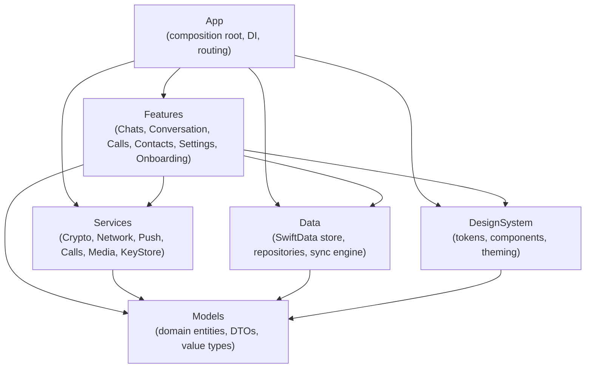
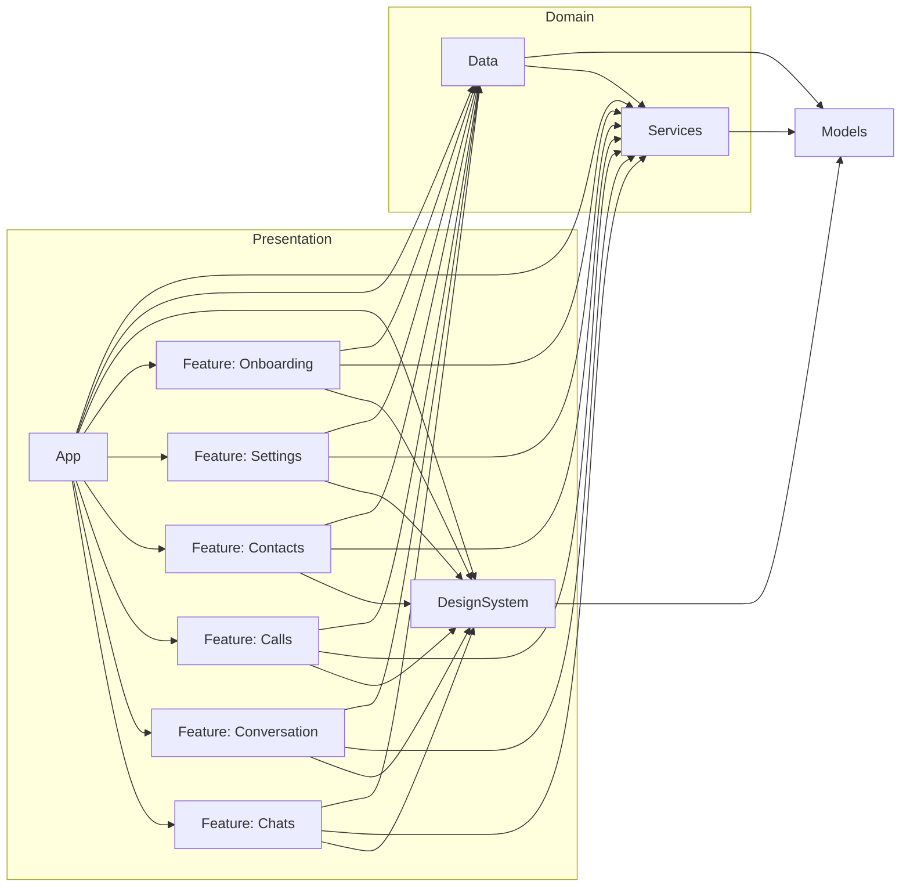
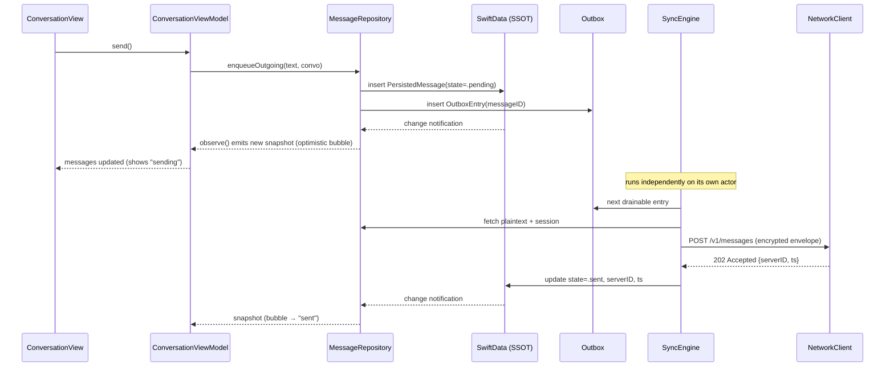
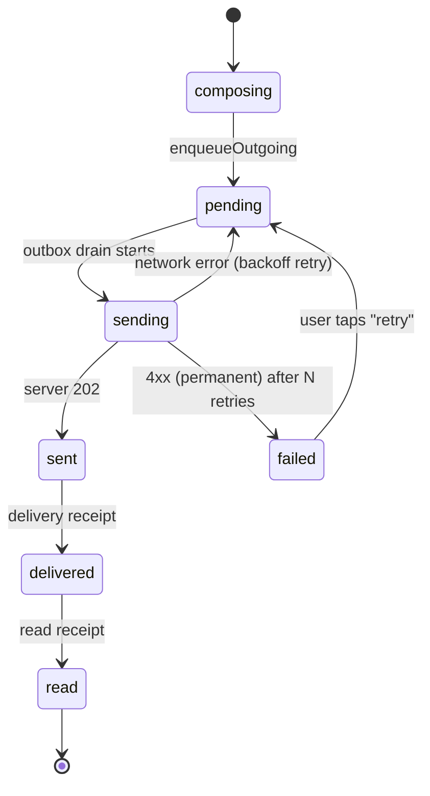
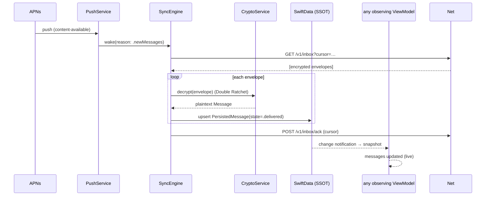

# Inditalk — Application Architecture

> **Status:** Draft for engineering review · **Owner:** Platform team · **Last updated:** 2026-07-24
> **Scope:** Native iOS client architecture for **Inditalk**, an original private-messaging app.
> **Non-goals:** Server/backend implementation details (covered in `SERVER.md`), cryptographic protocol proofs (covered in `CRYPTO.md`).

---

## 0. What Inditalk is (and is not)

Inditalk is an **original** native iOS private-messaging product. It is a clean-room design. It does **not** copy the branding, iconography, asset libraries, proprietary UI flows, or trademarked identities of WhatsApp, Signal, Telegram, iMessage, or any other product. Where Inditalk relies on cryptography or transport, it uses **open, publicly documented standards and prior art**:

- **Signal Protocol (X3DH + Double Ratchet)** — an open specification used as prior art for end-to-end message encryption. Inditalk implements against the published spec; it does not fork Signal's app code or reuse Signal branding.
- **WebRTC (RFC 8825 family, SRTP/DTLS)** — open standard for real-time audio/video transport.
- **APNs / PushKit** — Apple's push standards for notifications and VoIP wakeups.
- **Noise-style handshakes, HKDF, AEAD** — via Apple's **CryptoKit**.

> ⚠️ **Security disclaimer (read `LIMITATIONS` before quoting anything here):** Nothing in this document should be read as a claim that Inditalk is "production-secure." The design is intended to be *auditable* and to follow known-good patterns. It has **not** been independently audited. See [§16 Limitations & Required Audit](#16-limitations--required-audit).

---

## 1. Architectural goals & principles

| # | Principle | What it means concretely |
|---|-----------|--------------------------|
| G1 | **MVVM + unidirectional data flow** | Views are pure functions of state. ViewModels own state and intent; they never import UIKit view internals. |
| G2 | **Clean modular layering** | Six Swift Package modules with a strict, acyclic dependency graph (see [§4](#4-module-dependency-map)). Feature modules never depend on each other. |
| G3 | **Offline-first** | The local database is the single source of truth. The network is a *sync side-effect*, never a read dependency for the UI. |
| G4 | **Single source of truth (SSOT)** | One persistent store (SwiftData) + one in-memory observable `AppState`. No duplicated caches. |
| G5 | **Explicit dependency injection** | All services are resolved through one `AppEnvironment` value passed down the tree. No global singletons in feature code. |
| G6 | **Swift 6 strict concurrency** | Full `-strict-concurrency=complete`. Actors isolate mutable state; UI code is `@MainActor`; crypto/IO run on dedicated actors. |
| G7 | **Auditability over cleverness** | Prefer boring, testable code and Apple frameworks over third-party dependencies. Every third-party dep is justified in [§13](#13-third-party-dependencies). |

---

## 2. Layered architecture overview

Inditalk is split into **six horizontal layers**, each a Swift Package Manager module. Dependencies point strictly **downward** (App → Features → Services/Data → Models → DesignSystem). No upward or sideways edges.



### Layer responsibilities

| Layer / Module | Owns | Must NOT contain |
|----------------|------|------------------|
| **App** | App entry point (`@main`), `AppEnvironment` construction, root router, scene/lifecycle wiring, deep-link handling, DI graph. | Business logic, network calls, view bodies beyond the root shell. |
| **DesignSystem** | Color/spacing/typography tokens, reusable SwiftUI components (`Avatar`, `Bubble`, `TabBar`), theming, haptics, iconography. | Networking, persistence, feature state. |
| **Models** | Pure `Sendable` value types: domain entities (`Conversation`, `Message`, `Contact`), wire DTOs, enums, IDs. | Any framework beyond `Foundation`. No SwiftUI, no SwiftData `@Model` (see note). |
| **Data** | SwiftData schema (`@Model` classes), repositories, the sync engine, migration plans, the outbox. | UI. Crypto primitives (delegates to Services.Crypto). |
| **Services** | Side-effectful capabilities: `CryptoService`, `NetworkClient`, `PushService`, `CallService`, `MediaService`, `KeyStore`. Each behind a protocol. | SwiftUI views, SwiftData `@Model` types. |
| **Features** | One folder per feature: SwiftUI views + `@Observable` ViewModels + feature-local navigation. | Concrete service types (only protocols, injected). Direct imports of other Features. |

> **Note on Models vs. `@Model`:** SwiftData's `@Model` macro generates reference types that are *not* `Sendable` and are bound to a `ModelContext`. To keep `Models` pure and cross-actor safe, the persisted `@Model` classes live in **Data** (e.g., `PersistedMessage`), and **Models** holds the plain `Sendable` structs (e.g., `Message`) that flow across actor boundaries and into ViewModels. Repositories map between the two. This mapping is the price we pay for a clean concurrency story; see [§9](#9-persistence-swiftdata).

---

## 3. Directory & package layout

```
Inditalk/
├── Inditalk.xcodeproj                      # thin app target; depends on the local SPM package
├── Package.swift                       # multi-module SPM manifest (all layers)
├── Sources/
│   ├── App/
│   │   ├── InditalkApp.swift               # @main
│   │   ├── AppEnvironment.swift        # DI container
│   │   ├── AppState.swift             # SSOT in-memory state (@Observable, @MainActor)
│   │   ├── RootView.swift             # tab shell
│   │   ├── AppRouter.swift            # navigation coordinator
│   │   └── DeepLink.swift
│   ├── DesignSystem/
│   │   ├── Tokens/{Color,Spacing,Typography}.swift
│   │   ├── Components/{Avatar,MessageBubble,InditalkTabBar,PrimaryButton}.swift
│   │   └── Theme.swift
│   ├── Models/
│   │   ├── Entities/{Conversation,Message,Contact,Attachment,CallRecord}.swift
│   │   ├── DTO/{MessageEnvelopeDTO,PreKeyBundleDTO}.swift
│   │   └── IDs.swift
│   ├── Data/
│   │   ├── Schema/{PersistedConversation,PersistedMessage,...}.swift
│   │   ├── Repositories/{ConversationRepository,MessageRepository,...}.swift
│   │   ├── Sync/{SyncEngine,Outbox,SyncCursor}.swift
│   │   └── Migrations/InditalkSchemaV1.swift
│   ├── Services/
│   │   ├── Crypto/{CryptoService,DoubleRatchetSession,KeyStore}.swift
│   │   ├── Network/{NetworkClient,SocketClient,Endpoint}.swift
│   │   ├── Push/{PushService,PushKitDelegate}.swift
│   │   ├── Calls/{CallService,CallKitAdapter,WebRTCTransport}.swift
│   │   └── Media/{MediaService,ThumbnailPipeline}.swift
│   └── Features/
│       ├── Chats/{ChatListView,ChatListViewModel}.swift
│       ├── Conversation/{ConversationView,ConversationViewModel,Composer}.swift
│       ├── Calls/{CallView,CallViewModel}.swift
│       ├── Contacts/{ContactsView,ContactsViewModel}.swift
│       ├── Settings/{SettingsView,SettingsViewModel}.swift
│       └── Onboarding/{OnboardingView,OnboardingViewModel}.swift
└── Tests/
    ├── ModelsTests/ DataTests/ ServicesTests/ FeaturesTests/
```

---

## 4. Module dependency map

The graph is **acyclic** and enforced by SPM target dependencies. A feature cannot import another feature; cross-feature communication happens only through `AppState` and `AppRouter` (owned by App) or through injected service protocols.



**Enforced rules (checked in CI by a `swift package` graph lint script):**

1. `Features/*` targets list **only** `DesignSystem`, `Services`, `Data`, `Models` as dependencies — never each other.
2. `Services` never depends on `Data` (crypto and network must be usable without a database). *Data depends on Services*, not the reverse, because the sync engine needs the crypto/network clients.
3. `Models` depends on nothing but `Foundation`.
4. Only `App` may depend on all six.

---

## 5. Dependency injection: `AppEnvironment`

There is exactly **one** DI container, `AppEnvironment`, constructed once in `InditalkApp` and injected into the SwiftUI environment. It holds **protocol-typed** service references so tests and previews can swap fakes. No feature code ever calls a service initializer directly.

```swift
// Sources/App/AppEnvironment.swift
import SwiftUI

/// Immutable dependency container. Constructed once at app launch and
/// injected through the SwiftUI environment. All members are protocols so
/// that Previews/tests can substitute in-memory fakes.
@MainActor
public struct AppEnvironment: Sendable {
    public let crypto: any CryptoService
    public let network: any NetworkClient
    public let push: any PushService
    public let calls: any CallService
    public let media: any MediaService
    public let keyStore: any KeyStore

    // Data layer
    public let conversations: any ConversationRepository
    public let messages: any MessageRepository
    public let contacts: any ContactRepository
    public let sync: any SyncEngine

    // Shared observable state (SSOT, see §7)
    public let state: AppState

    public init(
        crypto: any CryptoService,
        network: any NetworkClient,
        push: any PushService,
        calls: any CallService,
        media: any MediaService,
        keyStore: any KeyStore,
        conversations: any ConversationRepository,
        messages: any MessageRepository,
        contacts: any ContactRepository,
        sync: any SyncEngine,
        state: AppState
    ) {
        self.crypto = crypto; self.network = network; self.push = push
        self.calls = calls; self.media = media; self.keyStore = keyStore
        self.conversations = conversations; self.messages = messages
        self.contacts = contacts; self.sync = sync; self.state = state
    }
}

private struct AppEnvironmentKey: EnvironmentKey {
    // No default: forces explicit injection. Accessing it before injection traps.
    static let defaultValue: AppEnvironment? = nil
}

public extension EnvironmentValues {
    var cove: AppEnvironment {
        get {
            guard let env = self[AppEnvironmentKey.self] else {
                preconditionFailure("AppEnvironment not injected. Inject at the app root.")
            }
            return env
        }
        set { self[AppEnvironmentKey.self] = newValue }
    }
}
```

### Composition root

```swift
// Sources/App/InditalkApp.swift
import SwiftUI
import SwiftData

@main
struct InditalkApp: App {
    @State private var environment: AppEnvironment
    private let modelContainer: ModelContainer

    init() {
        // 1. Build the persistent store (single container, single SSOT).
        let container = try! ModelContainer(
            for: InditalkSchemaV1.models,
            migrationPlan: InditalkMigrationPlan.self,
            configurations: ModelConfiguration(
                "Inditalk",
                isStoredInMemoryOnly: false,
                allowsSave: true,
                cloudKitDatabase: .none   // E2EE app: no CloudKit sync of plaintext
            )
        )
        self.modelContainer = container

        // 2. Wire concrete services (only place they are instantiated).
        let keyStore   = KeychainKeyStore()
        let crypto     = SignalProtocolCryptoService(keyStore: keyStore)
        let network    = URLSessionNetworkClient(baseURL: .coveAPI)
        let push       = ApplePushService()
        let media      = AVMediaService()
        let calls      = WebRTCCallService(signaling: network)

        let bg = ModelContext(container)              // background actor context
        let convRepo    = SwiftDataConversationRepository(context: bg)
        let msgRepo     = SwiftDataMessageRepository(context: bg, crypto: crypto)
        let contactRepo = SwiftDataContactRepository(context: bg)
        let sync        = LiveSyncEngine(network: network, crypto: crypto,
                                         messages: msgRepo, conversations: convRepo)

        let state = AppState()

        _environment = State(initialValue: AppEnvironment(
            crypto: crypto, network: network, push: push, calls: calls,
            media: media, keyStore: keyStore, conversations: convRepo,
            messages: msgRepo, contacts: contactRepo, sync: sync, state: state
        ))
    }

    var body: some Scene {
        WindowGroup {
            RootView()
                .environment(\.cove, environment)
                .modelContainer(modelContainer)
                .task { await environment.sync.start() }
        }
    }
}
```

**Why a struct, not a class of singletons:** `AppEnvironment` is a value passed explicitly. There is no ambient `.shared`. This makes the dependency surface of every feature discoverable at the call site and trivially mockable:

```swift
#Preview {
    ChatListView()
        .environment(\.cove, .preview)   // all fakes, in-memory store
}
```

---

## 6. MVVM & the View/ViewModel contract

- **View** — SwiftUI, `@MainActor`, stateless beyond `@State` for transient UI (focus, scroll). Reads a ViewModel and renders. Emits *intents* by calling ViewModel methods. Never touches services or repositories directly.
- **ViewModel** — `@Observable`, `@MainActor`, owns view state as plain properties. Holds injected service protocols. Translates intents into service/repository calls (async). Never imports SwiftUI view types.
- **State flows down, intents flow up.**

```swift
// Sources/Features/Conversation/ConversationViewModel.swift
import Observation

@Observable @MainActor
public final class ConversationViewModel {
    // MARK: View state (single source of truth for this screen)
    public private(set) var messages: [Message] = []
    public private(set) var phase: LoadPhase = .idle
    public var draft: String = ""
    public private(set) var banner: BannerState?

    public enum LoadPhase: Equatable { case idle, loading, loaded, failed(InditalkError) }

    // MARK: Dependencies (protocols, injected)
    private let conversationID: ConversationID
    private let repo: any MessageRepository
    private let sync: any SyncEngine
    private var stream: Task<Void, Never>?

    public init(conversationID: ConversationID, env: AppEnvironment) {
        self.conversationID = conversationID
        self.repo = env.messages
        self.sync = env.sync
    }

    // Intent: screen appeared → subscribe to the local store (offline-first read).
    public func onAppear() {
        phase = .loading
        stream = Task { [weak self] in
            guard let self else { return }
            do {
                for await snapshot in await repo.observe(conversationID: conversationID) {
                    self.messages = snapshot
                    self.phase = .loaded
                }
            } catch {
                self.phase = .failed(InditalkError(error))
            }
        }
    }

    // Intent: user tapped send. Optimistic append happens inside the repo/outbox.
    public func send() async {
        let text = draft.trimmingCharacters(in: .whitespacesAndNewlines)
        guard !text.isEmpty else { return }
        draft = ""
        do {
            try await repo.enqueueOutgoing(text: text, in: conversationID)
        } catch {
            banner = .error("Couldn't queue message. It will retry.")
        }
    }

    public func onDisappear() { stream?.cancel() }
}
```

The View is thin:

```swift
// Sources/Features/Conversation/ConversationView.swift
struct ConversationView: View {
    @Environment(\.cove) private var cove
    @State private var model: ConversationViewModel?

    let conversationID: ConversationID

    var body: some View {
        Group {
            if let model {
                MessageList(messages: model.messages, phase: model.phase)
                Composer(text: Binding(get: { model.draft },
                                       set: { model.draft = $0 }),
                         onSend: { Task { await model.send() } })
            } else { ProgressView() }
        }
        .onAppear {
            if model == nil { model = ConversationViewModel(conversationID: conversationID, env: cove) }
            model?.onAppear()
        }
        .onDisappear { model?.onDisappear() }
    }
}
```

---

## 7. Single source of truth & offline-first data flow

### 7.1 Two tiers of state

| Tier | Type | Lifetime | Purpose |
|------|------|----------|---------|
| **Persistent SSOT** | SwiftData store (`ModelContainer`) | Disk, survives launches | The authoritative record of every conversation, message, contact, key, and outbox entry. |
| **In-memory session state** | `AppState` (`@Observable`, `@MainActor`) | Process lifetime | Ephemeral cross-feature state: current account, connection status, active call, unread badge counts, selected route. Derived from the store; never the authority for persisted data. |

```swift
// Sources/App/AppState.swift
@Observable @MainActor
public final class AppState {
    public var account: Account?
    public var connectivity: Connectivity = .offline
    public var activeCall: CallSession?
    public var unreadTotal: Int = 0
    public var route: AppRoute = .chats

    public enum Connectivity: Sendable { case offline, connecting, online, degraded }
}
```

**Rule:** UI reads never wait on the network. Every screen renders from the local store. The network only *mutates* the store (via the sync engine) and *drains* the outbox.

### 7.2 Offline-first write path (optimistic send)



If the app is offline, the write path stops at "insert into SSOT + outbox." The UI already shows the message as `pending`. When connectivity returns, `SyncEngine` drains the outbox with exponential backoff. **No message is ever lost to a dropped network call** because the durable record is written *before* the network is touched.

### 7.3 Message delivery state machine



```swift
// Sources/Models/Entities/Message.swift
public enum DeliveryState: String, Codable, Sendable {
    case composing, pending, sending, sent, delivered, read, failed
}
```

### 7.4 Inbound path (push → decrypt → store → UI)



---

## 8. Combine vs. async/await — usage policy

Inditalk is **async/await-first**. Combine is used only where Apple's APIs are Combine-native or where a hot, multicast stream is the natural model.

| Concern | Mechanism | Rationale |
|---------|-----------|-----------|
| One-shot operations (send, fetch, decrypt) | `async` / `await` throwing functions | Linear, cancellable, integrates with structured concurrency. |
| Observing the local store | `AsyncStream<[Message]>` from repositories | Backpressure-free pull model; naturally cancelled when the `Task` is cancelled. |
| System event streams (Reachability, `NotificationCenter`, `NWPathMonitor`) | `AsyncStream` bridges, or Combine `Publisher` where the source is Combine-native | Uniform consumption in ViewModels. |
| Cross-feature broadcast (e.g., "account signed out") | Combine `PassthroughSubject` inside `AppState`, exposed as `AnyPublisher` | Multicast to N observers is exactly Combine's strength. |
| Debounce/throttle (typing indicators, search) | Combine `.debounce` / async `Task.sleep` + cancellation | Combine's operators are terse for search; typing indicators use a simple debounced Task. |

**Repository observation contract:**

```swift
public protocol MessageRepository: Sendable {
    /// Live, ordered snapshot of a conversation. Emits on every relevant store change.
    func observe(conversationID: ConversationID) async -> AsyncStream<[Message]>
    func enqueueOutgoing(text: String, in id: ConversationID) async throws
    func markRead(_ ids: [MessageID]) async throws
}
```

**Bridging SwiftData change notifications into `AsyncStream`:**

```swift
func observe(conversationID id: ConversationID) async -> AsyncStream<[Message]> {
    AsyncStream { continuation in
        let task = Task { [context] in
            // Emit initial snapshot, then re-query on each store save.
            func emit() throws {
                let rows = try context.fetch(Self.descriptor(for: id))
                continuation.yield(rows.map(Message.init(persisted:)))
            }
            try? emit()
            for await _ in NotificationCenter.default
                .notifications(named: ModelContext.didSave) {
                try? emit()
            }
        }
        continuation.onTermination = { _ in task.cancel() }
    }
}
```

---

## 9. Threading & concurrency model (Swift 6, strict)

The package compiles with `-strict-concurrency=complete`. Isolation domains are explicit.

| Domain | Isolation | Runs |
|--------|-----------|------|
| **UI** | `@MainActor` | All Views, all ViewModels, `AppState`, `AppRouter`. |
| **Persistence** | A background `ModelContext` owned by each repository; repositories are `actor`-like via a dedicated executor, or `@ModelActor`. | Fetch/insert/save. Never on the main thread. |
| **Crypto** | `actor CryptoService` (also gated by a serial ratchet actor per session) | Key agreement, ratchet steps, AEAD. Double Ratchet state is mutable and MUST be serialized per session. |
| **Network** | `URLSession` async APIs + an `actor SocketClient` | Request/response and the persistent socket. |
| **Media** | `actor MediaService` + `AVAssetExportSession` | Thumbnailing, transcoding, encryption of attachments. |

### 9.1 Data isolation with `@ModelActor`

SwiftData `ModelContext` is not `Sendable`. Each repository wraps its context in a `@ModelActor` so all persistence work is serialized off the main thread, and only `Sendable` `Models` value types cross the boundary back to `@MainActor`:

```swift
// Sources/Data/Repositories/SwiftDataMessageRepository.swift
@ModelActor
actor SwiftDataMessageRepository: MessageRepository {
    private let crypto: any CryptoService

    func enqueueOutgoing(text: String, in id: ConversationID) throws {
        let msg = PersistedMessage(conversationID: id, body: text, state: .pending,
                                   direction: .outgoing, createdAt: .now)
        modelContext.insert(msg)
        modelContext.insert(OutboxEntry(messageID: msg.id))
        try modelContext.save()   // triggers didSave → observers refresh
    }
}
```

### 9.2 Ratchet serialization

Double Ratchet advances mutate per-conversation key state; concurrent encrypts against the same session would corrupt the chain. We serialize per session:

```swift
actor DoubleRatchetSession {
    private var state: RatchetState
    func encrypt(_ plaintext: Data) throws -> MessageEnvelope { /* advances state */ }
    func decrypt(_ env: MessageEnvelope) throws -> Data { /* advances state */ }
}
// CryptoService holds a dictionary [ConversationID: DoubleRatchetSession]
// guarded by its own actor isolation.
```

### 9.3 Golden rules

1. ViewModels are `@MainActor`; they `await` into actors and assign results to `@Observable` properties on the main actor.
2. No `@Model` object crosses an actor boundary. Only `Models` value structs do.
3. No locks, no `DispatchQueue.sync`, no `@unchecked Sendable` outside of two audited, documented shims (the CryptoKit key wrapper and the WebRTC C-bridge).

---

## 10. Navigation architecture

Inditalk uses a **bottom tab bar** with a per-tab `NavigationStack`, coordinated by a single `AppRouter` that owns typed paths. This keeps navigation state serializable (for state restoration and deep links) and testable.

```swift
// Sources/App/AppRouter.swift
public enum AppTab: Hashable, Sendable { case chats, calls, contacts, settings }

public enum ChatsRoute: Hashable, Sendable {
    case conversation(ConversationID)
    case contactInfo(ContactID)
    case newMessage
}

@Observable @MainActor
public final class AppRouter {
    public var selectedTab: AppTab = .chats
    public var chatsPath: [ChatsRoute] = []
    public var callsPath: [CallsRoute] = []
    public var contactsPath: [ContactsRoute] = []
    public var settingsPath: [SettingsRoute] = []

    public func open(_ deepLink: DeepLink) {
        switch deepLink {
        case .conversation(let id):
            selectedTab = .chats
            chatsPath = [.conversation(id)]
        case .call(let id):
            selectedTab = .calls
            callsPath = [.active(id)]
        }
    }
}
```

```swift
// Sources/App/RootView.swift
struct RootView: View {
    @Environment(\.cove) private var cove
    @State private var router = AppRouter()

    var body: some View {
        TabView(selection: $router.selectedTab) {
            NavigationStack(path: $router.chatsPath) {
                ChatListView()
                    .navigationDestination(for: ChatsRoute.self, destination: destination)
            }
            .tabItem { Label("Chats", systemImage: "bubble.left.and.bubble.right") }
            .tag(AppTab.chats)

            NavigationStack(path: $router.callsPath) { CallsHomeView() /* … */ }
                .tabItem { Label("Calls", systemImage: "phone") }
                .tag(AppTab.calls)

            NavigationStack(path: $router.contactsPath) { ContactsView() /* … */ }
                .tabItem { Label("Contacts", systemImage: "person.2") }
                .tag(AppTab.contacts)

            NavigationStack(path: $router.settingsPath) { SettingsView() /* … */ }
                .tabItem { Label("Settings", systemImage: "gearshape") }
                .tag(AppTab.settings)
        }
        .tint(DS.Color.slateBlue)   // #2A3D5C accent
        .environment(router)
    }
}
```

**Design system note (per palette):** the tab bar background uses warm parchment `#F5F0E6`; the selected tab tint is slate-blue `#2A3D5C`; unread badges and subtle emphasis use muted ochre `#B8873A`. Avatars are always circular (`Circle().clip`).

**Deep links & VoIP:** an incoming call arrives via **PushKit** → `CallKit` reports the call → on answer, `AppRouter.open(.call(id))` navigates. Message notifications route through `open(.conversation(id))`. Paths are `Codable` for `@SceneStorage`-based state restoration.

---

## 11. Persistence: SwiftData (the decision)

### 11.1 Options considered

| Option | Pros | Cons | Verdict |
|--------|------|------|---------|
| **SQLite (GRDB or raw)** | Maximum control, mature, great for FTS. | Hand-rolled schema, migrations, and observation. Most code to own and audit. Value-type mapping is manual anyway. | Rejected as default. Kept as a **fallback** if SwiftData observation proves too coarse (see risk below). |
| **Core Data** | Battle-tested, `NSFetchedResultsController`, fine-grained change tracking, well-understood migrations. | Verbose, `NSManagedObject` KVC ergonomics, Objective-C heritage, more boilerplate to bridge into Swift 6 concurrency. | Rejected: SwiftData gives us the same engine (Core Data underneath) with far less boilerplate and first-class `@ModelActor` concurrency. |
| **SwiftData** ✅ | Swift-native `@Model`, `@ModelActor` fits Swift 6 strict concurrency cleanly, declarative `@Query`, typed `#Predicate`, `VersionedSchema` + `SchemaMigrationPlan`, same proven SQLite/Core Data engine underneath. | Newer (some rough edges in complex predicates/observation granularity); requires iOS 17+. | **Chosen.** |

### 11.2 Justification for SwiftData

1. **Concurrency fit.** `@ModelActor` gives us a first-class, compiler-checked way to keep all database work off the main actor while satisfying `-strict-concurrency=complete`. Core Data requires manual `perform` blocks and careful `Sendable` gymnastics; raw SQLite requires building all of this.
2. **Less code to audit.** For an E2EE app, the smaller and more declarative the persistence layer, the smaller the audit surface. `@Model` + `#Predicate` removes hundreds of lines of mapping/migration boilerplate.
3. **Same proven engine.** SwiftData is built on the Core Data stack (which is built on SQLite). We inherit its durability and WAL behavior without adopting its verbosity.
4. **Migrations are typed.** `VersionedSchema` + `SchemaMigrationPlan` give explicit, testable, staged migrations.
5. **iOS 17+ baseline is acceptable** for a new-in-2026 product; the addressable install base is overwhelmingly iOS 17/18+.

### 11.3 Encryption-at-rest posture

- Message plaintext columns are stored inside a database file protected by **`NSFileProtectionComplete`** (file is unreadable while device is locked).
- Long-term identity keys and pre-keys live in the **Keychain** (`kSecAttrAccessibleWhenUnlockedThisDeviceOnly`, `.biometryCurrentSet` where a passcode/biometric gate is desired), **never** in the SwiftData store.
- `cloudKitDatabase: .none` — plaintext is never synced to CloudKit.
- Attachments are encrypted at rest with a per-attachment key wrapped by the conversation key; only ciphertext blobs sit on disk.

> ⚠️ File protection and Keychain accessibility give meaningful at-rest protection but are **not** a substitute for a reviewed threat model. See [§16](#16-limitations--required-audit).

### 11.4 Schema (excerpt) & migration plan

```swift
// Sources/Data/Schema/PersistedMessage.swift
import SwiftData

@Model
final class PersistedMessage {
    @Attribute(.unique) var id: UUID
    var conversationID: UUID
    var body: String                     // plaintext at rest (file-protected)
    var direction: String                // "incoming" | "outgoing"
    var state: String                    // DeliveryState.rawValue
    var serverID: String?
    var createdAt: Date
    var editedAt: Date?
    @Relationship(deleteRule: .cascade) var attachments: [PersistedAttachment]

    init(conversationID: UUID, body: String, state: DeliveryState,
         direction: MessageDirection, createdAt: Date) {
        self.id = UUID(); self.conversationID = conversationID
        self.body = body; self.state = state.rawValue
        self.direction = direction.rawValue; self.createdAt = createdAt
        self.attachments = []
    }
}
```

```swift
// Sources/Data/Migrations/InditalkSchemaV1.swift
enum InditalkSchemaV1: VersionedSchema {
    static var versionIdentifier = Schema.Version(1, 0, 0)
    static var models: [any PersistentModel.Type] {
        [PersistedConversation.self, PersistedMessage.self,
         PersistedContact.self, PersistedAttachment.self,
         OutboxEntry.self, PersistedCallRecord.self]
    }
}

enum InditalkMigrationPlan: SchemaMigrationPlan {
    static var schemas: [any VersionedSchema.Type] { [InditalkSchemaV1.self] }
    static var stages: [MigrationStage] { [] }   // grows as schema evolves
}
```

---

## 12. Error model

A single, exhaustive `InditalkError` normalizes failures from every layer into something ViewModels can switch on and map to user-facing banners. Lower layers throw typed errors; a boundary initializer wraps unknowns.

```swift
// Sources/Models/InditalkError.swift
public enum InditalkError: Error, Sendable, Equatable {
    // Transport
    case offline
    case timeout
    case server(status: Int, code: String?)      // structured server error code

    // Crypto
    case noSession(ConversationID)
    case decryptionFailed                        // do NOT surface key material in message
    case identityKeyChanged(ContactID)           // safety-number changed

    // Persistence
    case persistenceFailed(String)
    case notFound

    // Media
    case attachmentTooLarge(bytes: Int)
    case unsupportedMediaType(String)

    // Fallback
    case unknown(String)

    public init(_ error: Error) {
        switch error {
        case let e as InditalkError: self = e
        case let e as URLError where e.code == .notConnectedToInternet: self = .offline
        case let e as URLError where e.code == .timedOut: self = .timeout
        default: self = .unknown(String(describing: error))
        }
    }
}
```

**Server error payload (real shape):**

```json
{
  "error": {
    "code": "RATE_LIMITED",
    "message": "Too many pre-key requests for this identity.",
    "retryAfterSeconds": 30,
    "requestId": "req_01J8Z9K2P3Q4R5S6T7U8V9W0X"
  }
}
```

**Retry policy:** `.offline` and `.timeout` and `server(5xx)` are retryable with exponential backoff + jitter (base 1s, cap 60s, factor 2). `server(4xx)` except `429` is terminal → message enters `failed`. `identityKeyChanged` always blocks send and surfaces a safety warning to the user (no silent key change).

---

## 13. Third-party dependencies

Default posture: **Apple frameworks only.** Every exception is listed here with license and justification. If a row can be removed by accepting a small feature cost, it will be revisited before GA.

| Dependency | License | Why it's needed | Apple alternative? |
|------------|---------|-----------------|--------------------|
| **WebRTC (Google `libwebrtc`)** | BSD-3-Clause | Real-time audio/video transport (ICE/DTLS/SRTP). There is no first-party Apple WebRTC stack; rolling our own SRTP/ICE is out of scope and a security liability. | Partial: `Network.framework` + custom RTP would be a multi-year effort and *less* auditable. |
| **swift-protobuf** | Apache-2.0 | Encoding Signal-Protocol message envelopes and call signaling in the exact wire formats the open specs define. | `Codable`/JSON works but diverges from the protobuf specs used as prior art; protobuf keeps us interoperable and compact. |
| *(candidate, not yet adopted)* **GRDB** | MIT | Only if SwiftData's change-observation granularity proves inadequate for large conversations (see Risk R1). | SwiftData (chosen). Listed for transparency. |

**Everything else uses Apple frameworks:** CryptoKit (crypto), CallKit + PushKit (calls/VoIP), AVFoundation (media capture/playback), Network.framework (sockets/reachability), SwiftData (persistence), UserNotifications (APNs), Contacts (system contacts import, opt-in).

> No dependency in this table pulls in analytics, ad SDKs, or telemetry. Inditalk ships **no** third-party telemetry.

---

## 14. Feature → module ownership matrix (28 features)

Each of the 28 required features has exactly one **owning module** (where its logic and state live). Owning module ≠ only module involved; the "Key collaborators" column lists the primary services it leans on.

| # | Feature | Owning module | Key collaborators |
|---|---------|---------------|-------------------|
| 1 | Onboarding & phone/username registration | `Features/Onboarding` | Services/Network, Services/Crypto (identity keygen), KeyStore |
| 2 | Identity key generation & pre-key upload | `Services/Crypto` | KeyStore, Services/Network |
| 3 | Contact discovery & import (opt-in) | `Features/Contacts` | Services/Network, Contacts.framework, Data/ContactRepository |
| 4 | 1:1 end-to-end encrypted messaging | `Features/Conversation` | Services/Crypto (Double Ratchet), Data/MessageRepository |
| 5 | Group messaging (sender-keys) | `Features/Conversation` | Services/Crypto, Data/ConversationRepository |
| 6 | Chat list / inbox | `Features/Chats` | Data/ConversationRepository, AppState (unread) |
| 7 | Message composer (text) | `Features/Conversation` | Data/MessageRepository (outbox) |
| 8 | Optimistic send + outbox retry | `Data/Sync` | Services/Network, Data/Outbox |
| 9 | Delivery & read receipts | `Data/Sync` | Services/Network, Data/MessageRepository |
| 10 | Typing indicators | `Features/Conversation` | Services/Network (SocketClient) |
| 11 | Image/video attachments | `Features/Conversation` | Services/Media, Services/Crypto (blob encryption) |
| 12 | Voice messages | `Features/Conversation` | Services/Media (AVAudioRecorder) |
| 13 | Attachment thumbnailing & transcoding | `Services/Media` | AVFoundation |
| 14 | Media viewer (full screen) | `Features/Conversation` | Services/Media, DesignSystem |
| 15 | 1:1 voice calls | `Features/Calls` | Services/Calls (WebRTC), CallKit, PushKit |
| 16 | 1:1 video calls | `Features/Calls` | Services/Calls (WebRTC/AVFoundation) |
| 17 | Call signaling | `Services/Calls` | Services/Network (SocketClient), swift-protobuf |
| 18 | System call UI integration (CallKit) | `Services/Calls` | CallKit, AppRouter |
| 19 | VoIP push wakeup | `Services/Push` | PushKit, Services/Calls |
| 20 | Call history | `Features/Calls` | Data/CallRecordRepository |
| 21 | Push notifications (messages) | `Services/Push` | APNs/UserNotifications, Data (badge counts) |
| 22 | Notification content decryption (NSE) | `Services/Crypto` | Notification Service Extension, KeyStore |
| 23 | Presence / online status | `Features/Contacts` | Services/Network (SocketClient), AppState |
| 24 | Safety numbers / key-change verification | `Features/Contacts` | Services/Crypto |
| 25 | Disappearing messages (TTL) | `Data` | Data/MessageRepository (reaper task), AppState |
| 26 | Blocking & report | `Features/Settings` | Data/ContactRepository, Services/Network |
| 27 | App lock (biometric/passcode gate) | `Features/Settings` | LocalAuthentication, KeyStore |
| 28 | Backup/restore (encrypted local archive) | `Features/Settings` | Services/Crypto, Data (export), Services/Media |

**Cross-cutting owners not counted as features:** `DesignSystem` (all UI primitives), `App` (routing, DI, lifecycle), `AppState` (session SSOT).

---

## 15. Build & run in Xcode

### 15.1 Requirements

| Tool | Version |
|------|---------|
| macOS | 14.5 (Sonoma) or later |
| Xcode | 16.0 or later (Swift 6 toolchain) |
| iOS deployment target | 17.0 |
| Swift language mode | 6 (strict concurrency = complete) |
| Physical device (for calls/push) | iPhone on iOS 17+ with a valid provisioning profile |

### 15.2 First-time setup

```bash
# 1. Clone
git clone git@github.com:cove-app/cove-ios.git
cd cove-ios

# 2. Resolve SwiftPM dependencies (WebRTC binary target + swift-protobuf).
xcodebuild -resolvePackageDependencies -project Inditalk.xcodeproj

# 3. Open in Xcode
open Inditalk.xcodeproj
```

### 15.3 Signing & capabilities

Enable these capabilities on the app target (`Signing & Capabilities`):

- **Push Notifications** (APNs)
- **Background Modes** → *Voice over IP*, *Remote notifications*, *Background processing* (for outbox drain)
- **Keychain Sharing** (shared access group so the Notification Service Extension can read decryption keys)
- **App Groups** (`group.app.cove.shared`) — shares the SwiftData store + Keychain group with the NSE

Set your Team and a unique bundle ID (`app.cove.ios`) in the target's signing settings. The Notification Service Extension target (`InditalkNotificationService`) must use the **same App Group and Keychain group**, or push decryption will fail.

### 15.4 Build & run

```bash
# Simulator build (messaging works; calls/VoIP push need a device):
xcodebuild -project Inditalk.xcodeproj -scheme Inditalk \
  -destination 'platform=iOS Simulator,name=iPhone 16 Pro' build

# Run tests (all module test targets):
xcodebuild test -project Inditalk.xcodeproj -scheme Inditalk \
  -destination 'platform=iOS Simulator,name=iPhone 16 Pro'
```

Or in the IDE: select the **Inditalk** scheme → an iPhone 16 Pro simulator → **⌘R**. For call/push testing, select a **physical device** (VoIP pushes and CallKit do not function in the Simulator).

### 15.5 Schemes & configurations

| Scheme | Configuration | Backend | Notes |
|--------|---------------|---------|-------|
| `Inditalk` | Debug | `dev.api.cove.app` | Verbose logging, in-memory store toggle available. |
| `Inditalk` | Release | `api.cove.app` | Optimized, logging minimized, strict-concurrency errors. |
| `Inditalk-UITests` | Debug | Mocked `AppEnvironment.preview` | Deterministic, no network. |

### 15.6 Previews & fakes

Every feature ships an `AppEnvironment.preview` with in-memory fakes so SwiftUI Previews run with no network, no keychain, and a seeded in-memory SwiftData container:

```swift
extension AppEnvironment {
    @MainActor static var preview: AppEnvironment {
        let container = try! ModelContainer(
            for: InditalkSchemaV1.models,
            configurations: ModelConfiguration(isStoredInMemoryOnly: true))
        // … wire FakeCryptoService, FakeNetworkClient, seeded repositories …
        return AppEnvironment(/* fakes */)
    }
}
```

---

## 16. Limitations & required audit

This section is **not** optional. Inditalk's architecture is designed to be auditable; it is **not** certified secure.

1. **No independent security audit yet.** The cryptographic integration (X3DH/Double Ratchet via CryptoKit primitives), key storage, and the Notification Service Extension decryption path **require an independent third-party security audit and a formal threat model** before any "secure" claim is made publicly. Do not market Inditalk as "production-secure" or "unbreakable."
2. **Prior-art protocol, first-party implementation.** Implementing an open protocol (Signal Protocol) from its specification is error-prone. Subtle mistakes (nonce reuse, ratchet state corruption under concurrency, replay handling) can silently break confidentiality. The per-session actor serialization ([§9.2](#92-ratchet-serialization)) mitigates one class of these bugs but does not prove correctness.
3. **Metadata is not fully protected.** End-to-end encryption protects message *content*. Delivery metadata (who talks to whom, when, message sizes/timing) is visible to the server and network observers unless additional mitigations (sealed sender, padding, cover traffic) are added. These are **not** in the current design.
4. **At-rest protection is device-dependent.** `NSFileProtectionComplete` and Keychain accessibility protect data while the device is locked, but offer limited protection against a jailbroken/compromised device, a coerced-unlock scenario, or a malicious backup path. Backup/restore (feature #28) is a particularly sensitive path requiring dedicated review.
5. **WebRTC surface area.** `libwebrtc` is a large C/C++ dependency; its media stack and the C-bridge shim are `@unchecked Sendable` and must be fuzzed and reviewed independently.
6. **SwiftData maturity risk (R1).** SwiftData's change-observation granularity may not scale to very large conversations. If profiling shows excessive full re-fetches, the `Data` layer will migrate the observation path to GRDB (already scoped in [§13](#13-third-party-dependencies)) behind the unchanged `MessageRepository` protocol — a contained change because the repository boundary hides the store.
7. **No formal privacy review.** Contact discovery (feature #3) and presence (feature #23) have privacy implications (hashed-identifier leakage, presence-based tracking) that require a privacy review before enablement.

> **Bottom line:** treat every security-relevant claim in this document as a *design intent to be verified*, not a guarantee. Ship gating: no public "secure messaging" positioning until items 1–4 above are closed by an external audit.

---

## 17. Appendix — key wire payloads

**Encrypted message envelope (client → server, `POST /v1/messages`):**

```json
{
  "envelope": {
    "version": 1,
    "conversationId": "cv_01J8Z9",
    "recipientDeviceIds": [4471, 8823],
    "type": "double-ratchet",
    "ratchet": {
      "dhPublic": "BQ7…base64…",
      "prevChainLen": 12,
      "messageNumber": 3
    },
    "ciphertext": "b3V0ZXItYWVhZC1jaXBoZXJ0ZXh0…",
    "authTag": "kR9…",
    "timestamp": 1753315200000
  }
}
```

**Server accept response (`202`):**

```json
{ "serverId": "msg_01J8ZB", "acceptedAt": 1753315200412, "fanout": 2 }
```

**Call signaling offer (over socket, protobuf shown here as JSON for readability):**

```json
{
  "callSignal": {
    "callId": "call_01J8ZC",
    "kind": "OFFER",
    "sdp": "v=0\r\no=- 46117… (elided) …\r\n",
    "media": ["audio", "video"],
    "from": "usr_A",
    "to": "usr_B"
  }
}
```

**Inbox cursor ack (`POST /v1/inbox/ack`):**

```json
{ "cursor": "eyJvZmZzZXQiOjE0Mn0", "ackedCount": 7 }
```
