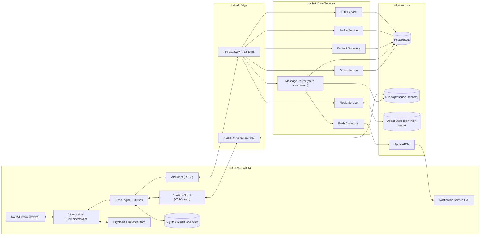
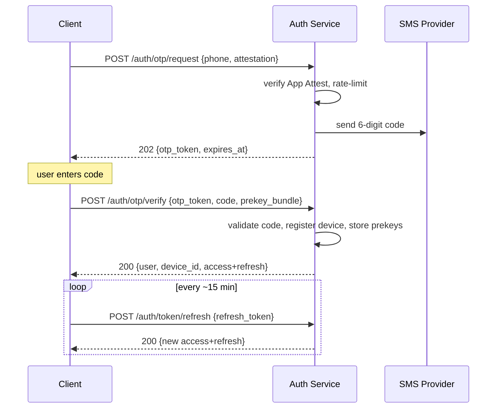
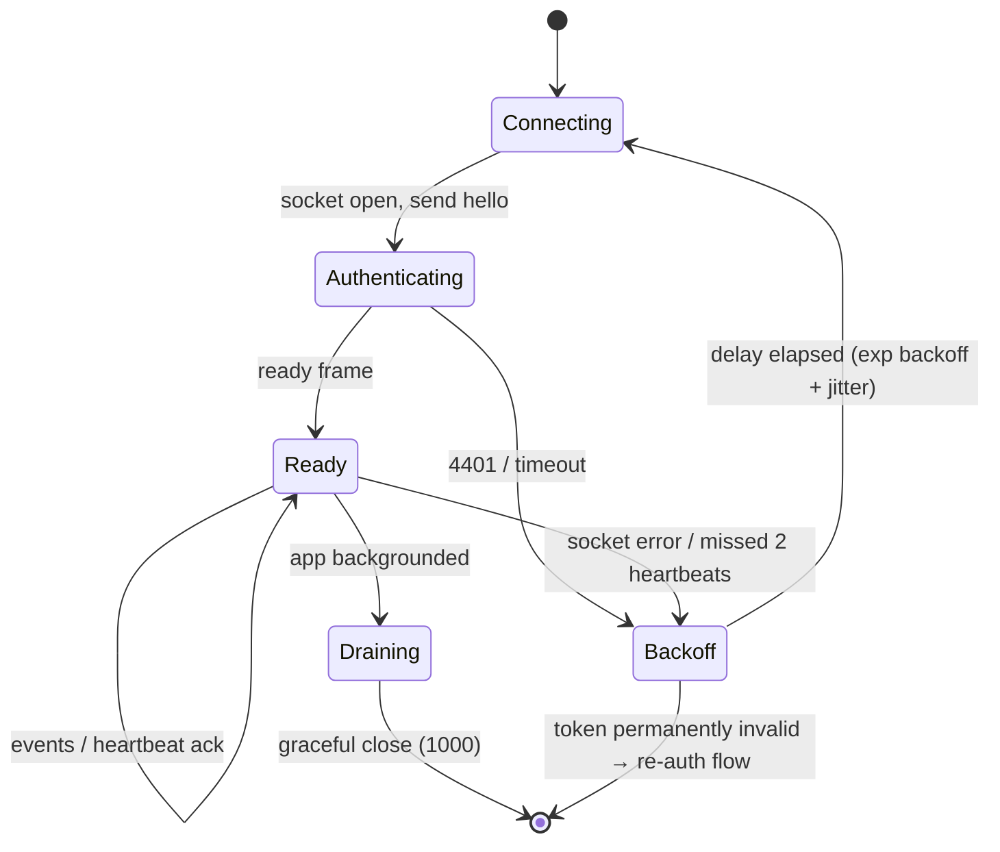
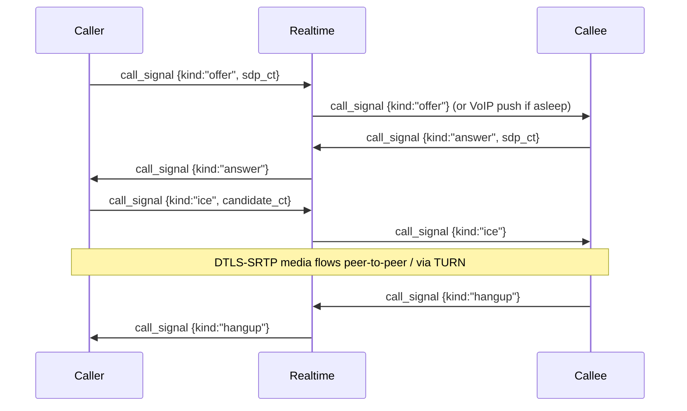
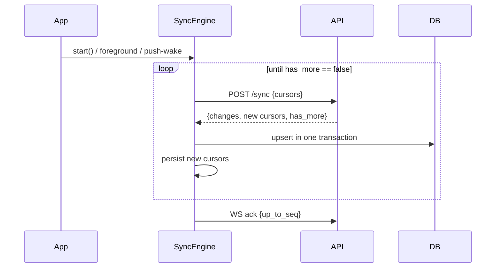
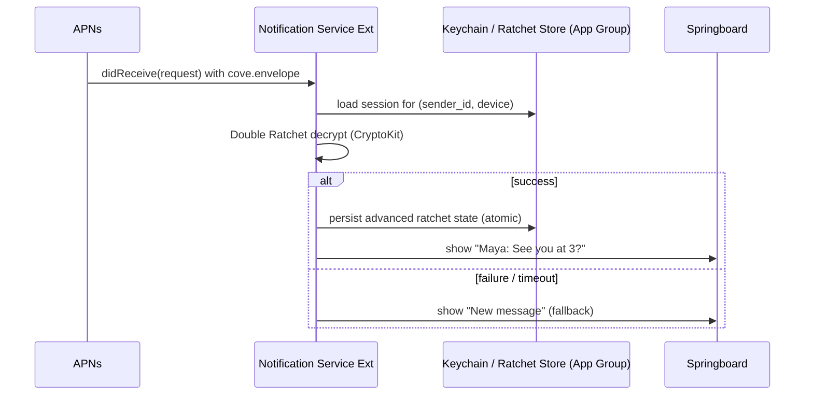
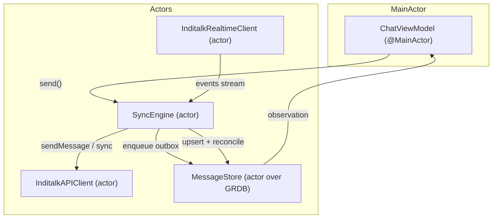

# Inditalk — Phase 3: Backend API & Realtime Design

> **Product:** Inditalk — an original, privacy-focused native iOS private-messaging app.
> **Status:** Engineering design (Phase 3). Backend contract, realtime protocol, client sync engine, push notifications.
> **Audience:** iOS engineers, backend engineers, security reviewers.
> **Platform target:** iOS 17+, Swift 6, SwiftUI, MVVM, Combine + async/await.

Inditalk is an **original product**. It is not WhatsApp, Signal, or Telegram, and it copies none of their branding, assets, or proprietary UI. Where this document references the **Signal Protocol (X3DH + Double Ratchet)**, **WebRTC**, **APNs**, and **JWT**, it does so as open standards / prior art, not as a copy of any product. Cryptographic transport is E2EE; the server is designed as an untrusted relay that stores only ciphertext and minimal routing metadata.

> ⚠️ **This document does not claim Inditalk is "production-secure."** All cryptographic and privacy claims here are design intent. See the [Limitations & Required Audit](#12-limitations--required-independent-audit) section. No part of this design should be shipped to real users protecting real secrets without an independent cryptographic and infrastructure audit.

---

## Table of Contents

1. [Architecture Overview](#1-architecture-overview)
2. [Conventions: IDs, Time, Versioning](#2-conventions-ids-time-versioning)
3. [Authentication (Phone OTP + JWT + Refresh)](#3-authentication-phone-otp--jwt--refresh)
4. [Unified Error Envelope](#4-unified-error-envelope)
5. [REST API Contract](#5-rest-api-contract)
6. [Groups](#6-groups)
7. [WebSocket Realtime Protocol](#7-websocket-realtime-protocol)
8. [Client Sync Engine](#8-client-sync-engine)
9. [Push Notifications (APNs)](#9-push-notifications-apns)
10. [Swift Protocols: `APIClient` & `RealtimeClient`](#10-swift-protocols-apiclient--realtimeclient)
11. [Threat Model Notes](#11-threat-model-notes)
12. [Limitations & Required Independent Audit](#12-limitations--required-independent-audit)

---

## 1. Architecture Overview



**Key design principles**

| Principle | Implication |
|---|---|
| Server is an untrusted relay | Server stores ciphertext + envelope routing metadata only. Message plaintext, media plaintext, and group titles/avatars are never server-readable. |
| Store-and-forward | Messages persist server-side (encrypted) until every recipient device ACKs delivery, then are eligible for deletion per retention policy. |
| Per-device fanout | Each user may have N linked devices; each is a separate cryptographic endpoint with its own session. |
| Offline-first client | The client is the source of truth for its own UI. The network is a sync channel, not a blocking dependency. |
| Idempotent writes | Every state-changing send carries a client-generated idempotency key. |

---

## 2. Conventions: IDs, Time, Versioning

- **Base URL:** `https://api.inditalk.com/v1`
- **Realtime URL:** `wss://rt.inditalk.com/v1/ws`
- **All request/response bodies:** `application/json; charset=utf-8` unless noted (media bytes are `application/octet-stream` to the object store).
- **IDs:** Server-issued IDs are **ULIDs** (Universally Unique Lexicographically Sortable Identifiers), 26-char Crockford base32, e.g. `01J9Z8Q7K3M6V2E4B1TN5X7YAB`. ULIDs are time-sortable, which we exploit for cursors.
- **Client-generated IDs:** Outbox/idempotency keys are UUIDv4.
- **Time:** All timestamps are RFC 3339 UTC with millisecond precision, e.g. `2026-07-24T14:03:22.481Z`. Servers additionally expose a monotonic `seq` (int64) per conversation for ordering; clients never trust wall-clock for ordering.
- **API versioning:** Path-versioned (`/v1`). Breaking changes bump the path. Additive fields are non-breaking; clients must ignore unknown fields.
- **Content negotiation:** Clients send `Inditalk-Client: ios/1.4.0 (build 812)` and `Inditalk-Protocol: 3` headers. Server rejects unsupported protocol versions with `426 Upgrade Required`.
- **Encoding of ciphertext:** All binary crypto payloads inside JSON are **base64url (unpadded)**.

---

## 3. Authentication (Phone OTP + JWT + Refresh)

Inditalk uses phone-number ownership as the identity anchor, then issues a short-lived **access JWT** and a long-lived **rotating refresh token**. The phone number is never stored in plaintext long-term server-side after registration completes; it is stored as a salted hash for account recovery (see [Limitations](#12-limitations--required-independent-audit)).

### 3.1 Token model

| Token | Lifetime | Storage (client) | Transport |
|---|---|---|---|
| Access JWT | 15 min | In-memory + Keychain (kSecAttrAccessibleAfterFirstUnlockThisDeviceOnly) | `Authorization: Bearer <jwt>` |
| Refresh token | 60 days, **rotated on every use** | Keychain only, never in memory longer than needed | request body to `/auth/token/refresh` |

**Access JWT claims** (`RS256`, verified against JWKS at `/.well-known/jwks.json`):

```json
{
  "iss": "https://api.inditalk.com",
  "sub": "01J9Z8Q7K3M6V2E4B1TN5X7YAB",
  "aud": "cove-api",
  "device_id": "01J9ZB2M4C8F0H3K5N7Q9R1SDT",
  "iat": 1753365802,
  "exp": 1753366702,
  "scope": "user messages media groups",
  "jti": "01J9ZB4XW2P6R8T0V2Y4A6C8EG"
}
```

Refresh tokens are opaque (not JWT) so they can be revoked server-side by deletion. Rotation: each refresh returns a new refresh token and invalidates the previous one. Reuse of an invalidated refresh token triggers **family revocation** (all tokens for that device are killed) — a standard refresh-token-reuse-detection defense.

### 3.2 OTP request

`POST /auth/otp/request`

```json
{
  "phone_e164": "+14155550137",
  "locale": "en-US",
  "delivery": "sms",
  "attestation": {
    "provider": "app_attest",
    "key_id": "s2f...",
    "assertion": "b64url..."
  }
}
```

- `attestation` uses **Apple App Attest / DeviceCheck** to raise the cost of automated OTP abuse. Missing/invalid attestation is allowed on simulator builds only (server flag) and rejected in prod.

**`202 Accepted`**

```json
{
  "otp_token": "01J9ZC0R5D9G2K4N6Q8T0V2XZA",
  "expires_at": "2026-07-24T14:08:22.481Z",
  "resend_available_at": "2026-07-24T14:04:22.481Z",
  "channel": "sms",
  "code_length": 6
}
```

`otp_token` is a server handle that binds the subsequent verify call to this request (prevents cross-request code guessing). The actual 6-digit code is delivered out-of-band via SMS.

**Rate limits:** 3 requests / phone / 15 min, 30 / IP / hour. Exceeding returns `429` (see error envelope). Response includes `Retry-After` header.

### 3.3 OTP verify

`POST /auth/otp/verify`

```json
{
  "otp_token": "01J9ZC0R5D9G2K4N6Q8T0V2XZA",
  "code": "418302",
  "device": {
    "device_id": null,
    "display_name": "iPhone 16 Pro",
    "platform": "ios",
    "app_version": "1.4.0",
    "push_token": null,
    "identity_key_pub": "b64url-ed25519-pub",
    "signed_prekey": {
      "key_id": 41,
      "pub": "b64url-x25519-pub",
      "signature": "b64url-sig"
    },
    "one_time_prekeys": [
      { "key_id": 1001, "pub": "b64url-x25519-pub" },
      { "key_id": 1002, "pub": "b64url-x25519-pub" }
    ]
  }
}
```

On first verify for a new install, the client uploads its **X3DH prekey bundle** (identity key, signed prekey, batch of one-time prekeys) so peers can start sessions asynchronously. `device_id: null` requests a new device registration; a value re-authenticates an existing device.

**`200 OK`**

```json
{
  "user": {
    "id": "01J9Z8Q7K3M6V2E4B1TN5X7YAB",
    "created_at": "2026-07-24T14:05:11.900Z",
    "is_new": true
  },
  "device_id": "01J9ZB2M4C8F0H3K5N7Q9R1SDT",
  "tokens": {
    "access_token": "eyJhbGciOiJSUzI1NiIsImtpZCI6Imsz...",
    "token_type": "Bearer",
    "expires_in": 900,
    "refresh_token": "rt_01J9ZB7.n8Zq...opaque..."
  }
}
```

Status codes: `200` success · `400` malformed · `401` wrong/expired code · `410` `otp_token` expired · `429` too many attempts (5 per `otp_token`, then invalidated).

### 3.4 Refresh & logout

`POST /auth/token/refresh`

```json
{ "refresh_token": "rt_01J9ZB7.n8Zq...", "device_id": "01J9ZB2M4C8F0H3K5N7Q9R1SDT" }
```

`200 OK` → same `tokens` shape as above (new access + new refresh). `401` if refresh invalid/expired. `409` `refresh_reuse_detected` → client must force full re-auth (OTP).

`POST /auth/logout` (Bearer required) revokes the current device's refresh family. `204 No Content`.

### 3.5 Auth sequence



---

## 4. Unified Error Envelope

Every non-2xx response (except `204`) uses this exact envelope. Success responses never wrap in `error`.

```json
{
  "error": {
    "code": "otp_invalid_code",
    "message": "The verification code is incorrect or has expired.",
    "http_status": 401,
    "retryable": false,
    "retry_after_ms": null,
    "field_errors": [
      { "field": "code", "issue": "mismatch" }
    ],
    "trace_id": "01J9ZD3F6H8K0M2P4R6T8V0XZB",
    "docs": "https://developers.inditalk.com/errors/otp_invalid_code"
  }
}
```

**Field semantics**

- `code`: stable machine-readable slug. Clients switch on this, never on `message`.
- `retryable`: whether a naive retry could succeed. For `429` and `503`, true, with `retry_after_ms`.
- `field_errors`: present on `422` validation failures.
- `trace_id`: echoes `X-Inditalk-Trace-Id` response header for support/correlation.

**Canonical error codes**

| HTTP | `code` | Meaning |
|---|---|---|
| 400 | `bad_request` | Malformed JSON / missing required field |
| 401 | `unauthenticated` | Missing/invalid/expired access token |
| 401 | `otp_invalid_code` | OTP wrong or attempt expired |
| 403 | `forbidden` | Authenticated but not permitted (e.g. not a group admin) |
| 404 | `not_found` | Resource does not exist or is not visible to caller |
| 409 | `conflict` | Idempotency/version conflict (see body detail) |
| 409 | `refresh_reuse_detected` | Refresh-token reuse → re-auth |
| 410 | `gone` | `otp_token`/invite expired |
| 413 | `payload_too_large` | Body or media descriptor over limit |
| 422 | `validation_failed` | Semantic validation (`field_errors` populated) |
| 426 | `upgrade_required` | Unsupported `Inditalk-Protocol` |
| 429 | `rate_limited` | Throttled; `retry_after_ms` set |
| 500 | `internal` | Unexpected server fault |
| 503 | `unavailable` | Dependency down / maintenance; `retryable: true` |

Swift decoding target:

```swift
struct APIErrorEnvelope: Decodable, Error {
    struct FieldError: Decodable { let field: String; let issue: String }
    let code: String
    let message: String
    let httpStatus: Int
    let retryable: Bool
    let retryAfterMs: Int?
    let fieldErrors: [FieldError]?
    let traceId: String
    let docs: URL?
}
```

---

## 5. REST API Contract

All endpoints below require `Authorization: Bearer <access_jwt>` unless in the `/auth` namespace.

### 5.1 User profile

Profile display name and avatar are **client-side-encrypted opaque blobs** to peers who have a session, but a minimal non-sensitive profile is stored server-side for the account owner and for group membership rendering. Inditalk's design keeps `display_name` server-visible (tradeoff: contact-name convenience vs. metadata minimization — see [Threat Model](#11-threat-model-notes)).

`GET /users/me`

```json
{
  "id": "01J9Z8Q7K3M6V2E4B1TN5X7YAB",
  "display_name": "Rowan",
  "about": "Away until Friday",
  "avatar": {
    "media_id": "01J9ZE1G7K9M2P4R6T8V0XZBCD",
    "blurhash": "LEHV6nWB2yk8pyo0adR*.7kCMdnj"
  },
  "phone_hash": "b64url-hmac-sha256",
  "created_at": "2026-07-24T14:05:11.900Z",
  "capabilities": ["groups.v2", "calls.v1"]
}
```

`PATCH /users/me` accepts any subset of `{ display_name, about, avatar: { media_id } }`. `200` returns the updated object. `422` if `display_name` violates constraints (1–48 graphemes).

`GET /users/{id}` returns the public projection (`id`, `display_name`, `avatar`, `capabilities`) — `404` if not discoverable by the caller.

### 5.2 Contact discovery (privacy-preserving)

Clients discover which of their address-book contacts use Inditalk **without uploading raw phone numbers**. Numbers are normalized to E.164, then HMAC'd with a rotating server-provided daily discovery key delivered inside the E2EE channel plus a client secret — a **hashed-identifier lookup**. This is a hardening measure, not a guarantee: phone-number hash spaces are enumerable and this endpoint is a known metadata risk (see [Limitations](#12-limitations--required-independent-audit)).

`POST /contacts/discover`

```json
{
  "hashes": [
    "b64url-hmac-1",
    "b64url-hmac-2",
    "b64url-hmac-3"
  ],
  "hash_scheme": "hmac-sha256-daily-v1"
}
```

Constraints: max 2,000 hashes/request, 5 requests/device/day. Server never learns which hashes did *not* match beyond count.

**`200 OK`**

```json
{
  "matches": [
    {
      "hash": "b64url-hmac-2",
      "user": {
        "id": "01J9ZF2H8K0M2P4R6T8V0XZBCE",
        "display_name": "Maya",
        "avatar": { "media_id": "01J9ZF5...", "blurhash": "L6Pj..." },
        "capabilities": ["groups.v2"]
      }
    }
  ],
  "hash_scheme": "hmac-sha256-daily-v1",
  "generated_at": "2026-07-24T14:12:00.000Z"
}
```

### 5.3 Chat list

Returns the caller's conversation summaries, ordered by `last_activity_seq` descending, cursor-paginated.

`GET /chats?limit=30&cursor=<opaque>`

```json
{
  "chats": [
    {
      "chat_id": "01J9ZG0K2M4P6R8T0V2XZBCEFG",
      "type": "direct",
      "peer_user_id": "01J9ZF2H8K0M2P4R6T8V0XZBCE",
      "title": null,
      "avatar": null,
      "last_message": {
        "message_id": "01J9ZG3N5Q7T9V1X3ZBCEFGHIJ",
        "sender_id": "01J9ZF2H8K0M2P4R6T8V0XZBCE",
        "sent_at": "2026-07-24T14:10:55.120Z",
        "preview_ciphertext": "b64url...",
        "type": "text"
      },
      "unread_count": 2,
      "last_activity_seq": 88213,
      "muted_until": null,
      "pinned": false
    },
    {
      "chat_id": "01J9ZG7Q9T1V3X5ZBCEFGHIJKL",
      "type": "group",
      "peer_user_id": null,
      "title_ciphertext": "b64url...",
      "avatar": { "media_id": "01J9ZG9...", "blurhash": "LKO2?U..." },
      "last_message": {
        "message_id": "01J9ZGB...",
        "sender_id": "01J9Z8Q7K3M6V2E4B1TN5X7YAB",
        "sent_at": "2026-07-24T14:11:40.900Z",
        "preview_ciphertext": "b64url...",
        "type": "text"
      },
      "unread_count": 0,
      "last_activity_seq": 88240,
      "muted_until": "2026-08-01T00:00:00.000Z",
      "pinned": true
    }
  ],
  "page": {
    "next_cursor": "eyJzZXEiOjg4MjEzfQ",
    "has_more": true
  }
}
```

Cursor is an opaque base64url of `{ "seq": 88213 }`. Clients treat it as a token; only the server encodes/decodes it. `has_more:false` and `next_cursor:null` at the end.

### 5.4 Message send

Sending is E2EE per-recipient-device: the client encrypts a distinct ciphertext for each recipient device session and posts them together. The server fans out and stores per-device.

`POST /chats/{chat_id}/messages`

Header: `Idempotency-Key: 7b1e...` (UUIDv4). Re-posting the same key returns the original result with `200` and header `Idempotency-Replayed: true`.

```json
{
  "client_message_id": "d3b07384-d9a0-4c9b-8f2e-1a2b3c4d5e6f",
  "type": "text",
  "sent_at": "2026-07-24T14:13:02.010Z",
  "reply_to_message_id": null,
  "recipients": [
    {
      "user_id": "01J9ZF2H8K0M2P4R6T8V0XZBCE",
      "device_id": "01J9ZFA...",
      "ciphertext": "b64url-double-ratchet-envelope",
      "envelope_type": "prekey"
    },
    {
      "user_id": "01J9ZF2H8K0M2P4R6T8V0XZBCE",
      "device_id": "01J9ZFB...",
      "ciphertext": "b64url-double-ratchet-envelope",
      "envelope_type": "whisper"
    }
  ],
  "media": null
}
```

- `envelope_type`: `prekey` (X3DH session-initiating) or `whisper` (established Double Ratchet).
- For media messages, `media` holds `{ media_id, key_ciphertext_per_device }` and `type` is `image|video|audio|file`. Media bytes are uploaded separately (see [5.6](#56-media-upload-pre-signed)).

**`201 Created`**

```json
{
  "message_id": "01J9ZH2K4M6P8R0T2V4XZBCEFH",
  "client_message_id": "d3b07384-d9a0-4c9b-8f2e-1a2b3c4d5e6f",
  "chat_id": "01J9ZG0K2M4P6R8T0V2XZBCEFG",
  "seq": 88241,
  "server_received_at": "2026-07-24T14:13:02.480Z",
  "accepted_devices": ["01J9ZFA...", "01J9ZFB..."],
  "stale_devices": []
}
```

`stale_devices` lists recipient devices whose session the sender didn't include (e.g. a device linked after the sender's last prekey fetch). The client must fetch fresh prekeys for those devices and re-send to them; the message is delivered to the devices that were included. Status: `201` accepted · `409 conflict` if the whole recipient set is stale (client must refetch prekeys and retry) · `413` if payload too large (>1 MiB total ciphertext) · `422` malformed recipient set.

### 5.5 Message history (pagination cursors)

`GET /chats/{chat_id}/messages?limit=50&before=<cursor>` (backward paging into history) or `?after=<cursor>` (forward, for catch-up).

```json
{
  "messages": [
    {
      "message_id": "01J9ZH2K4M6P8R0T2V4XZBCEFH",
      "chat_id": "01J9ZG0K2M4P6R8T0V2XZBCEFG",
      "sender_id": "01J9Z8Q7K3M6V2E4B1TN5X7YAB",
      "seq": 88241,
      "type": "text",
      "sent_at": "2026-07-24T14:13:02.010Z",
      "server_received_at": "2026-07-24T14:13:02.480Z",
      "ciphertext": "b64url-envelope-for-THIS-device",
      "envelope_type": "whisper",
      "reply_to_message_id": null,
      "edited_at": null,
      "deleted": false
    }
  ],
  "page": {
    "prev_cursor": "eyJzZXEiOjg4MjQxfQ",
    "next_cursor": "eyJzZXEiOjg4MTkxfQ",
    "has_more": true
  }
}
```

Only the ciphertext addressed to the requesting device is returned. History is device-scoped: a newly linked device cannot decrypt messages sent before it existed (no server-side plaintext to re-key from) — a deliberate forward-secrecy tradeoff. `before`/`after` cursors encode `{ "seq": N }`; server guarantees stable ordering by `seq`.

### 5.6 Media upload (pre-signed)

Two-phase: (1) request a pre-signed PUT URL, (2) client encrypts bytes locally with a random symmetric key (AES-256-GCM via CryptoKit), uploads ciphertext directly to object storage, (3) references `media_id` in a message and ships the per-device-wrapped media key inside the message envelope.

`POST /media/uploads`

```json
{
  "content_type": "image/jpeg",
  "byte_size": 1048320,
  "sha256": "b64url-of-ciphertext-digest",
  "purpose": "message_media"
}
```

**`201 Created`**

```json
{
  "media_id": "01J9ZK1M3P5R7T9V1X3ZBCEFHI",
  "upload": {
    "method": "PUT",
    "url": "https://blob.inditalk.com/u/01J9ZK1M.../ct?X-Amz-Signature=...",
    "headers": {
      "Content-Type": "application/octet-stream",
      "x-amz-meta-sha256": "b64url-of-ciphertext-digest"
    },
    "expires_at": "2026-07-24T14:28:00.000Z",
    "max_bytes": 1048576
  }
}
```

Client then `PUT`s the AES-GCM ciphertext (nonce prepended, GCM tag appended) to `upload.url`. On success it references `media_id` in a message. Download mirror: `GET /media/{media_id}/download` returns a pre-signed GET URL (`302` or `200` with `{ url, expires_at }`). The server never sees plaintext bytes or the media key.

Limits: images/files ≤ 100 MiB, per-chunk video via resumable multipart (not covered in Phase 3). `413` if `byte_size` exceeds `max_bytes` for the purpose.

---

## 6. Groups

Groups in Inditalk use **client-side fanout encryption**: there is no server-held group key. The group title, avatar, and membership *display* are E2EE; the server maintains only an opaque membership roster of user/device IDs needed for routing plus a **permissions ACL** it must enforce (since the server gates who may post/administrate). This is a pragmatic split: routing/authorization metadata is server-visible; content is not.

### 6.1 Create group

`POST /groups`

```json
{
  "client_group_id": "b9c2d1e4-5a6f-7b8c-9d0e-1f2a3b4c5d6e",
  "title_ciphertext": "b64url",
  "avatar_media_id": null,
  "initial_members": [
    "01J9ZF2H8K0M2P4R6T8V0XZBCE",
    "01J9ZM4P6R8T0V2X4ZBCEFHIJK"
  ],
  "settings": {
    "who_can_send": "all_members",
    "who_can_edit_info": "admins_only",
    "who_can_add_members": "admins_only",
    "disappearing_seconds": null
  }
}
```

**`201 Created`**

```json
{
  "group_id": "01J9ZN0R2T4V6X8Z0BCEFHIJKL",
  "chat_id": "01J9ZN0R2T4V6X8Z0BCEFHIJKL",
  "version": 1,
  "created_by": "01J9Z8Q7K3M6V2E4B1TN5X7YAB",
  "members": [
    { "user_id": "01J9Z8Q7...", "role": "owner", "joined_at": "2026-07-24T14:20:00.000Z" },
    { "user_id": "01J9ZF2H...", "role": "member", "joined_at": "2026-07-24T14:20:00.000Z" },
    { "user_id": "01J9ZM4P...", "role": "member", "joined_at": "2026-07-24T14:20:00.000Z" }
  ],
  "settings": {
    "who_can_send": "all_members",
    "who_can_edit_info": "admins_only",
    "who_can_add_members": "admins_only",
    "disappearing_seconds": null
  }
}
```

Every mutating group op returns and requires a `version` (optimistic concurrency). Sending a stale `version` → `409 conflict` with the current version in the body so the client can rebase.

### 6.2 Roles & permissions

| Role | Add/remove members | Edit info | Change settings | Delete group | Post (if restricted) |
|---|---|---|---|---|---|
| `owner` | ✅ | ✅ | ✅ | ✅ | ✅ |
| `admin` | ✅ | ✅ | ✅ | ❌ | ✅ |
| `member` | per-setting | per-setting | ❌ | ❌ | per-setting |

`settings.who_can_send`: `all_members` \| `admins_only`. `who_can_edit_info` / `who_can_add_members`: `all_members` \| `admins_only`. The **server enforces** these ACLs; a member's `POST message` to an `admins_only` group is rejected `403 forbidden` (`code: forbidden`, `field_errors: [{field:"role", issue:"insufficient"}]`).

### 6.3 Membership operations

- `POST /groups/{id}/members` `{ version, add: [user_id...] }` → `200` new roster + incremented version. `403` if caller lacks permission.
- `DELETE /groups/{id}/members/{user_id}` (query `?version=`) → `200`. Removing self = leave.
- `PATCH /groups/{id}/members/{user_id}` `{ version, role: "admin" }` → promote/demote (owner/admin only).
- `PATCH /groups/{id}` `{ version, title_ciphertext?, avatar_media_id?, settings? }`.
- `DELETE /groups/{id}` `{ version }` → owner only, `204`.

Whenever membership changes, existing members must **re-establish sessions** with new members (client fetches their prekeys) and rotate any sender-key-style state client-side. The server emits a `group.updated` realtime event (see [§7.4](#74-message-types)).

### 6.4 Invite links

`POST /groups/{id}/invites`

```json
{ "version": 7, "max_uses": 25, "expires_at": "2026-08-24T00:00:00.000Z" }
```

**`201`**

```json
{
  "invite_id": "01J9ZP2T4V6X8Z0B2CEFHIJKLM",
  "token": "cvinv_9f3aQ7...",
  "url": "https://www.inditalk.com/j/9f3aQ7...",
  "max_uses": 25,
  "used_count": 0,
  "expires_at": "2026-08-24T00:00:00.000Z"
}
```

Joining: `POST /groups/join` `{ "token": "cvinv_9f3aQ7..." }` → `200` returns the group summary the joiner needs to bootstrap sessions, or `410 gone` (expired/exhausted), `403` if joiner is blocked. `DELETE /groups/{id}/invites/{invite_id}` revokes. **Privacy note:** invite tokens are bearer secrets; anyone with the link can join up to `max_uses`. The link contains no membership info; the joiner learns the roster only after acceptance and E2EE bootstrap.

---

## 7. WebSocket Realtime Protocol

The realtime channel delivers events promptly while the device is foregrounded/connected. It is **not** the durable delivery guarantee — that is the store-and-forward REST/history layer. Realtime is a low-latency accelerator over the same `seq` cursors; anything missed while disconnected is recovered via [delta sync](#8-client-sync-engine).

### 7.1 Connection & auth handshake

1. Client opens `wss://rt.inditalk.com/v1/ws` with `Sec-WebSocket-Protocol: cove.rt.3`.
2. Client MUST send a `hello` frame within 5 s or the server closes with code `4401`.

```json
{
  "t": "hello",
  "id": "c-0001",
  "d": {
    "access_token": "eyJhbGciOiJSUzI1NiIs...",
    "device_id": "01J9ZB2M4C8F0H3K5N7Q9R1SDT",
    "protocol": 3,
    "resume": {
      "session_id": "01J9ZQ3V5X7Z9B1D3FHIJKLMNO",
      "last_ack_seq": 88240
    }
  }
}
```

Server replies `ready` (fresh) or resumes and replays events after `last_ack_seq`:

```json
{
  "t": "ready",
  "id": "s-0001",
  "d": {
    "session_id": "01J9ZQ7V5X7Z9B1D3FHIJKLMNP",
    "resumed": true,
    "heartbeat_interval_ms": 25000,
    "server_time": "2026-07-24T14:22:10.000Z"
  }
}
```

Auth failure closes with WebSocket close code `4401 unauthenticated`; the client refreshes its JWT (REST) and reconnects. Protocol mismatch closes `4426`.

### 7.2 Frame envelope schema

Every frame is a JSON object:

```json
{
  "t": "new_message",
  "id": "s-0042",
  "ref": "c-0007",
  "ts": "2026-07-24T14:22:11.310Z",
  "d": { }
}
```

| Field | Type | Notes |
|---|---|---|
| `t` | string | Frame type (see [§7.4](#74-message-types)). |
| `id` | string | Sender-scoped frame id (`c-*` client, `s-*` server). |
| `ref` | string? | Correlates a server frame to the client frame it answers. |
| `ts` | string? | RFC 3339; present on server event frames. |
| `d` | object | Type-specific payload. |

Server→client event frames that carry conversation state include a `seq`; the client ACKs the highest contiguous `seq` it has durably persisted so the server can trim its replay buffer.

### 7.3 Connection state machine



### 7.4 Message types

| `t` | Dir | Payload `d` (abridged) |
|---|---|---|
| `hello` | C→S | `{ access_token, device_id, protocol, resume? }` |
| `ready` | S→C | `{ session_id, resumed, heartbeat_interval_ms, server_time }` |
| `ping` / `pong` | both | `{ }` heartbeat |
| `ack` | C→S | `{ up_to_seq }` — durable-persist watermark |
| `new_message` | S→C | `{ message: <history message obj>, chat_id, seq }` |
| `delivery_receipt` | both | `{ chat_id, message_id, device_id, status: "delivered", at }` |
| `read_receipt` | both | `{ chat_id, up_to_seq, at }` |
| `typing` | both | `{ chat_id, state: "start"\|"stop", ttl_ms }` |
| `presence` | S→C | `{ user_id, state: "online"\|"offline", last_seen_at? }` |
| `call_signal` | both | `{ call_id, kind, sdp?/candidate?, from_device, to_device, payload_ciphertext? }` |
| `group_updated` | S→C | `{ group_id, version, change: "members"\|"info"\|"settings" }` |
| `error` | S→C | error envelope, plus `close_after: bool` |

**Typing** frames are ephemeral, never persisted, and carry a `ttl_ms` (default 6000) so a missed `stop` self-clears. **Presence** honors a per-user privacy setting; if a user disables last-seen, `last_seen_at` is omitted and `state` may be coarsened.

`new_message` example:

```json
{
  "t": "new_message",
  "id": "s-0100",
  "ts": "2026-07-24T14:22:11.310Z",
  "d": {
    "chat_id": "01J9ZG0K2M4P6R8T0V2XZBCEFG",
    "seq": 88242,
    "message": {
      "message_id": "01J9ZR2T4V6X8Z0B2CEFHIJKLN",
      "sender_id": "01J9ZF2H8K0M2P4R6T8V0XZBCE",
      "type": "text",
      "sent_at": "2026-07-24T14:22:11.010Z",
      "ciphertext": "b64url-envelope-for-this-device",
      "envelope_type": "whisper"
    }
  }
}
```

### 7.5 Call signaling (WebRTC over the realtime channel)

Inditalk voice/video uses **WebRTC** (an open standard) for media; the realtime channel carries **signaling only** (SDP offer/answer, ICE candidates), and signaling payloads are themselves E2EE (`payload_ciphertext`). CallKit/PushKit wake the app for incoming calls (see [§9.3](#93-call-wake--pushkit)).



`kind ∈ {offer, answer, ice, ringing, hangup, busy, decline}`. TURN/STUN credentials are fetched via `GET /calls/ice-servers` (short-lived HMAC creds). Media relay servers see only encrypted SRTP.

### 7.6 Heartbeat, reconnect, backoff

- Server sends `ping` every `heartbeat_interval_ms` (25 s). Client replies `pong`. Client also independently pings; **two consecutive missed heartbeats** (≈ 50 s) → treat connection dead, close, reconnect.
- Reconnect uses **exponential backoff with full jitter**: `delay = random(0, min(cap, base * 2^attempt))`, `base = 1 s`, `cap = 30 s`, reset on a successful `ready`.
- On reconnect the client sends `resume` with `last_ack_seq`; if the server's replay buffer no longer covers it (buffer TTL exceeded), server responds `ready {resumed:false}` and the client falls back to full [delta sync](#8-client-sync-engine).

```swift
func reconnectDelay(attempt: Int) -> TimeInterval {
    let base = 1.0, cap = 30.0
    let expo = min(cap, base * pow(2.0, Double(attempt)))
    return Double.random(in: 0...expo)   // full jitter
}
```

---

## 8. Client Sync Engine

The `SyncEngine` reconciles server state into the local GRDB store and drives the outbox. It is the only component that writes canonical message rows.

### 8.1 Delta sync with server cursors

The client persists a per-scope cursor. A single `POST /sync` returns everything changed since the cursor, batched:

`POST /sync`

```json
{
  "cursors": {
    "chats": "eyJzZXEiOjg4MjQwfQ",
    "contacts": "eyJ2IjoxN30",
    "groups": "eyJ2Ijo0Mn0"
  },
  "limit": 500
}
```

**`200`**

```json
{
  "changes": {
    "chats": [ /* changed chat summaries */ ],
    "messages": [ /* new messages addressed to this device */ ],
    "receipts": [ /* delivery/read receipts */ ],
    "groups": [ /* group version bumps */ ]
  },
  "cursors": {
    "chats": "eyJzZXEiOjg4MjUwfQ",
    "contacts": "eyJ2IjoxN30",
    "groups": "eyJ2Ijo0M30"
  },
  "has_more": true
}
```

The client loops `POST /sync` while `has_more`. The realtime `new_message`/`group_updated` frames are an accelerator; on cold start, reconnect, or push wake, the engine always runs a delta sync to guarantee completeness. Cursors are opaque and monotonic per scope.



### 8.2 Outbox / send-queue with idempotency

Outgoing messages are written to a durable `outbox` table **before** any network call. The UI reflects `pending` immediately (optimistic). A background worker drains the queue.

```swift
enum OutboxState: String, Codable {
    case pending      // enqueued, not yet attempted
    case inFlight     // POST in progress
    case sent         // server 201; awaiting delivery receipts
    case failed       // permanent failure; user can retry/delete
}

struct OutboxItem: Codable, Identifiable {
    let id: UUID                 // client_message_id AND idempotency key
    let chatId: String
    let payload: EncryptedMessagePayload
    var state: OutboxState
    var attempts: Int
    var nextAttemptAt: Date
    var lastError: String?
    let createdAt: Date
}
```

- The `id` (UUIDv4) is used as both `client_message_id` and the `Idempotency-Key` header. If the app crashes after the server persisted but before the client saw `201`, the retry replays the same key → server returns the original result (`Idempotency-Replayed: true`), no duplicate.
- The server retains idempotency keys for **48 h**; retries beyond that window are treated as new messages (acceptable because the client also dedups on `client_message_id`).

### 8.3 Retry with backoff + jitter

```swift
func outboxRetryDelay(attempts: Int, retryAfterMs: Int?) -> TimeInterval {
    if let ra = retryAfterMs { return Double(ra) / 1000.0 }   // honor server 429/503
    let base = 0.5, cap = 60.0
    let expo = min(cap, base * pow(2.0, Double(attempts)))
    return expo * Double.random(in: 0.5...1.0)                // decorrelated jitter
}
```

Retryable: network errors, `429`, `500`, `503`, and `409 stale_devices` (after refetching prekeys). Non-retryable → `failed`: `403` (blocked/permission), `413` (too large), `422` (malformed). `409 conflict` on group version → rebase against server version, then retry once.

### 8.4 Conflict resolution

| Conflict | Resolution |
|---|---|
| Message ordering | Server `seq` is authoritative. Local optimistic rows are keyed by `client_message_id`; on receiving the server echo, the local row is reconciled (its `message_id`/`seq` filled in) rather than duplicated. |
| Group metadata (title/settings) | Optimistic concurrency on `version`. Loser rebases onto server `version` and re-applies its intended change if still valid; if the change is now moot (e.g. removing an already-removed member) it is dropped. |
| Read state | **Last-writer-wins by `up_to_seq`** (monotonic max). A device that read up to seq 90 never regresses to 85. |
| Profile edits across devices | LWW by `server_received_at`; server is the tiebreaker. |

### 8.5 Deduplication

Two dedup layers:

1. **Send-side:** idempotency key prevents the server from creating duplicates.
2. **Receive-side:** the local store has a `UNIQUE(message_id)` and a secondary `UNIQUE(chat_id, client_message_id)` index. A message arriving via *both* realtime and delta sync is inserted once (upsert `ON CONFLICT DO NOTHING`, then merge any receipt fields). Ratchet-layer replay is separately rejected by the Double Ratchet (a duplicate ciphertext won't re-decrypt), which is the real anti-replay guarantee; the DB uniqueness is a UI-consistency guard.

---

## 9. Push Notifications (APNs)

Inditalk uses two APNs channels: **alert pushes** (user-visible, `apns-push-type: alert`) and **silent/background pushes** (`apns-push-type: background`, `content-available: 1`) to trigger sync while the app is not foregrounded. Because message content is E2EE, the server can never put plaintext in the push. Previews are decrypted **on-device** by a **Notification Service Extension (NSE)**.

### 9.1 Alert push payload (E2EE preview)

The server sends a content-free alert with an encrypted stub. The NSE fetches/decrypts and rewrites the notification body before display.

```json
{
  "aps": {
    "alert": {
      "loc-key": "NEW_MESSAGE_FALLBACK",
      "title-loc-key": "NEW_MESSAGE_TITLE"
    },
    "mutable-content": 1,
    "sound": "default",
    "thread-id": "01J9ZG0K2M4P6R8T0V2XZBCEFG",
    "interruption-level": "active"
  },
  "cove": {
    "v": 3,
    "type": "message",
    "chat_id": "01J9ZG0K2M4P6R8T0V2XZBCEFG",
    "message_id": "01J9ZR2T4V6X8Z0B2CEFHIJKLN",
    "seq": 88242,
    "envelope": "b64url-double-ratchet-envelope-for-this-device",
    "envelope_type": "whisper",
    "sender_id": "01J9ZF2H8K0M2P4R6T8V0XZBCE"
  }
}
```

- `mutable-content: 1` lets the NSE intercept.
- `envelope` is the actual ciphertext, so the NSE can decrypt **without a network round-trip** in the common case. If decryption requires advancing the ratchet with state only the main app holds, the NSE falls back to the generic `NEW_MESSAGE_FALLBACK` copy ("New message").
- The fallback (`loc-key`) is what shows if the NSE times out (Apple gives it ~30 s and limited memory).

### 9.2 Notification Service Extension flow



**Concurrency hazard:** both the NSE and the main app can decrypt (advance) the same ratchet, corrupting state. Mitigation: the ratchet store lives in a **shared App Group container** guarded by an `NSFileCoordinator` / advisory lock; only one process advances the ratchet for a given message, and decrypted-message dedup is keyed by `message_id`. This is a known fragile area flagged for audit (see [Limitations](#12-limitations--required-independent-audit)).

Swift skeleton:

```swift
final class NotificationService: UNNotificationServiceExtension {
    override func didReceive(_ request: UNNotificationRequest,
                             withContentHandler handler: @escaping (UNNotificationContent) -> Void) {
        guard let best = request.content.mutableCopy() as? UNMutableNotificationContent,
              let cove = InditalkPushPayload(request.content.userInfo) else { return handler(request.content) }
        Task {
            do {
                let plaintext = try await RatchetStore.shared.decryptForPreview(cove.envelope,
                                                                                from: cove.senderId)
                best.title = plaintext.senderDisplayName
                best.body  = plaintext.previewText          // truncated on-device
                best.threadIdentifier = cove.chatId
                handler(best)
            } catch {
                handler(best)   // keep localized fallback body
            }
        }
    }
    override func serviceExtensionTimeWillExpire() { /* deliver fallback */ }
}
```

### 9.3 Silent/background push (wake to sync)

For receipts, typing (not pushed), group updates, and to catch up while backgrounded, the server sends a background push:

```json
{
  "aps": { "content-available": 1 },
  "cove": { "v": 3, "type": "sync_hint", "reason": "new_message", "chat_id": "01J9ZG0K2M4P6R8T0V2XZBCEFG" }
}
```

`apns-push-type: background`, `apns-priority: 5`. On `didReceiveRemoteNotification`, the app runs a bounded [delta sync](#8-client-sync-engine) within the background execution window. iOS throttles background pushes; they are best-effort, which is exactly why store-and-forward + delta sync (not push) is the delivery guarantee.

### 9.4 Call wake (PushKit)

Incoming calls use **PushKit VoIP pushes** (`apns-push-type: voip`) which wake the app reliably and **must** report to **CallKit** immediately (Apple requirement) via `CXProvider`.

```json
{
  "cove": {
    "v": 3,
    "type": "call_invite",
    "call_id": "01J9ZS3V5X7Z9B1D3FHIJKLMNQ",
    "chat_id": "01J9ZG0K2M4P6R8T0V2XZBCEFG",
    "caller_id": "01J9ZF2H8K0M2P4R6T8V0XZBCE",
    "media": "audio",
    "signal_ciphertext": "b64url-encrypted-sdp-offer"
  }
}
```

Flow: VoIP push → `PKPushRegistry` delegate → decrypt offer → `CXProvider.reportNewIncomingCall` (CallKit UI) → on answer, open WebRTC peer connection and continue signaling over the [realtime channel](#75-call-signaling-webrtc-over-the-realtime-channel). If the app is fully asleep, the VoIP push both wakes it and carries the initial offer so ringing is instant.

---

## 10. Swift Protocols: `APIClient` & `RealtimeClient`

Written for Swift 6 (strict concurrency). All async, `Sendable`-clean, `actor`-friendly.

### 10.1 `APIClient`

```swift
import Foundation

public protocol APIClient: Sendable {

    // MARK: Auth
    func requestOTP(_ req: OTPRequest) async throws -> OTPChallenge
    func verifyOTP(_ req: OTPVerify) async throws -> AuthSession
    func refresh(_ token: RefreshToken, deviceID: DeviceID) async throws -> AuthSession
    func logout() async throws

    // MARK: Profile
    func fetchMe() async throws -> UserProfile
    func updateMe(_ patch: ProfilePatch) async throws -> UserProfile
    func fetchUser(id: UserID) async throws -> PublicUser

    // MARK: Contact discovery
    func discoverContacts(hashes: [String],
                          scheme: DiscoveryScheme) async throws -> [ContactMatch]

    // MARK: Chats & messages
    func fetchChats(limit: Int, cursor: Cursor?) async throws -> Page<ChatSummary>
    func sendMessage(chatID: ChatID,
                     idempotencyKey: UUID,
                     body: OutgoingMessage) async throws -> MessageAccepted
    func fetchHistory(chatID: ChatID,
                      limit: Int,
                      before: Cursor?,
                      after: Cursor?) async throws -> Page<StoredMessage>

    // MARK: Media
    func createUpload(_ req: MediaUploadRequest) async throws -> MediaUploadTicket
    func resolveDownload(mediaID: MediaID) async throws -> MediaDownloadTicket

    // MARK: Groups
    func createGroup(_ req: CreateGroup) async throws -> Group
    func updateGroup(id: GroupID, version: Int, patch: GroupPatch) async throws -> Group
    func addMembers(id: GroupID, version: Int, userIDs: [UserID]) async throws -> Group
    func removeMember(id: GroupID, version: Int, userID: UserID) async throws -> Group
    func setRole(id: GroupID, version: Int, userID: UserID, role: GroupRole) async throws -> Group
    func createInvite(id: GroupID, version: Int, maxUses: Int?, expiresAt: Date?) async throws -> GroupInvite
    func joinGroup(token: String) async throws -> Group
    func revokeInvite(id: GroupID, inviteID: InviteID) async throws

    // MARK: Sync
    func sync(cursors: SyncCursors, limit: Int) async throws -> SyncResponse
}

public struct Page<Element: Sendable & Decodable>: Sendable, Decodable {
    public let items: [Element]
    public let nextCursor: Cursor?
    public let prevCursor: Cursor?
    public let hasMore: Bool
}

public struct Cursor: Sendable, Codable, Hashable { public let raw: String }
```

The concrete implementation is an `actor InditalkAPIClient` that injects a `TokenProvider` (auto-refreshes on `401` once, then surfaces), decodes the [unified error envelope](#4-unified-error-envelope) into `APIErrorEnvelope`, and applies request signing headers.

### 10.2 `RealtimeClient`

```swift
public protocol RealtimeClient: Sendable {
    /// Hot stream of decoded inbound frames. Multiple consumers via broadcast.
    var events: AsyncStream<RealtimeEvent> { get }

    /// Observable connection status for UI (drives a "connecting…" banner).
    var connectionState: AsyncStream<RealtimeConnectionState> { get }

    func connect(resume: ResumeState?) async
    func disconnect() async

    func send(_ frame: OutboundFrame) async throws
    func acknowledge(upToSeq: Int64) async

    // Convenience wrappers over `send`
    func sendTyping(chatID: ChatID, state: TypingState) async
    func sendReadReceipt(chatID: ChatID, upToSeq: Int64) async
    func sendCallSignal(_ signal: CallSignal) async throws
}

public enum RealtimeConnectionState: Sendable, Equatable {
    case idle
    case connecting(attempt: Int)
    case authenticating
    case ready(sessionID: String, resumed: Bool)
    case backingOff(nextRetry: Date)
    case unauthenticated   // needs JWT refresh + reconnect
}

public enum RealtimeEvent: Sendable {
    case newMessage(chatID: ChatID, seq: Int64, message: StoredMessage)
    case deliveryReceipt(DeliveryReceipt)
    case readReceipt(chatID: ChatID, upToSeq: Int64, at: Date)
    case typing(chatID: ChatID, userID: UserID, state: TypingState, ttlMs: Int)
    case presence(userID: UserID, state: PresenceState, lastSeenAt: Date?)
    case callSignal(CallSignal)
    case groupUpdated(groupID: GroupID, version: Int, change: GroupChange)
    case error(APIErrorEnvelope, closeAfter: Bool)
}
```

`InditalkRealtimeClient` is an `actor` wrapping `URLSessionWebSocketTask`, owning the [heartbeat/backoff state machine](#73-connection-state-machine). It never blocks the main actor; ViewModels subscribe to `events`/`connectionState` and marshal to `@MainActor` for UI updates. On `.unauthenticated` it signals the auth layer to refresh, then reconnects with the same `ResumeState`.

### 10.3 How the pieces compose



The single writer to `MessageStore` is the `SyncEngine`, eliminating cross-actor write races. ViewModels are read-mostly observers plus intent emitters. This keeps Swift 6 strict-concurrency checks satisfied without `@unchecked Sendable` escapes.

---

## 11. Threat Model Notes

**In scope (design intent):**
- Content confidentiality/integrity via Signal-Protocol-style E2EE (X3DH + Double Ratchet) with forward secrecy and post-compromise security. Server sees ciphertext only for message/media/group-content.
- Transport confidentiality via TLS 1.3 with certificate pinning on the client.
- Authenticated device registration; refresh-token-reuse detection; App Attest on OTP.
- Media at rest is client-encrypted before upload; object store holds ciphertext.

**Explicitly NOT solved / residual risk:**
- **Metadata.** The server observes who talks to whom, when, message sizes, group membership graphs, presence, and IP addresses. Inditalk does not implement sealed-sender or metadata-private routing in Phase 3. This is a significant privacy limitation.
- **Contact discovery** via hashed phone numbers is enumerable; a malicious server (or one compelled by legal process) can brute-force the phone-hash space. This is a mitigation, not privacy.
- **`display_name` is server-visible** for convenience; usernames/profile are not E2EE.
- **NSE ratchet advancement** across two processes (extension + app) is a correctness/security hazard requiring careful locking and audit.
- **Group ACL enforcement** is server-side and therefore trusts the server for authorization (not for content). A compromised server could permit unauthorized posts (content still E2EE, but membership/routing integrity is not cryptographically enforced in Phase 3).
- **Key transparency / safety numbers.** Out-of-band identity-key verification UX exists but there is no automated key-transparency log in Phase 3; MITM at first contact is possible if the server serves a forged prekey bundle and users don't verify safety numbers.

---

## 12. Limitations & Required Independent Audit

> **Inditalk is not claimed to be production-secure.** Everything in this document is a design specification, not a verified, penetration-tested, or formally analyzed system.

Before Inditalk handles real users' private communications, the following **must** be independently audited and remediated:

1. **Cryptographic protocol review** — an independent review of the X3DH/Double Ratchet implementation, key storage in Keychain/App Group, nonce management for AES-256-GCM media, and the NSE cross-process ratchet locking. Use of standards (Signal Protocol, WebRTC, APNs) does not by itself make the implementation correct.
2. **Metadata exposure assessment** — formal analysis of what the relay learns and legal/operational controls; decide whether sealed-sender-style techniques are required for the target threat model.
3. **Contact-discovery privacy** — evaluate the hashed-phone-number scheme against enumeration; consider private set intersection (PSI) or enclave-based discovery as future work.
4. **Abuse & rate-limit hardening** — OTP/SMS pumping, invite-link abuse, spam fanout, and DoS on the realtime fanout service.
5. **Infrastructure review** — object-store bucket policy, pre-signed URL scoping/expiry, JWKS key rotation, refresh-token storage, and blast radius of a compromised backend.
6. **Key transparency / MITM at first contact** — assess whether an auditable key-transparency mechanism is required before launch.
7. **Privacy & legal** — data-retention windows, lawful-access posture, and jurisdiction, reviewed by counsel.

No security claim in this document should be treated as guaranteed until the above are completed by qualified independent reviewers and findings are resolved. Standards referenced here are prior art; Inditalk's specific composition and implementation are what require audit.

---

*End of Phase 3 design — Inditalk Backend API & Realtime.*
