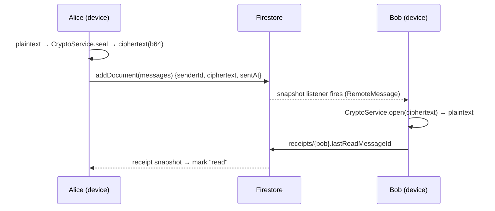

# Inditalk × Firebase — backend integration

Inditalk's Phase 3 backend is implemented on **Firebase** (project **cove** / `cove-7f31f`,
project number `493828629214`). Firebase is a documented third-party dependency
(Apache-2.0, added via Swift Package Manager) — a deliberate deviation from the
"Apple-frameworks-only" default, chosen because the project is already connected.

The Swift services all sit behind Inditalk's existing service boundary, so the app's UI
and store are untouched:

| Concern | Service file | Firebase product |
|---|---|---|
| Phone OTP auth | [`FirebaseAuthService`](../Inditalk/Inditalk/Services/Firebase/FirebaseAuthService.swift) | FirebaseAuth |
| Chats & messages (realtime) | [`FirestoreService`](../Inditalk/Inditalk/Services/Firebase/FirestoreService.swift) | FirebaseFirestore |
| Media | [`FirebaseStorageService`](../Inditalk/Inditalk/Services/Firebase/FirebaseStorageService.swift) | FirebaseStorage |
| Push tokens | [`PushService`](../Inditalk/Inditalk/Services/Firebase/PushService.swift) | FirebaseMessaging |
| Bootstrap + APNs | [`AppDelegate`](../Inditalk/Inditalk/App/AppDelegate.swift) | FirebaseCore |

---

## ⚠️ E2EE + Firestore — read this

Firestore is **not** end-to-end encrypted. Data is encrypted in transit and at rest,
but **Google can read anything you store in plaintext.** To keep Inditalk's Phase 5 E2EE
promise:

- Message **bodies are stored as ciphertext only** (`RemoteMessage.ciphertext`),
  produced by `CryptoService.seal(...)` on-device. The server cannot read them.
- Media is encrypted **before** upload; Storage holds an opaque blob.
- **Visible to the server (metadata):** who is in each chat, message timestamps and
  sizes, read receipts, presence. This is the same metadata exposure described in
  [`PHASE5_ENCRYPTION.md`](PHASE5_ENCRYPTION.md).
- **Never** write a plaintext body to Firestore.

This is a reference integration and is **not production-secure** until the crypto +
backend are independently audited.

---

## One-time console setup

1. **Register the iOS app** — Firebase console → project *cove* → Add app → iOS.
   Bundle ID: **`chat.cove.app`** (matches `project.yml`). Download the generated
   **`GoogleService-Info.plist`** and drop it into `Inditalk/Resources/`, added to the app
   target. (A template with your known values is at
   `Inditalk/Resources/GoogleService-Info.SAMPLE.plist` — delete it after.)
2. **Authentication** → Sign-in method → enable **Phone**. For real devices, upload an
   **APNs auth key** (Project settings → Cloud Messaging) so silent-push verification
   works. Add test numbers under Phone → "Phone numbers for testing" for the simulator.
3. **Firestore Database** → create (production mode) → paste
   [`firestore.rules`](../firestore.rules) and deploy (always pin the project — a
   home-dir active-project override can otherwise target the wrong project):
   `firebase deploy --project cove-7f31f --only firestore:rules,firestore:indexes,storage`.
4. **Storage** → get started → deploy matching rules (participants-only).
5. **Cloud Messaging** — enable; a Cloud Function fans out a push on new-message writes
   (payload carries only `chatId` + a generic nudge; the app fetches + decrypts).
6. **Capabilities** in Xcode → Push Notifications + Background Modes (Remote
   notifications, VoIP for calls).

Add the SPM packages (Xcode → Add Packages → `https://github.com/firebase/firebase-ios-sdk`):
`FirebaseAuth`, `FirebaseFirestore`, `FirebaseStorage`, `FirebaseMessaging`.
(`xcodegen generate` wires these automatically from `project.yml`.)

---

## Firestore schema

```
users/{uid}
  displayName, phone, about, avatarURL,
  identityKey (b64 X25519 public key), fcmToken, isOnline, lastSeen

chats/{chatId}
  kind ("direct"|"group"), title, participantIds[], adminIds[],
  avatarURL, disappearingSeconds, lastActivity

chats/{chatId}/messages/{messageId}
  senderId, kind, ciphertext (b64), replyTo?, sentAt (serverTimestamp)

chats/{chatId}/receipts/{uid}   → lastReadMessageId, lastReadAt
chats/{chatId}/typing/{uid}     → isTyping, updatedAt
```

Access is enforced by [`firestore.rules`](../firestore.rules): only chat participants
can read a chat/messages; a message's `senderId` must equal the writer; profile /
receipt / typing docs are owned by their `uid`.

---

## Wiring the live OTP flow

The app ships with a local mock OTP (demo code `424242`) so development sign-in works
before the console is configured. To switch [`OnboardingViewModel`](../Inditalk/Inditalk/Features/Onboarding/OnboardingViewModel.swift)
to real Firebase phone auth, replace its `requestCode()` / `verifyIfComplete(_:)`
bodies with:

```swift
func requestCode() {
    isSending = true; error = nil
    Task {
        do {
            try await FirebaseAuthService.shared.sendCode(to: countryCode + phone.filter(\.isNumber))
            isSending = false; step = .code
        } catch {
            isSending = false; self.error = error.localizedDescription
        }
    }
}

func verifyIfComplete(_ onVerified: @escaping () -> Void) {
    let digits = code.filter(\.isNumber)
    guard digits.count == 6 else { return }
    Task {
        do { _ = try await FirebaseAuthService.shared.verify(code: digits); onVerified() }
        catch { self.error = "That code didn't match. Try again." }
    }
}
```

Then, after sign-in, call `appDelegate.registerForPushNotifications()` and
`FirestoreService.shared.setPresence(online: true)`.

---

## Send/receive path (E2EE)



The `FirestoreService` listeners map `RemoteMessage` → domain `Message` (after
decryption) and feed the same `DataStore`, so the existing chat UI renders live data
with no view changes. SwiftData remains the offline cache; Firestore's offline
persistence + Inditalk's outbox cover reconnect.
