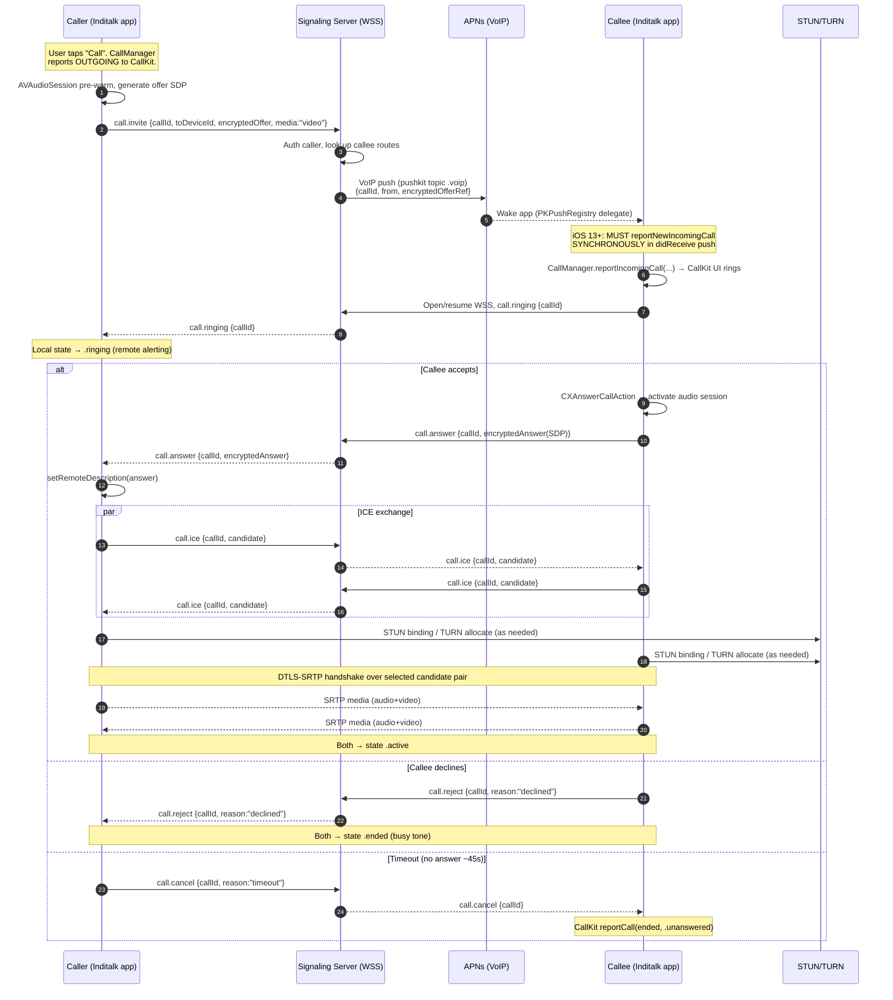
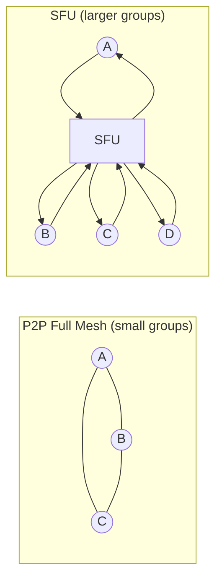
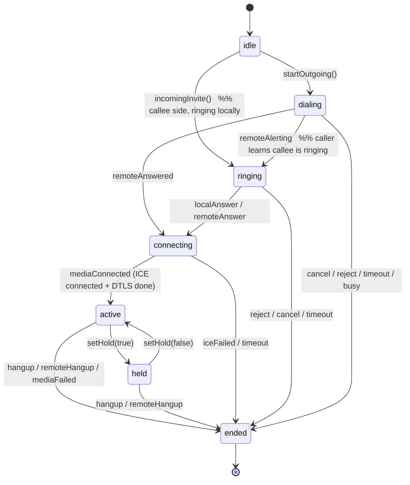
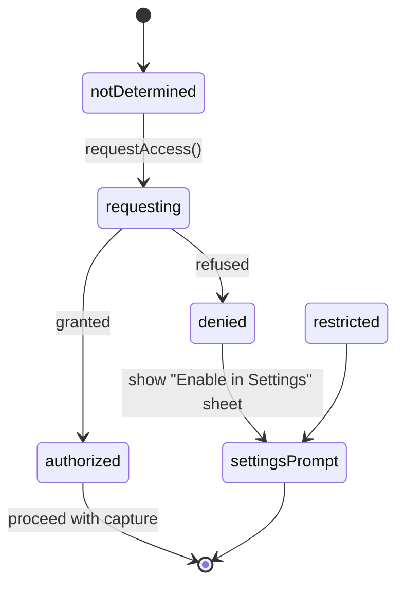

# Inditalk — Phase 4: Voice & Video Calling Architecture

**Status:** Draft / Engineering Design
**Owner:** Real-Time Media team
**Platform:** Native iOS (Swift 6, SwiftUI, MVVM, Combine + async/await)
**Last updated:** 2026-07-24

---

## 0. Scope & Non-Goals

This document specifies the calling subsystem for **Inditalk**, an original native iOS
private-messaging app. It covers 1:1 and small-group voice/video calls: the
end-to-end signaling flow, CallKit + PushKit integration, the media-transport
technology decision, the client-side call state machine, permission handling,
and concrete Swift skeletons for the two central components (`CallManager`,
`SignalingClient`).

**Inditalk is an original product.** It is not WhatsApp, Signal, or Telegram, and it
copies none of their branding, assets, or proprietary UI. Where this document
references the **Signal Protocol**, **WebRTC**, **APNs**, **SRTP**, or **ICE**, it
references them as open, published standards / prior art — not as products we clone.

**Non-goals for Phase 4:** call recording, PSTN/SIP gateway interop, live
transcription, screen sharing, and large broadcast rooms (>16 participants). These
are tracked separately and explicitly out of scope here.

> ### ⚠️ Security disclaimer (read first)
> **Nothing described here is "production-secure" as written.** The designs below
> are engineering intent. The cryptographic handshake, key-continuity guarantees,
> TURN-relay trust boundary, and metadata-minimization claims **require an
> independent third-party security audit and penetration test before any GA
> release.** See [§12 Limitations & Required Audit](#12-limitations--required-audit).

---

## 1. High-Level Architecture

```
┌─────────────────────────────────────────────────────────────────┐
│                         Inditalk iOS App                             │
│                                                                  │
│  SwiftUI Views ──▶ CallViewModel (@MainActor, ObservableObject)  │
│                          │  Combine / async-await                │
│        ┌─────────────────┼─────────────────────┐                 │
│        ▼                 ▼                     ▼                 │
│  CallManager        SignalingClient       MediaEngine            │
│  (CallKit +         (WSS + JSON,          (WebRTC wrapper:        │
│   PushKit +          async streams)        RTCPeerConnection)     │
│   AVAudioSession)                                                 │
└────────┬──────────────────┬──────────────────────┬──────────────┘
         │ VoIP push (APNs)  │ WSS signaling          │ SRTP media
         ▼                   ▼                        ▼
   ┌───────────┐     ┌────────────────┐      ┌──────────────────┐
   │   APNs    │     │  Signaling svc  │      │ STUN / TURN / SFU │
   │  (Apple)  │     │  (edge, stateless│      │  (media plane)    │
   └───────────┘     │  fan-out relay) │      └──────────────────┘
                     └────────────────┘
```

Three planes, deliberately separated so a compromise of one does not trivially
compromise the others:

| Plane | Transport | Carries | Trust posture |
|-------|-----------|---------|---------------|
| **Wakeup** | APNs VoIP push (PushKit) | Encrypted call-offer envelope, opaque call ID | Apple-operated; treated as untrusted courier |
| **Signaling** | WSS (TLS 1.3) + JSON | SDP, ICE candidates, call control | Server relays ciphertext control where possible; sees routing metadata |
| **Media** | SRTP over UDP (DTLS-SRTP keying) | Audio/video RTP | E2E between peers for P2P; SFU sees SRTP only if we hand it keys (see §5.3) |

The **signaling server is a relay, not an authority on content.** It routes
messages between authenticated devices. It cannot read media. It *can* observe
who-called-whom-and-when (call-metadata), which is a known limitation (§12).

---

## 2. End-to-End Call Flow

### 2.1 Sequence diagram — caller → signaling → callee (1:1)



### 2.2 Why this ordering matters

- The **VoIP push must arrive before or with the WSS invite** so the callee's app
  is guaranteed to wake even if suspended/killed. On iOS 13+, receiving a VoIP
  push obligates the app to call `reportNewIncomingCall` **before the
  `didReceiveIncomingPushWith` completion handler returns**, or the system may
  terminate the app and throttle future pushes. See [§4](#4-pushkit-voip-push).
- SDP offer/answer and ICE candidates are exchanged over the **already-authenticated
  WSS**, not over the push. The push carries only a small wakeup envelope; the full
  offer is fetched/exchanged over WSS to stay under APNs payload limits (5 KB) and
  to avoid trusting the push channel with large ciphertext.

---

## 3. CallKit Integration

CallKit gives Inditalk calls the native system call UI (full-screen incoming call,
lock-screen answering, Recents integration, audio-route control, and correct
interaction with cellular calls). We use three CallKit objects:

- **`CXProvider`** — reports call events *to* the system (incoming, connected,
  ended) and receives the user's UI actions via `CXProviderDelegate`.
- **`CXCallController`** — requests call *transactions* (start, answer, end, hold,
  mute) *from* our code into the system.
- **`CXCallUpdate`** — describes call metadata (remote handle, has-video) shown in
  the system UI.

### 3.1 Provider configuration

```swift
import CallKit

enum CallKitConfig {
    static func providerConfiguration() -> CXProviderConfiguration {
        // Note: the localizedName initializer is deprecated in iOS 14+;
        // set the display name via the app bundle. Kept explicit here for clarity.
        let config = CXProviderConfiguration()
        config.supportsVideo = true
        config.maximumCallGroups = 1          // Inditalk does not merge calls
        config.maximumCallsPerCallGroup = 1   // 1:1 today; group calls use a single CXCall
        config.supportedHandleTypes = [.generic] // Inditalk IDs, not phone numbers
        config.iconTemplateImageData = UIImage(named: "InditalkCallKitIcon")?
            .pngData()                        // 40x40 pt template, monochrome mask
        config.includesCallsInRecents = true
        // Ringtone bundled with the app (original asset, warm marimba motif).
        config.ringtoneSound = "cove_ring.caf"
        return config
    }
}
```

**Design note:** `supportedHandleTypes` is `.generic` because Inditalk identities are
opaque account IDs, not phone numbers. We never place an Inditalk contact into the
system's phone-number handle space (privacy + avoids accidental PSTN dialing).

### 3.2 Reporting an **incoming** call

Called from the PushKit delegate (see §4). Must be synchronous relative to the
push completion handler.

```swift
func reportIncomingCall(
    callId: UUID,
    from displayName: String,
    hasVideo: Bool,
    completion: @escaping (Error?) -> Void
) {
    let update = CXCallUpdate()
    update.remoteHandle = CXHandle(type: .generic, value: displayName)
    update.hasVideo = hasVideo
    update.supportsHolding = true
    update.supportsGrouping = false
    update.supportsUngrouping = false
    update.supportsDTMF = false

    provider.reportNewIncomingCall(with: callId, update: update) { error in
        // If error != nil (e.g. Do Not Disturb / user blocked), we must NOT
        // proceed to set up media, and should tell the server the callee is busy.
        completion(error)
    }
}
```

### 3.3 Reporting an **outgoing** call

```swift
func startOutgoingCall(callId: UUID, calleeHandle: String, hasVideo: Bool) {
    let handle = CXHandle(type: .generic, value: calleeHandle)
    let action = CXStartCallAction(call: callId, handle: handle)
    action.isVideo = hasVideo
    let transaction = CXTransaction(action: action)
    callController.request(transaction) { error in
        if let error { self.eventSubject.send(.failed(callId, .callKit(error))) }
    }
}
```

Lifecycle reports for the outgoing call, driven off signaling events:

```swift
// When we send the invite and the callee's device starts ringing:
provider.reportOutgoingCall(with: callId, startedConnectingAt: Date())
// When the callee answers and media negotiation begins:
provider.reportOutgoingCall(with: callId, connectedAt: Date())
```

### 3.4 `CXProviderDelegate`

```swift
extension CallManager: CXProviderDelegate {

    func providerDidReset(_ provider: CXProvider) {
        // System tore down all calls (e.g. audio subsystem reset).
        // Hard-stop every RTCPeerConnection immediately.
        mediaEngine.terminateAll()
        activeCalls.removeAll()
    }

    // User accepted (from lock screen / banner / CallKit UI).
    func provider(_ provider: CXProvider, perform action: CXAnswerCallAction) {
        guard let call = activeCalls[action.callUUID] else {
            action.fail(); return
        }
        // Do NOT activate the audio session here; wait for
        // didActivate audioSession below. Just prepare media.
        Task {
            do {
                try await mediaEngine.prepareToAnswer(call)
                action.fulfill()                     // tells system UI "connected"
            } catch {
                action.fail()
            }
        }
    }

    func provider(_ provider: CXProvider, perform action: CXEndCallAction) {
        Task {
            await mediaEngine.hangUp(action.callUUID)
            await signaling.send(.hangup(callId: action.callUUID, reason: .localEnded))
            action.fulfill()
            activeCalls[action.callUUID] = nil
        }
    }

    func provider(_ provider: CXProvider, perform action: CXSetHeldCallAction) {
        mediaEngine.setHold(action.callUUID, held: action.isOnHold)
        action.fulfill()
    }

    func provider(_ provider: CXProvider, perform action: CXSetMutedCallAction) {
        mediaEngine.setMicrophoneEnabled(action.callUUID, enabled: !action.isMuted)
        action.fulfill()
    }

    func provider(_ provider: CXStartCallAction, perform action: CXStartCallAction) { /* see §3.3 path */ }

    // CRITICAL: activate WebRTC audio only after CallKit hands us the session.
    func provider(_ provider: CXProvider, didActivate audioSession: AVAudioSession) {
        // WebRTC's RTCAudioSession must be told the session is active; do not
        // call setActive(true) yourself — CallKit already did.
        mediaEngine.audioSessionDidActivate(audioSession)
    }

    func provider(_ provider: CXProvider, didDeactivate audioSession: AVAudioSession) {
        mediaEngine.audioSessionDidDeactivate(audioSession)
    }
}
```

### 3.5 Audio session activation — the subtle part

The single most common CallKit bug is fighting CallKit over the audio session.
Rules Inditalk follows:

1. **Configure** the `AVAudioSession` category/mode **before** requesting or
   answering (`.playAndRecord`, mode `.voiceChat`, options `.allowBluetooth`,
   `.mixWithOthers` off) — but **do not** call `setActive(true)`.
2. **Never** call `AVAudioSession.setActive(true)` yourself for a CallKit call.
   CallKit activates it and notifies you via
   `provider(_:didActivate:)`. That callback is the *only* place WebRTC audio
   (`RTCAudioSession.audioSessionDidActivate`) is started.
3. With WebRTC, set `RTCAudioSession.sharedInstance().useManualAudio = true` and
   `isAudioEnabled = false` until `didActivate` fires, then flip `isAudioEnabled = true`.

```swift
func configureAudioSessionForCall(video: Bool) throws {
    let session = AVAudioSession.sharedInstance()
    try session.setCategory(
        .playAndRecord,
        mode: video ? .videoChat : .voiceChat,
        options: [.allowBluetooth, .allowBluetoothA2DP, .duckOthers]
    )
    // NO setActive(true) — CallKit owns activation.
    let rtc = RTCAudioSession.sharedInstance()
    rtc.useManualAudio = true
    rtc.isAudioEnabled = false
}
```

---

## 4. PushKit VoIP Push

### 4.1 Why VoIP pushes specifically

A regular APNs alert push cannot reliably launch a killed/suspended app fast
enough to ring, and iOS may batch or delay it. **PushKit VoIP pushes** are the
Apple-sanctioned mechanism for incoming calls: they wake the app in the
background with high priority so it can immediately present the incoming-call UI.

### 4.2 The iOS 13+ hard requirement

Since iOS 13, **every VoIP push must result in a call to
`CXProvider.reportNewIncomingCall(with:update:completion:)` before the
`didReceiveIncomingPushWith` completion handler returns.** If the app receives a
VoIP push and does *not* report a call to CallKit, iOS terminates the app and,
after repeated offenses, stops delivering VoIP pushes to it entirely. This means:

- We must **never** use a VoIP push for anything other than an incoming call
  (no "silent data sync" abuse).
- The wakeup path must be able to report *some* incoming call even under
  degraded conditions — if the encrypted payload can't be processed, we still
  report a call with a generic handle, then reconcile/cancel over WSS.

### 4.3 Registration

```swift
import PushKit

final class VoIPPushRegistrar: NSObject, PKPushRegistryDelegate {
    private let registry = PKPushRegistry(queue: .main)
    private let onToken: (Data) -> Void
    private let onIncoming: (VoIPPayload, @escaping () -> Void) -> Void

    init(onToken: @escaping (Data) -> Void,
         onIncoming: @escaping (VoIPPayload, @escaping () -> Void) -> Void) {
        self.onToken = onToken
        self.onIncoming = onIncoming
        super.init()
        registry.delegate = self
        registry.desiredPushTypes = [.voIP]
    }

    func pushRegistry(_ registry: PKPushRegistry,
                      didUpdate credentials: PKPushCredentials,
                      for type: PKPushType) {
        // Upload this VoIP token to Inditalk's signaling backend, keyed by deviceId.
        onToken(credentials.token)
    }

    func pushRegistry(_ registry: PKPushRegistry,
                      didReceiveIncomingPushWith payload: PKPushPayload,
                      for type: PKPushType,
                      completion: @escaping () -> Void) {
        guard type == .voIP,
              let parsed = VoIPPayload(payload.dictionaryPayload) else {
            // MUST still report *some* call or iOS penalizes us.
            reportFallbackCall(completion: completion)
            return
        }
        // onIncoming MUST synchronously call reportNewIncomingCall,
        // then invoke completion() once CallKit has been told.
        onIncoming(parsed, completion)
    }
}
```

### 4.4 VoIP push payload schema

APNs `apns-push-type: voip`, topic `<bundleid>.voip`, `apns-priority: 10`.
Payload budget ≤ 5 KB; we keep it small and treat it as an opaque wakeup token,
not as the source of truth.

```json
{
  "aps": {},
  "cove": {
    "v": 1,
    "type": "call.invite",
    "callId": "5F2C9A0E-3B14-4D8A-9E77-0A1B2C3D4E5F",
    "fromDeviceId": "d:8fc31a…",
    "media": "video",
    "displayNameCipher": "b64:Aes256Gcm(nonce||ct||tag)",
    "offerRef": "wss-fetch",
    "sentAt": 1753305600,
    "ttl": 45
  }
}
```

| Field | Meaning |
|-------|---------|
| `callId` | UUID used identically by CallKit (`reportNewIncomingCall`), signaling, and media |
| `fromDeviceId` | Opaque sender device id (routing only; no PII) |
| `media` | `"audio"` \| `"video"` — sets `CXCallUpdate.hasVideo` |
| `displayNameCipher` | Caller display name, **encrypted** so the push courier (Apple/network) can't read it; decrypted client-side with the session key |
| `offerRef` | `"wss-fetch"` means "the full SDP offer is waiting on the WSS channel" — keeps push small and off the untrusted push path |
| `ttl` | Seconds the invite is valid; after this, auto-cancel + `reportCall(ended:.unanswered)` |

**Note:** `displayNameCipher` requires an established key with the peer. On a
first-ever contact with no key yet, we fall back to a neutral handle
("Inditalk call") and decrypt/update the handle after the WSS session establishes.
Whether this leaks anything meaningful is an audit item (§12).

---

## 5. Media Transport — Technology Decision

### 5.1 Decision

> **Adopt WebRTC** (via the standard Swift/Objective-C wrapper,
> `RTCPeerConnection` et al.) as Inditalk's media engine, rather than building a
> custom RTP/SRTP stack on Apple frameworks.

### 5.2 Options considered

| Option | Summary | Verdict |
|--------|---------|---------|
| **A. WebRTC** (Google, **BSD-3-Clause**) | Battle-tested RTP/SRTP, ICE, DTLS-SRTP keying, Opus/VP8/H.264, echo cancellation (AEC3), jitter buffer, bandwidth estimation (GCC) | **Chosen** |
| **B. Custom on Apple frameworks** | `Network.framework` (UDP/DTLS) + `AVAudioEngine`/`AVFoundation` capture + hand-rolled RTP + `VideoToolbox` H.264 | Rejected for v1 |
| **C. Third-party managed SDK** | Vendor SDK (e.g., a hosted RTC provider) | Rejected: recurring cost, closed source, data-plane trust, vendor lock-in |

**Why not Option B (custom):** we would have to re-implement, correctly and
securely, ICE/STUN/TURN, DTLS-SRTP, congestion control (GCC/transport-cc), NACK/PLI
retransmission, FEC, jitter buffering, and acoustic echo cancellation. AEC alone
is a multi-engineer-year problem. This is exactly the "don't roll your own"
territory — for media *and* for the SRTP crypto. We revisit a custom transport
only if a hard requirement (e.g., a codec WebRTC lacks) forces it.

### 5.3 Licensing analysis — WebRTC BSD-3-Clause

WebRTC is licensed **BSD-3-Clause** (permissive): we may use, modify, and ship it
in a closed-source commercial app, provided we **retain the copyright notice and
disclaimer** and **do not use the authors' names to endorse** our product. There
is no copyleft/source-disclosure obligation and no patent-grant beyond what BSD
implies.

Practical obligations we take on:
- Ship the BSD-3 license text + copyright notice in Inditalk's in-app
  "Acknowledgements" / open-source-licenses screen.
- Track the exact WebRTC build/commit we vendor (reproducible builds; we pin a
  known-good milestone rather than tracking tip-of-tree).
- **Codec patent caveat:** BSD covers the *code*, not third-party *patents*.
  **H.264** carries MPEG-LA/AVC patent-pool considerations; **VP8** and **Opus**
  are royalty-free. Legal must confirm H.264 licensing exposure for our
  distribution before we enable H.264 hardware encode broadly. Default to **VP8 +
  Opus** where hardware/interop allows; use H.264 (hardware) as an
  energy/thermal optimization where the licensing question is cleared. **This is
  an open legal item, flagged in §12.**

> This is the **only 3rd-party dependency** introduced by Phase 4. Everything else
> (CallKit, PushKit, AVFoundation, Network, CryptoKit) is first-party Apple.

### 5.4 P2P mesh vs SFU (group calls)



| Aspect | P2P mesh | SFU (Selective Forwarding Unit) |
|--------|----------|----------------------------------|
| Uplink cost per sender | Sends N−1 copies (one per peer) | Sends 1 copy to SFU |
| Scales to | ~3–4 participants before uplink/CPU/battery collapse | 16+ |
| Latency | Lowest (direct) | +1 hop |
| E2E encryption | Native (DTLS-SRTP peer↔peer) | Requires **Insertable Streams / SFrame** to keep media E2E; otherwise SFU sees plaintext media |
| Server media cost | None | Egress + CPU on SFU |

**Inditalk's staged plan:**
- **1:1 and 3-way:** **P2P mesh.** Direct DTLS-SRTP, no server touches media,
  strongest privacy, lowest latency.
- **4–16 participants:** **SFU.** To preserve end-to-end confidentiality through
  an SFU (so the SFU forwards but cannot decrypt), we plan **SFrame / insertable
  streams** end-to-end keying layered on top of DTLS-SRTP. **This E2E-through-SFU
  design is explicitly unaudited and not a security guarantee yet** (§12).

### 5.5 NAT traversal — STUN / TURN / ICE

- **STUN** lets each peer discover its public (server-reflexive) address so peers
  can attempt a direct connection through NAT.
- **ICE** gathers candidates (host, srflx via STUN, relay via TURN), pairs them,
  runs connectivity checks, and picks the best working pair.
- **TURN** relays media when a direct path is impossible (symmetric NAT, strict
  firewalls). ~10–20% of real-world calls need TURN. TURN is bandwidth-expensive
  (all media flows through it) so it's a fallback, not the default.

```
ICE candidate priority (typical):  host  >  srflx (STUN)  >  relay (TURN)
```

We run our own **coturn**-style STUN/TURN with **short-lived, per-call HMAC
credentials** (REST-style ephemeral credentials, e.g. 5-minute TTL) delivered
over WSS — never static long-lived TURN secrets in the client. TURN relays SRTP
ciphertext only; it cannot read media.

### 5.6 Codecs & bandwidth

| Media | Codec | Notes | Typical bitrate |
|-------|-------|-------|-----------------|
| Audio | **Opus** | Royalty-free, 8–48 kHz, in-band FEC + DTX (silence suppression) | 16–40 kbps |
| Video | **VP8** | Royalty-free default; software but universal in WebRTC | 150 kbps (LD) – 1.2 Mbps (HD) |
| Video | **H.264** (hardware, `VideoToolbox`) | Lower battery/thermal via HW encode; **patent-licensing caveat (§5.3)** | 150 kbps – 2.5 Mbps |

WebRTC's **GCC / transport-cc** congestion control adapts bitrate to measured
loss/RTT. We cap video to preserve battery and cellular data; on cellular we
default to a lower resolution/framerate ceiling and let the user opt into HD on
Wi-Fi.

### 5.7 Production tradeoffs

- **Battery/thermal:** Video encode is the dominant drain. Prefer **hardware
  H.264** where licensing is cleared; otherwise cap VP8 resolution/framerate. Drop
  to audio-only automatically under sustained thermal pressure
  (`ProcessInfo.thermalState == .serious/.critical`).
- **NAT traversal reliability:** Provision TURN generously; a call that fails ICE
  is a worse experience than a relayed one. Instrument the srflx-vs-relay ratio.
- **Scaling:** P2P has zero media-server cost but doesn't scale past ~3–4. SFU
  scales but adds egress cost and an E2E-encryption burden (SFrame). Plan SFU
  capacity per concurrent-call, not per user.
- **Interop/version pinning:** Pin the WebRTC milestone; upgrading WebRTC is a
  deliberate, tested event, not a silent bump.

---

## 6. Call State Machine

### 6.1 Diagram



### 6.2 Swift model

```swift
/// The lifecycle state of a single Inditalk call.
enum CallState: Equatable, Sendable {
    case idle
    case dialing        // outgoing: invite sent, awaiting remote alerting/answer
    case ringing        // incoming ringing locally, OR outgoing remote is alerting
    case connecting     // answered; ICE/DTLS negotiation in progress
    case active         // media flowing
    case held           // active call placed on hold (local or by CallKit)
    case ended(CallEndReason)
}

enum CallEndReason: Equatable, Sendable {
    case localEnded          // user hung up
    case remoteEnded         // peer hung up
    case declined            // callee rejected
    case busy                // callee on another call / DND
    case unanswered          // ttl/timeout expired
    case failed(CallError)   // media or signaling failure
}

/// Events that drive transitions. Fed from CallKit actions, signaling, and media.
enum CallEvent: Sendable {
    case startOutgoing(callId: UUID, video: Bool)
    case incomingInvite(callId: UUID, video: Bool)
    case remoteAlerting          // callee device is ringing
    case localAnswer             // CXAnswerCallAction fulfilled
    case remoteAnswered(sdp: SessionDescription)
    case mediaConnected          // RTCIceConnectionState.connected + DTLS complete
    case setHold(Bool)
    case hangup                  // local end
    case remoteHangup
    case reject
    case cancel
    case timeout
    case mediaFailed(CallError)
}
```

### 6.3 Reducer

The reducer is pure and total; illegal transitions are logged and ignored (the
machine never traps on an unexpected event, important because signaling and
CallKit can race).

```swift
struct CallReducer {
    /// Returns the next state (nil = ignore event in this state).
    static func reduce(_ state: CallState, _ event: CallEvent) -> CallState? {
        switch (state, event) {
        case (.idle, .startOutgoing):            return .dialing
        case (.idle, .incomingInvite):           return .ringing
        case (.dialing, .remoteAlerting):        return .ringing
        case (.dialing, .remoteAnswered),
             (.ringing, .localAnswer),
             (.ringing, .remoteAnswered):        return .connecting
        case (.connecting, .mediaConnected):     return .active
        case (.active, .setHold(true)):          return .held
        case (.held, .setHold(false)):           return .active
        case (_, .hangup):                       return .ended(.localEnded)
        case (_, .remoteHangup):                 return .ended(.remoteEnded)
        case (.ringing, .reject),
             (.dialing, .reject):                return .ended(.declined)
        case (_, .cancel):                       return .ended(.unanswered)
        case (_, .timeout):                      return .ended(.unanswered)
        case (_, .mediaFailed(let e)):           return .ended(.failed(e))
        default:                                 return nil // illegal / no-op
        }
    }
}
```

---

## 7. Error Model

```swift
enum CallError: Error, Equatable, Sendable {
    // Signaling
    case signalingUnreachable          // WSS could not connect
    case signalingClosed(code: Int)    // server closed the socket
    case invitationExpired             // ttl elapsed before answer
    case peerBusy
    case peerDeclined

    // Media / WebRTC
    case iceGatheringFailed
    case iceConnectionFailed           // no working candidate pair
    case dtlsHandshakeFailed
    case sdpNegotiationFailed(String)
    case mediaEngineInternal(String)

    // Permissions / OS
    case microphoneDenied
    case cameraDenied
    case callKitReportFailed
    case audioSessionActivationFailed

    // Envelope / crypto
    case decryptOfferFailed
    case unknownSenderDevice
}
```

### 7.1 Wire error envelope (WSS)

Server- and peer-originated failures share one JSON shape:

```json
{
  "type": "call.error",
  "callId": "5F2C9A0E-3B14-4D8A-9E77-0A1B2C3D4E5F",
  "code": "PEER_BUSY",
  "retriable": false,
  "detail": "Callee is in another call",
  "at": 1753305612
}
```

| `code` | Maps to `CallError` | `retriable` |
|--------|---------------------|-------------|
| `PEER_BUSY` | `.peerBusy` | false |
| `PEER_OFFLINE` | `.signalingUnreachable` (routing) | true (retry via push) |
| `INVITE_EXPIRED` | `.invitationExpired` | false |
| `ICE_FAILED` | `.iceConnectionFailed` | true (renegotiate/relay) |
| `AUTH_FAILED` | (session error) | false |

---

## 8. Camera & Microphone Permissions

### 8.1 Info.plist keys (required)

```xml
<key>NSMicrophoneUsageDescription</key>
<string>Inditalk uses your microphone so you can talk during calls.</string>

<key>NSCameraUsageDescription</key>
<string>Inditalk uses your camera for video calls.</string>

<!-- Background execution for VoIP + audio during calls -->
<key>UIBackgroundModes</key>
<array>
    <string>voip</string>
    <string>audio</string>
</array>
```

> **Note:** the legacy top-level `voip` UIBackgroundMode remains required for the
> app to run VoIP networking; incoming-call *wakeups* are delivered via **PushKit**
> (§4), which is the modern path. The `audio` mode keeps audio alive when the
> call UI is backgrounded.

### 8.2 Authorization flow



### 8.3 Swift — gated pre-flight before offering media

We request permissions **before** generating an SDP offer/answer, so we never
create media tracks we're not allowed to use, and so we degrade gracefully
(video-call request with camera denied → offer audio-only, tell the user).

```swift
import AVFoundation

enum MediaPermission {
    static func ensure(video: Bool) async -> Result<Void, CallError> {
        let mic = await request(.audio)
        guard mic else { return .failure(.microphoneDenied) }
        if video {
            let cam = await request(.video)
            guard cam else { return .failure(.cameraDenied) }
        }
        return .success(())
    }

    private static func request(_ type: AVMediaType) async -> Bool {
        switch AVCaptureDevice.authorizationStatus(for: type) {
        case .authorized:
            return true
        case .notDetermined:
            return await AVCaptureDevice.requestAccess(for: type)
        case .denied, .restricted:
            return false
        @unknown default:
            return false
        }
    }
}
```

**Incoming-call nuance:** when a VoIP push arrives and the mic is denied, we still
`reportNewIncomingCall` (iOS requirement, §4.2), but on answer we immediately end
the call with a user-visible "Microphone access is off for Inditalk" message and route
the user to Settings. We never silently drop the push.

---

## 9. `CallManager` Skeleton (CallKit + PushKit + orchestration)

`CallManager` is the `@MainActor` façade that owns CallKit objects, bridges
PushKit, and coordinates the state machine with `SignalingClient` and the media
engine. `CallViewModel` observes it via the published state.

```swift
import CallKit
import PushKit
import AVFoundation
import Combine

@MainActor
final class CallManager: NSObject, ObservableObject {

    // MARK: Published UI state
    @Published private(set) var state: CallState = .idle
    @Published private(set) var currentCallId: UUID?

    // MARK: CallKit
    private let provider: CXProvider
    private let callController = CXCallController()

    // MARK: Collaborators
    private let signaling: SignalingClient
    private let mediaEngine: MediaEngine        // WebRTC wrapper (RTCPeerConnection)
    private var registrar: VoIPPushRegistrar!

    // MARK: Bookkeeping
    private struct ActiveCall {
        let id: UUID
        var video: Bool
        var isIncoming: Bool
    }
    private var activeCalls: [UUID: ActiveCall] = [:]
    private var cancellables = Set<AnyCancellable>()

    init(signaling: SignalingClient, mediaEngine: MediaEngine) {
        self.signaling = signaling
        self.mediaEngine = mediaEngine
        self.provider = CXProvider(configuration: CallKitConfig.providerConfiguration())
        super.init()
        provider.setDelegate(self, queue: nil)

        self.registrar = VoIPPushRegistrar(
            onToken: { [weak self] token in
                Task { await self?.signaling.registerVoIPToken(token) }
            },
            onIncoming: { [weak self] payload, completion in
                // MUST report to CallKit before completion() returns.
                self?.handleIncomingPush(payload, completion: completion)
            }
        )

        bindSignaling()
    }

    // MARK: Outgoing

    func placeCall(to calleeHandle: String, deviceId: String, video: Bool) async {
        guard case .success = await MediaPermission.ensure(video: video) else {
            state = .ended(.failed(video ? .cameraDenied : .microphoneDenied)); return
        }
        let callId = UUID()
        activeCalls[callId] = ActiveCall(id: callId, video: video, isIncoming: false)
        currentCallId = callId
        apply(.startOutgoing(callId: callId, video: video))

        // Tell system this is an outgoing call (system UI + Recents).
        let handle = CXHandle(type: .generic, value: calleeHandle)
        let start = CXStartCallAction(call: callId, handle: handle)
        start.isVideo = video
        do {
            try await callController.request(CXTransaction(action: start))
            try await mediaEngine.createPeerConnection(for: callId, video: video)
            let offer = try await mediaEngine.createOffer(for: callId)
            await signaling.send(.invite(callId: callId,
                                          toDeviceId: deviceId,
                                          media: video ? .video : .audio,
                                          offer: offer))
            provider.reportOutgoingCall(with: callId, startedConnectingAt: Date())
        } catch {
            apply(.mediaFailed(.mediaEngineInternal("\(error)")))
        }
    }

    // MARK: Incoming (from PushKit)

    private func handleIncomingPush(_ payload: VoIPPayload, completion: @escaping () -> Void) {
        let callId = payload.callId
        activeCalls[callId] = ActiveCall(id: callId, video: payload.isVideo, isIncoming: true)
        currentCallId = callId

        let update = CXCallUpdate()
        update.remoteHandle = CXHandle(type: .generic, value: payload.displayName ?? "Inditalk call")
        update.hasVideo = payload.isVideo
        update.supportsHolding = true

        provider.reportNewIncomingCall(with: callId, update: update) { [weak self] error in
            if let error {
                // e.g. DND / blocked — tell server callee is unavailable.
                Task { await self?.signaling.send(.reject(callId: callId, reason: .busy)) }
                self?.activeCalls[callId] = nil
            } else {
                self?.apply(.incomingInvite(callId: callId, video: payload.isVideo))
                // Ensure WSS is up to receive the full offer + ICE.
                Task { await self?.signaling.ensureConnected() }
            }
            completion() // <-- MUST be called; releases the push
        }
    }

    // MARK: Signaling → state machine

    private func bindSignaling() {
        Task { [weak self] in
            guard let self else { return }
            for await message in signaling.inbound {
                await self.route(message)
            }
        }
    }

    private func route(_ msg: SignalingClient.Inbound) async {
        switch msg {
        case let .offer(callId, sdp):
            try? await mediaEngine.setRemoteOffer(sdp, for: callId)
        case .ringing(let callId) where callId == currentCallId:
            apply(.remoteAlerting)
        case let .answer(callId, sdp):
            try? await mediaEngine.setRemoteAnswer(sdp, for: callId)
            apply(.remoteAnswered(sdp: sdp))
        case let .ice(callId, candidate):
            try? await mediaEngine.addIceCandidate(candidate, for: callId)
        case .hangup:
            apply(.remoteHangup)
            endSystemCall(currentCallId, reason: .remoteEnded)
        case let .reject(_, reason):
            apply(reason == .busy ? .reject : .reject) // maps to .declined/busy in reducer
            endSystemCall(currentCallId, reason: .declined)
        case let .error(callId, err):
            apply(.mediaFailed(err)); endSystemCall(callId, reason: .failed(err))
        }
    }

    // MARK: State machine driver

    private func apply(_ event: CallEvent) {
        guard let next = CallReducer.reduce(state, event) else {
            log("Ignored illegal event \(event) in state \(state)")
            return
        }
        state = next
        onEnter(next)
    }

    private func onEnter(_ state: CallState) {
        switch state {
        case .active:
            if let id = currentCallId {
                provider.reportOutgoingCall(with: id, connectedAt: Date())
            }
        case .ended(let reason):
            currentCallId.map { activeCalls[$0] = nil }
            currentCallId = nil
        default: break
        }
    }

    private func endSystemCall(_ id: UUID?, reason: CallEndReason) {
        guard let id else { return }
        let cxReason: CXCallEndedReason = switch reason {
            case .declined, .busy: .declinedElsewhere
            case .unanswered:      .unanswered
            case .remoteEnded, .localEnded: .remoteEnded
            case .failed:          .failed
        }
        provider.reportCall(with: id, endedAt: Date(), reason: cxReason)
    }

    private func log(_ s: String) { /* structured logging, no PII */ }
}
```

`CXProviderDelegate` conformance is as shown in [§3.4](#34-cxproviderdelegate);
`didActivate`/`didDeactivate` drive `mediaEngine.audioSessionDidActivate(...)`.

---

## 10. `SignalingClient` Skeleton

`SignalingClient` owns the authenticated WSS connection and exposes inbound
messages as an `AsyncStream`. It uses `URLSessionWebSocketTask`, auto-reconnects
with jittered backoff, and (re)establishes on demand when a VoIP push wakes the
app.

```swift
import Foundation

actor SignalingClient {

    // MARK: Outbound (client → server)
    enum Outbound: Encodable {
        case invite(callId: UUID, toDeviceId: String, media: MediaKind, offer: SessionDescription)
        case ringing(callId: UUID)
        case answer(callId: UUID, sdp: SessionDescription)
        case ice(callId: UUID, candidate: IceCandidate)
        case hangup(callId: UUID, reason: CallEndReason)
        case reject(callId: UUID, reason: CallEndReason)
        case cancel(callId: UUID, reason: CallEndReason)
    }

    // MARK: Inbound (server → client)
    enum Inbound: Sendable {
        case offer(callId: UUID, sdp: SessionDescription)
        case ringing(callId: UUID)
        case answer(callId: UUID, sdp: SessionDescription)
        case ice(callId: UUID, candidate: IceCandidate)
        case hangup(callId: UUID)
        case reject(callId: UUID, reason: CallEndReason)
        case error(callId: UUID, CallError)
    }

    // MARK: State
    private var task: URLSessionWebSocketTask?
    private let session = URLSession(configuration: .default)
    private let endpoint: URL
    private let authProvider: () async throws -> String   // returns bearer/session token
    private var reconnectAttempt = 0

    private var continuation: AsyncStream<Inbound>.Continuation?
    nonisolated let inbound: AsyncStream<Inbound>

    init(endpoint: URL, authProvider: @escaping () async throws -> String) {
        self.endpoint = endpoint
        self.authProvider = authProvider
        var cont: AsyncStream<Inbound>.Continuation!
        self.inbound = AsyncStream { cont = $0 }
        self.continuation = cont
    }

    // MARK: Connection lifecycle

    func ensureConnected() async {
        guard task == nil else { return }
        await connect()
    }

    private func connect() async {
        do {
            let token = try await authProvider()
            var req = URLRequest(url: endpoint)
            req.setValue("Bearer \(token)", forHTTPHeaderField: "Authorization")
            req.setValue("cove.v1", forHTTPHeaderField: "Sec-WebSocket-Protocol")
            let ws = session.webSocketTask(with: req)
            self.task = ws
            ws.resume()
            reconnectAttempt = 0
            await receiveLoop()
        } catch {
            await scheduleReconnect()
        }
    }

    private func receiveLoop() async {
        guard let task else { return }
        do {
            while true {
                let message = try await task.receive()
                switch message {
                case .string(let text):
                    if let parsed = decodeInbound(text) { continuation?.yield(parsed) }
                case .data(let data):
                    if let text = String(data: data, encoding: .utf8),
                       let parsed = decodeInbound(text) { continuation?.yield(parsed) }
                @unknown default: break
                }
            }
        } catch {
            self.task = nil
            await scheduleReconnect()
        }
    }

    private func scheduleReconnect() async {
        reconnectAttempt += 1
        let base = min(pow(2.0, Double(reconnectAttempt)), 30) // cap 30s
        let jitter = Double.random(in: 0...(base * 0.3))
        try? await Task.sleep(nanoseconds: UInt64((base + jitter) * 1_000_000_000))
        await connect()
    }

    // MARK: Send

    func send(_ message: Outbound) async {
        await ensureConnected()
        guard let task, let json = encodeOutbound(message) else { return }
        try? await task.send(.string(json))
    }

    func registerVoIPToken(_ token: Data) async {
        // POST token to backend keyed by device id (out of band or over WSS).
    }

    // MARK: Codec (JSON <-> enum) — real wire format below in §10.1
    private func encodeOutbound(_ m: Outbound) -> String? { /* JSONEncoder */ nil }
    private func decodeInbound(_ text: String) -> Inbound? { /* JSONDecoder + type tag */ nil }
}
```

### 10.1 WSS message wire formats

All messages are JSON objects with a `type` discriminator and a `callId`. SDP and
ICE payloads are carried in the fields WebRTC expects.

**`call.invite`** (client → server):
```json
{
  "type": "call.invite",
  "callId": "5F2C9A0E-3B14-4D8A-9E77-0A1B2C3D4E5F",
  "toDeviceId": "d:8fc31a…",
  "media": "video",
  "offer": {
    "type": "offer",
    "sdp": "v=0\r\no=- 46117312 2 IN IP4 127.0.0.1\r\ns=-\r\nt=0 0\r\na=group:BUNDLE 0 1\r\n..."
  }
}
```

**`call.answer`** (callee → server → caller):
```json
{
  "type": "call.answer",
  "callId": "5F2C9A0E-3B14-4D8A-9E77-0A1B2C3D4E5F",
  "sdp": {
    "type": "answer",
    "sdp": "v=0\r\no=- 82631 2 IN IP4 127.0.0.1\r\ns=-\r\nt=0 0\r\n..."
  }
}
```

**`call.ice`** (trickle ICE, either direction):
```json
{
  "type": "call.ice",
  "callId": "5F2C9A0E-3B14-4D8A-9E77-0A1B2C3D4E5F",
  "candidate": {
    "candidate": "candidate:842163049 1 udp 1677729535 203.0.113.7 54321 typ srflx raddr 10.0.0.4 rport 54321 generation 0",
    "sdpMid": "0",
    "sdpMLineIndex": 0
  }
}
```

**`call.ringing` / `call.hangup` / `call.reject`** (control):
```json
{ "type": "call.ringing", "callId": "5F2C9A0E-…" }
{ "type": "call.hangup",  "callId": "5F2C9A0E-…", "reason": "localEnded" }
{ "type": "call.reject",  "callId": "5F2C9A0E-…", "reason": "declined" }
```

### 10.2 Shared media value types

```swift
struct SessionDescription: Codable, Sendable {
    enum Kind: String, Codable, Sendable { case offer, answer, pranswer, rollback }
    let type: Kind
    let sdp: String
}

struct IceCandidate: Codable, Sendable {
    let candidate: String
    let sdpMid: String?
    let sdpMLineIndex: Int32
}

enum MediaKind: String, Codable, Sendable { case audio, video }
```

---

## 11. UI Notes (Inditalk palette)

The in-call surface is native SwiftUI over CallKit's system UI. When Inditalk's own
in-app call screen is shown (returning to the app mid-call), it uses the product
palette:

- **Background:** warm parchment `#F5F0E6`.
- **Primary action / connected accent:** deep slate-blue `#2A3D5C` (end-call
  button inverts to a warm red for clarity).
- **Secondary controls (mute, speaker, video toggle):** muted ochre `#B8873A`
  chips on parchment.
- **Avatars:** circular, centered during audio-only calls; the remote video fills
  the frame during video calls with a small circular self-view.
- **Navigation:** the app's standard bottom tab bar is hidden during an active
  call; a slim "return to call" pill appears at the top when the call is
  backgrounded.

These are UI conventions only; none imitate a competitor's proprietary layout.

---

## 12. Limitations & Required Audit

> **This system is NOT production-secure as specified.** The following must be
> independently reviewed and resolved before any general-availability release.

1. **Cryptographic handshake unaudited.** The E2E media key agreement (DTLS-SRTP
   fingerprint binding to Inditalk identities, and any SFrame keying for SFU) has
   **not** been reviewed by an independent cryptographer. DTLS-SRTP alone
   authenticates the transport, not the *human*; binding SDP fingerprints to
   verified Inditalk identity keys (Signal-Protocol-style) is required and unverified.
2. **Signaling metadata exposure.** The signaling server observes who calls whom,
   when, and for how long. This call-metadata is not hidden by anything here.
   Metadata-minimization (sealed-sender-style routing) is a follow-up, unbuilt.
3. **Push-payload confidentiality.** `displayNameCipher` depends on a pre-shared
   session key; first-contact and re-key edge cases may leak a neutral handle.
   The exact leakage surface must be threat-modeled.
4. **TURN relay trust.** TURN relays SRTP ciphertext but is a network chokepoint
   and a metadata vantage point. Ephemeral-credential rotation and relay
   operator trust boundaries need review.
5. **SFU end-to-end encryption is aspirational.** E2E-through-SFU via SFrame /
   insertable streams is a *plan*, not a shipped, verified guarantee. Until
   audited, group calls through the SFU should be treated as **not** end-to-end
   encrypted.
6. **H.264 patent licensing is unresolved (legal).** See §5.3. Do not enable
   H.264 broadly in distribution until legal clears MPEG-LA/AVC exposure.
7. **WebRTC supply chain.** We vendor a large 3rd-party (BSD-3) codebase. Pin,
   reproducibly build, and monitor CVEs; an un-pinned or unpatched WebRTC is a
   material risk.
8. **Denial-of-service / call-spam.** Rate-limiting of `call.invite` and VoIP
   push abuse mitigation are not specified here and must be designed before GA.

**Action:** commission an independent third-party security audit and penetration
test covering items 1–8, plus a formal privacy review of call-metadata handling,
before Inditalk calling ships to the public.

---

## 13. Dependency Summary

| Dependency | Source | License | Why needed |
|------------|--------|---------|------------|
| **WebRTC** | Google (`webrtc.googlesource.com`) | **BSD-3-Clause** (permissive) | Media transport: RTP/SRTP, ICE, DTLS-SRTP, Opus/VP8/H.264, AEC, congestion control. Re-implementing is impractical & error-prone. **Only 3rd-party dep in Phase 4.** |
| CallKit | Apple | System | Native call UI, audio session coordination, Recents |
| PushKit | Apple | System | VoIP wakeup pushes for incoming calls |
| AVFoundation / AVAudioSession | Apple | System | Capture, audio routing |
| Network.framework | Apple | System | Connectivity/path monitoring |
| CryptoKit | Apple | System | Envelope encryption (push payload), key handling |
| VideoToolbox | Apple | System | Hardware H.264 encode/decode (battery) |

---

*End of Phase 4 design. Reminder: nothing herein is production-secure until the
audit in §12 is complete.*
