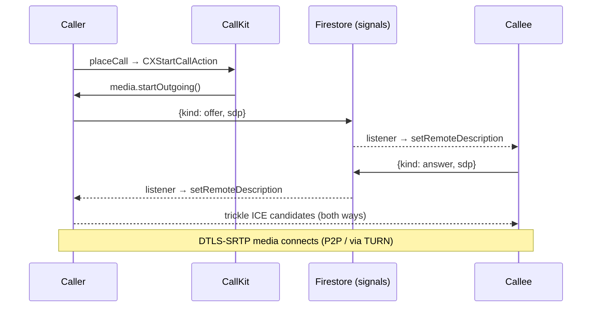

# Inditalk calling — WebRTC over Firestore signaling

This is the concrete signaling implementation for the calling architecture in
[`PHASE4_CALLING.md`](PHASE4_CALLING.md). Media transport is **WebRTC** (BSD-3); the
SDP/ICE handshake is carried over **Firestore** (it's already realtime, so no separate
signaling server is needed for 1:1 calls).

## Pieces

| File | Role | Verified here |
|---|---|---|
| [`CallSignaling.swift`](../Inditalk/Inditalk/Services/Calling/CallSignaling.swift) | `CallSignal` models + `SignalingChannel` protocol | ✅ type-check + JSON round-trip |
| [`CallSessionMachine.swift`](../Inditalk/Inditalk/Services/Calling/CallSessionMachine.swift) | Pure call state machine | ✅ ran green (9/9) |
| [`FirestoreSignalingService.swift`](../Inditalk/Inditalk/Services/Calling/FirestoreSignalingService.swift) | `SignalingChannel` over Firestore | glue (needs SDK) |
| [`WebRTCMediaSession.swift`](../Inditalk/Inditalk/Services/Calling/WebRTCMediaSession.swift) | `CallMediaSession` via RTCPeerConnection | glue (needs SDK) |
| [`CallCenter.swift`](../Inditalk/Inditalk/Services/Calling/CallCenter.swift) | Orchestrates CallKit + signaling + media | glue (needs SDK) |
| [`CallManager.swift`](../Inditalk/Inditalk/Services/Calling/CallManager.swift) | CallKit (CXProvider) + PushKit VoIP | glue (needs SDK) |

## Firestore layout

```
calls/{callId}                 { from, to, media: "voice"|"video", state, createdAt }
calls/{callId}/signals/{id}    CallSignal { from, to, kind, sdp?, candidate?, createdAt }
```

`kind ∈ { ringing, offer, answer, candidate, hangup, decline, busy }`.
Access is locked to the two parties by [`firestore.rules`](../firestore.rules); a
signal must be authored by `request.auth.uid`.

## Outgoing call



## Incoming call

Production alerts the callee with a **PushKit VoIP push** (`CallManager` +
`VoIPPushHandler`), which must call `reportIncoming` immediately (iOS 13+ rule). In the
foreground, `CallCenter.startListening()` also watches `calls where to == myUID &&
state == "ringing"` as a fallback. Either way → CallKit native incoming UI → on answer,
`media.accept()` answers the buffered offer.

## Security & limitations

- WebRTC mandates **DTLS-SRTP**, so call audio/video is encrypted peer-to-peer.
- Signaling **metadata** (who called whom, when, media type) transits Firestore in the
  clear — same metadata exposure as messaging.
- Add a **TURN** server for reliable NAT traversal (the code ships with a public STUN
  server only — fine for testing, not for production reachability).
- Group calls need an **SFU** (mesh doesn't scale past ~4); out of scope here.
- **Not production-secure** until the media + signaling stack is independently audited.

## Wiring it up

Once the WebRTC + Firebase packages are added: after sign-in call
`CallCenter.shared.startListening()`; from a chat/contact "call" button call
`CallCenter.shared.placeCall(to: peerUID, peerName:, video:)`. The active-call screens
([`VoiceCallView`](../Inditalk/Inditalk/Features/ActiveCall/VoiceCallView.swift) /
[`VideoCallView`](../Inditalk/Inditalk/Features/ActiveCall/VideoCallView.swift)) currently run
on the local `CallViewModel` simulation; point them at `CallCenter.shared.state` and
feed the remote video track from `WebRTCMediaSession.onRemoteVideoTrack` into an
`RTCMTLVideoView` to show live media.
```
