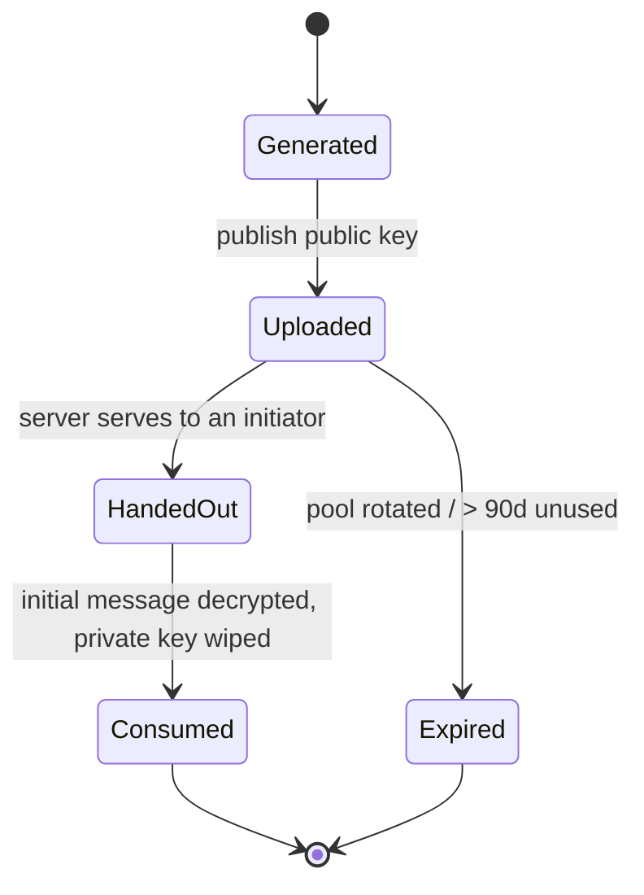
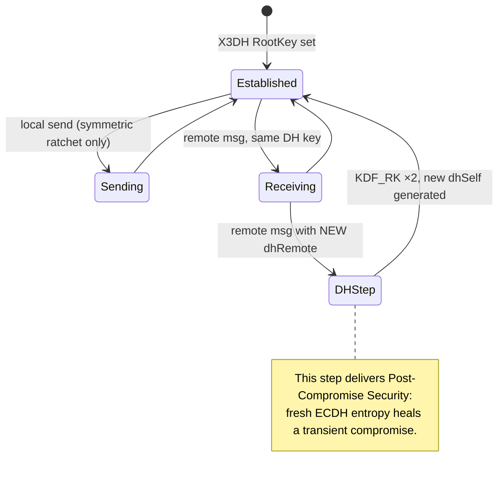
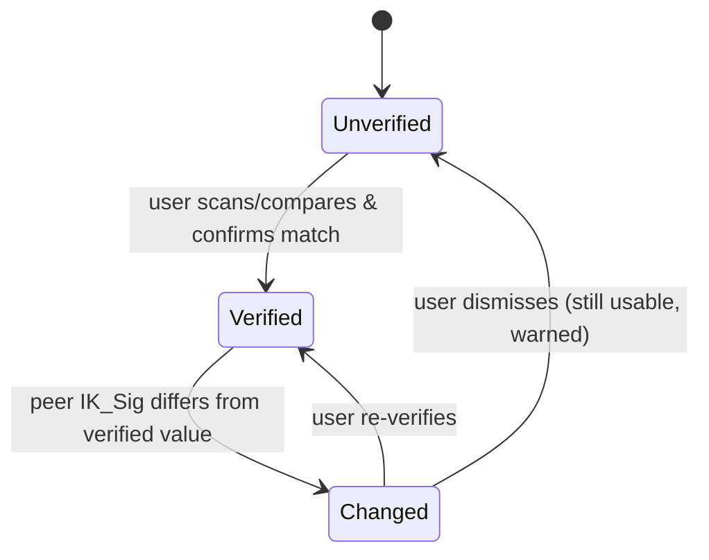

# Inditalk — Phase 5: End-to-End Encryption Design

> **Status:** Architecture / reference implementation. **Not production-secure.** See [§13 Limitations](#13-limitations--requires-independent-audit).
>
> **Product:** Inditalk is an **original** native iOS private-messaging app. It is not WhatsApp, Signal, or Telegram, and reuses none of their branding, assets, or proprietary UI. Where this document references the **Signal Protocol** (X3DH, Double Ratchet, sender keys), **WebRTC**, and **APNs/PushKit**, those are cited as published standards and prior art, not as products we are cloning.
>
> **Platform target:** iOS 18+, Swift 6 (strict concurrency), SwiftUI, Combine + async/await, MVVM.
>
> **Audience:** Inditalk engineers implementing the crypto layer and reviewers auditing it.

---

## Table of Contents

1. [Goals & Non-Goals](#1-goals--non-goals)
2. [Threat Model](#2-threat-model)
3. [Cryptographic Primitives & CryptoKit Mapping](#3-cryptographic-primitives--cryptokit-mapping)
4. [Key Hierarchy: Identity, Signed Prekeys, One-Time Prekeys](#4-key-hierarchy-identity-signed-prekeys-one-time-prekeys)
5. [X3DH-Style Asynchronous Key Agreement](#5-x3dh-style-asynchronous-key-agreement)
6. [Double-Ratchet-Style Session](#6-double-ratchet-style-session)
7. [Message Envelope Schema](#7-message-envelope-schema)
8. [Local Key Storage: Keychain & Secure Enclave](#8-local-key-storage-keychain--secure-enclave)
9. [Safety Numbers & Verification UX](#9-safety-numbers--verification-ux)
10. [Disappearing Messages](#10-disappearing-messages)
11. [Group Messaging (Sender Keys)](#11-group-messaging-sender-keys)
12. [The `CryptoService` Protocol](#12-the-cryptoservice-protocol)
13. [Limitations — Requires Independent Audit](#13-limitations--requires-independent-audit)
14. [Appendix: Error Model & Test Vectors](#14-appendix-error-model--test-vectors)

---

## 1. Goals & Non-Goals

### Goals

- **Confidentiality & integrity** of message content between exactly the intended participants (AEAD-authenticated).
- **Asynchronous session setup** — Alice can start an encrypted conversation with Bob while Bob is offline, using prekeys the server holds on Bob's behalf.
- **Forward secrecy (FS)** — compromise of current keys does not reveal past messages.
- **Post-compromise security (PCS)** — after a transient device compromise, the session "self-heals" once a fresh DH ratchet step completes.
- **Keys never leave the device.** The server is treated as an untrusted transport + prekey bulletin board.
- **User-verifiable identity** via safety numbers (numeric + QR).
- **Sender-controlled disappearing messages** as a UX/retention feature (explicitly *not* a security guarantee).

### Non-Goals

- We do **not** hide metadata (who talks to whom, when, how often, message sizes) from the server. See [§2.3](#23-metadata-cove-does-not-protect).
- We do **not** provide anonymity or traffic-analysis resistance.
- We do **not** protect against a compromised endpoint OS/device (jailbreak, malicious keyboard, screen recording).
- We do **not** implement server-side encrypted backup/restore in Phase 5 (called out as future work).

---

## 2. Threat Model

### 2.1 Adversaries considered

| Adversary | Capability | Inditalk's stance |
|---|---|---|
| **Passive network attacker** | Reads all TLS-wrapped traffic (assume TLS terminated) | Content ciphertext is opaque; AEAD prevents tampering. |
| **Malicious / compromised Inditalk server** | Stores, reorders, drops, replays envelopes; serves prekeys; can attempt an active MITM by substituting keys | Content stays E2EE. Server **can** attempt key substitution at first contact — mitigated *only* by out-of-band safety-number verification ([§9](#9-safety-numbers--verification-ux)). |
| **Active network MITM** | Injects/modifies packets | AEAD + signed prekeys + safety numbers. |
| **Future key compromise (device seized later)** | Recovers current session state | FS protects prior messages that were ratcheted past and deleted. |
| **Transient compromise (malware evicted)** | Reads session state at time *t* | PCS: healing after next DH ratchet step from the healthy peer. |

### 2.2 What E2EE protects

- **Plaintext message bodies**, attachments' symmetric keys, and typing-into-envelope payloads.
- **Integrity/authenticity** of each message (a modified ciphertext fails AEAD verification and is dropped).
- **Message-key uniqueness** — each message is encrypted under a distinct key derived from the ratchet.

### 2.3 Metadata Inditalk does **not** protect

This is deliberately prominent because users routinely overestimate E2EE.

- **Social graph:** sender ID, recipient ID(s), group membership.
- **Timing & frequency:** when messages are sent/delivered/read.
- **Volume & size:** ciphertext length leaks approximate plaintext length (we pad to bucket boundaries — see [§7.3](#73-length-padding) — but do not fully hide it).
- **Device & transport metadata:** IP address, APNs device token relationships, app version.
- **Prekey-fetch events:** the server learns when A initiates a session with B.
- **Delivery receipts / read receipts** (themselves E2EE, but their *existence and timing* are observable).

> **Design consequence:** we never tell users "Inditalk is anonymous" or "the server can't see who you talk to." The UI copy is scoped to "messages are end-to-end encrypted."

### 2.4 Trust assumptions

- The client binary is authentic (App Store distribution, code signing). We do **not** defend against a backdoored client build.
- CryptoKit and the Secure Enclave behave per Apple's documentation.
- The user's device passcode/biometric gate is enabled (Keychain `AfterFirstUnlock` protection depends on this for at-rest strength).

---

## 3. Cryptographic Primitives & CryptoKit Mapping

Inditalk prefers **Apple CryptoKit** for all primitives it can express safely. The table below is the authoritative mapping; deviations are justified in [§3.2](#32-where-cryptokit-is-insufficient).

### 3.1 Primitive → CryptoKit type

| Role | Primitive | CryptoKit type | Notes |
|---|---|---|---|
| Identity key (long-term) | X25519 (ECDH) | `Curve25519.KeyAgreement.PrivateKey` / `.PublicKey` | Used in X3DH DHs. |
| Identity signing key | Ed25519 | `Curve25519.Signing.PrivateKey` / `.PublicKey` | Signs prekeys and safety-number attestations. |
| Signed prekey (SPK) | X25519 | `Curve25519.KeyAgreement.PrivateKey` | Rotated ~weekly; public part signed by Ed25519 identity. |
| One-time prekey (OPK) | X25519 | `Curve25519.KeyAgreement.PrivateKey` | Single-use; consumed on first contact. |
| Ratchet DH keys | X25519 | `Curve25519.KeyAgreement.PrivateKey` | New key each DH ratchet step. |
| Shared-secret KDF | HKDF-SHA256 | `HKDF<SHA256>` | Root/chain key derivation. |
| DH agreement output | X25519 shared secret | `SharedSecret` (from `.sharedSecretFromKeyAgreement`) | Fed into HKDF, never used raw. |
| Message AEAD | ChaCha20-Poly1305 (primary), AES-256-GCM (alt) | `ChaChaPoly` / `AES.GCM` | ChaChaPoly chosen for constant-time software path & nonce-misuse resistance in our usage. |
| Hashing / fingerprints | SHA-256 | `SHA256` | Safety-number iterated hash. |
| Symmetric keys | 256-bit | `SymmetricKey` | Message keys, chain keys wrapped as `SymmetricKey`. |
| MAC (chain-key derivation) | HMAC-SHA256 | `HMAC<SHA256>` | KDF_CK step (see [§6.3](#63-symmetric-key-ratchet)). |

**Why ChaChaPoly primary, AES-GCM alternate:** CryptoKit's `AES.GCM` uses the hardware AES path (fast, constant-time on modern Apple silicon). `ChaChaPoly` is chosen as the default because our envelope construction derives a **fresh key per message**, so nonce reuse risk is structurally low, and ChaCha's design tolerates our deterministic nonce derivation cleanly. We keep AES-GCM as a negotiable cipher-suite for interop/perf experiments. The suite ID is carried in the envelope header ([§7](#7-message-envelope-schema)) so we can migrate without breaking older clients.

### 3.2 Where CryptoKit is **insufficient** and what we do instead

CryptoKit is a high-level, opinionated library. It intentionally omits low-level operations the ratchet needs. Each gap below is a place where we either (a) compose CryptoKit primitives carefully, or (b) require a **vetted third-party library or reviewed custom code**.

1. **XEdDSA / key reuse between KA and Signing.**
   The Signal spec uses *one* Curve25519 key for both DH and signatures via XEdDSA. **CryptoKit cannot do this** — `Curve25519.KeyAgreement` and `Curve25519.Signing` are distinct, non-interconvertible types, and CryptoKit exposes no birational Montgomery↔Edwards map. **Decision:** Inditalk uses **separate identity keys** — one `KeyAgreement` (IK_DH) and one `Signing` (IK_Sig) key — bound together by having IK_Sig sign IK_DH's public bytes at registration. This diverges from Signal-on-purpose and is simpler to reason about, at the cost of one extra 32-byte public key per identity. No XEdDSA code is required.

2. **Constant-time scalar/byte comparison.**
   CryptoKit's AEAD open is constant-time, but we compare fingerprints, tags, and cached keys elsewhere. **Swift's `==` on `Data` is not guaranteed constant-time.** **Decision:** implement a reviewed `constantTimeEquals(_:_:)` helper (fixed-loop XOR-accumulate) for all secret comparisons. This is small, custom, and must be in the audit scope.

3. **Skipped-message key storage & bounded look-ahead.**
   The Double Ratchet must cache message keys for out-of-order / dropped messages, with a hard cap to prevent memory-exhaustion DoS. CryptoKit offers no session state. **Decision:** custom `RatchetState` with a bounded LRU of skipped `MessageKey`s (cap `MAX_SKIP = 1000` per chain, `MAX_SKIP_CHAINS = 5`). Custom, must be audited for the DoS bound.

4. **Secure-Enclave-backed X25519 key agreement.**
   The Secure Enclave supports **P-256** (`SecureEnclave.P256.KeyAgreement`) but **not Curve25519**. So an SE-backed identity key would have to be P-256, not X25519 — which then can't participate in the X25519 DHs. **Decision & tradeoff:** the *primary* identity DH key is X25519 in the Keychain (not SE-resident). We *additionally* generate an **SE-resident P-256 "device binding" key** used to wrap/unwrap the identity key material at rest and to attest the device. See [§8.3](#83-secure-enclave-role). Full SE-resident messaging identity is **not achievable with CryptoKit today** and is noted as a limitation.

5. **Long-term audited protocol implementation.**
   For a shipping product we would evaluate **`libsignal` (Signal Messenger, AGPL-3.0 / commercial)** via its Swift bindings rather than hand-rolling the ratchet. It is the reference implementation and is battle-tested. **This document deliberately specifies a from-scratch CryptoKit implementation** for pedagogical/architectural clarity and to avoid the AGPL obligation in a proprietary app; a production decision to adopt `libsignal` must weigh license (AGPL-3.0) against audit cost. See dependency table in [§3.3](#33-third-party-dependency-register).

### 3.3 Third-party dependency register

| Dependency | License | Used for | Justification / alternative |
|---|---|---|---|
| **Apple CryptoKit** | Apple SDK (system) | All core primitives | First-party, hardware-backed, no external supply-chain risk. |
| **swift-crypto** (Apple) | Apache-2.0 | Only if we need CryptoKit APIs on non-Apple CI/test hosts | Source-compatible with CryptoKit; not shipped in the app binary. |
| *(evaluated, not adopted)* **libsignal** | AGPL-3.0 / commercial | Full X3DH + Double Ratchet | Reference-grade, but AGPL is incompatible with a closed-source app without a commercial license. Adopt only after legal + audit sign-off. |
| *(evaluated, not adopted)* **BoringSSL / swift-sodium** | ISC / MIT | XEdDSA, raw curve ops | Only needed if we require Signal wire-compatibility. Avoided by using split IK design ([§3.2.1](#32-where-cryptokit-is-insufficient)). |

**Current Phase 5 shipping dependency footprint for crypto: CryptoKit only.** Every other row is either test-only or explicitly deferred.

---

## 4. Key Hierarchy: Identity, Signed Prekeys, One-Time Prekeys

### 4.1 Per-user key material

```
User (registered on device D)
├── IK_Sig      Ed25519 signing keypair        (long-term identity, ~never rotates)
├── IK_DH       X25519 key-agreement keypair    (long-term, signed by IK_Sig)
├── SPK         X25519 signed prekey            (rotated ≈ every 7 days)
│    └── SPK_sig = Ed25519_sign(IK_Sig, encode(SPK_pub))
└── OPK[0..N]   X25519 one-time prekeys          (batch of 100; server hands out one per new session)
```

- **IK_Sig** is the root of trust for a device. Its public key's hash is the basis of the safety number.
- **IK_DH** participates in the X3DH DHs. It is signed by IK_Sig so a peer can bind "this DH key belongs to this identity."
- **SPK** decouples identity longevity from prekey freshness; rotation limits the window in which a stolen SPK is useful.
- **OPK** provides FS for the *very first* message before any ratchet exists. The server stores only public OPKs and marks each consumed.

### 4.2 Prekey bundle the server publishes (public keys only)

```json
{
  "registrationId": 41537,
  "identityKeySig": "MCowBQYDK2VwAyEA7Q...==",     // Ed25519 pub (base64, DER SPKI)
  "identityKeyDH":  "hSDf0y2m9k3l...==",           // X25519 pub (base64, raw 32B)
  "identityKeyDHSignature": "9f2c...==",           // Ed25519 sig over identityKeyDH raw bytes
  "signedPreKey": {
    "keyId": 552,
    "publicKey": "Bq7m2...==",                     // X25519 pub raw 32B
    "signature": "a1b2...==",                      // Ed25519 sig over publicKey raw bytes
    "createdAt": "2026-07-20T10:00:00Z"
  },
  "oneTimePreKey": {                               // omitted if pool exhausted
    "keyId": 90814,
    "publicKey": "Cx9n3...=="
  },
  "cipherSuite": "INDITALK_X25519_CHACHAPOLY_V1"
}
```

**Server-side validation on upload:** the server rejects a bundle whose `identityKeyDHSignature` or `signedPreKey.signature` does not verify against `identityKeySig`. This does *not* stop a malicious server from lying to a *fetcher* — it only enforces internal consistency. Trust still rests on [§9](#9-safety-numbers--verification-ux).

### 4.3 Prekey lifecycle & replenishment

- Client uploads a batch of **100 OPKs** at registration.
- A **background task** (`BGProcessingTask`) tops the pool back to 100 whenever the server reports `< 25` remaining (queried opportunistically on app foreground).
- SPK rotation: generate new SPK, upload, keep the **previous** SPK private key for `SPK_GRACE = 30 days` to decrypt in-flight initial messages, then wipe.

State machine for a single OPK:



---

## 5. X3DH-Style Asynchronous Key Agreement

Goal: **Alice** establishes a shared secret with **Bob** while Bob is offline, using Bob's published prekey bundle. This mirrors the published **X3DH** protocol (Marlinspike & Perrin), implemented on CryptoKit with Inditalk's split-identity variant.

### 5.1 Inputs

- Alice knows: her `IK_DH_A` (private), generates ephemeral `EK_A`.
- From Bob's bundle: `IK_DH_B`, `SPK_B`, optional `OPK_B` (all public), plus signatures.

### 5.2 The DH computations

Alice verifies `SPK_B.signature` and `identityKeyDHSignature` with `IK_Sig_B` first. If either fails → **abort** with `.untrustedPrekeyBundle`.

Then she computes four (or three, if no OPK) ECDH agreements:

```
DH1 = ECDH(IK_DH_A,  SPK_B)
DH2 = ECDH(EK_A,     IK_DH_B)
DH3 = ECDH(EK_A,     SPK_B)
DH4 = ECDH(EK_A,     OPK_B)      // omitted if no OPK available

SK  = HKDF-SHA256(
          ikm  = 0xFF*32 || DH1 || DH2 || DH3 [|| DH4],
          salt = 0x00*32,
          info = "Inditalk_X3DH_v1",
          L    = 32 )
```

- The `0xFF*32` prefix is a domain-separation/"F" constant (per X3DH) to prevent cross-protocol collisions with raw curve outputs.
- `SK` becomes the **initial root key** for the Double Ratchet ([§6](#6-double-ratchet-style-session)).
- `DH2`/`DH3`/`DH4` bind Alice's ephemeral to Bob's identity + prekeys → mutual authentication + FS for message 0.

### 5.3 CryptoKit sketch

```swift
func x3dhInitiator(
    myIdentityDH: Curve25519.KeyAgreement.PrivateKey,
    bundle: VerifiedPreKeyBundle
) throws -> (rootKey: SymmetricKey, ephemeralPub: Curve25519.KeyAgreement.PublicKey, usedOpkId: UInt32?) {

    let ek = Curve25519.KeyAgreement.PrivateKey()

    let dh1 = try myIdentityDH.sharedSecretFromKeyAgreement(with: bundle.signedPreKey)
    let dh2 = try ek.sharedSecretFromKeyAgreement(with: bundle.identityKeyDH)
    let dh3 = try ek.sharedSecretFromKeyAgreement(with: bundle.signedPreKey)
    let dh4 = try bundle.oneTimePreKey.map { try ek.sharedSecretFromKeyAgreement(with: $0) }

    var ikm = Data(repeating: 0xFF, count: 32)
    for dh in [dh1, dh2, dh3] { dh.withUnsafeBytes { ikm.append(contentsOf: $0) } }
    dh4?.withUnsafeBytes { ikm.append(contentsOf: $0) }

    let rootKey = SymmetricKey(data: HKDF<SHA256>.deriveKey(
        inputKeyMaterial: SymmetricKey(data: ikm),
        salt: Data(repeating: 0, count: 32),
        info: Data("Inditalk_X3DH_v1".utf8),
        outputByteCount: 32))

    ikm.resetBytes(in: 0..<ikm.count)   // best-effort scrub
    return (rootKey, ek.publicKey, bundle.oneTimePreKey != nil ? bundle.oneTimePreKeyId : nil)
}
```

### 5.4 Sequence

```mermaid
sequenceDiagram
    participant A as Alice (device)
    participant S as Inditalk Server (untrusted)
    participant B as Bob (device, offline)

    Note over B,S: Bob previously uploaded identity + SPK + OPK pool
    A->>S: GET /prekeys/bob
    S-->>A: PreKeyBundle (IK_DH_B, SPK_B, OPK_B, signatures)
    A->>A: verify signatures (else abort)
    A->>A: gen EK_A; compute DH1..DH4 → SK → RootKey
    A->>A: init Double Ratchet, encrypt msg0
    A->>S: PUT /messages (PreKeyEnvelope: EK_A pub, IK_DH_A pub, opkId, ratchet header, ciphertext)
    Note over S: server marks OPK_B consumed, queues for Bob
    B->>S: fetch queued messages (on wake / APNs)
    S-->>B: PreKeyEnvelope
    B->>B: recompute DH1..DH4 with private SPK_B/OPK_B/IK_DH_B → SK
    B->>B: init matching Double Ratchet, decrypt msg0
```

---

## 6. Double-Ratchet-Style Session

After X3DH yields the initial `RootKey`, Inditalk runs a **Double Ratchet** (Perrin & Marlinspike) providing FS (per-message key deletion) and PCS (periodic DH ratchet).

### 6.1 State

```swift
struct RatchetState: Sendable {
    var rootKey: SymmetricKey                      // RK
    var dhSelf: Curve25519.KeyAgreement.PrivateKey // current sending DH ratchet key
    var dhRemote: Curve25519.KeyAgreement.PublicKey?// last received DH ratchet pub
    var chainKeySend: SymmetricKey?                // CKs
    var chainKeyRecv: SymmetricKey?                // CKr
    var sendCount: UInt32                          // Ns
    var recvCount: UInt32                          // Nr
    var prevChainLen: UInt32                       // PN (msgs in prev sending chain)
    var skipped: SkippedKeyStore                   // bounded cache (MAX_SKIP)
}
```

### 6.2 Two ratchets

- **DH ratchet (asymmetric):** each time a party receives a *new* remote DH public key, it (a) does `ECDH(dhSelf, dhRemote)` → HKDF with `RootKey` → new `RootKey` + new receiving chain key, then generates a fresh `dhSelf` and does another DH → new `RootKey` + new sending chain key. This is what delivers **PCS**: a fresh DH step introduces entropy the attacker didn't capture.
- **Symmetric-key ratchet (per message):** within a chain, each message advances the chain key and derives a one-time message key. This delivers **FS**: message keys are deleted after use.

### 6.3 Symmetric-key ratchet (KDF_CK / KDF_RK)

```
KDF_CK(CK):
    mk = HMAC-SHA256(CK, 0x01)      // message key
    CK' = HMAC-SHA256(CK, 0x02)     // next chain key
    return (CK', mk)

KDF_RK(RK, dh_out):
    okm = HKDF-SHA256(ikm=dh_out, salt=RK, info="Inditalk_DR_v1", L=64)
    RK'  = okm[0..32]
    CK   = okm[32..64]
    return (RK', CK)
```

CryptoKit expression:

```swift
func kdfCK(_ ck: SymmetricKey) -> (next: SymmetricKey, mk: SymmetricKey) {
    let mk   = HMAC<SHA256>.authenticationCode(for: Data([0x01]), using: ck)
    let next = HMAC<SHA256>.authenticationCode(for: Data([0x02]), using: ck)
    return (SymmetricKey(data: Data(next)), SymmetricKey(data: Data(mk)))
}

func kdfRK(rk: SymmetricKey, dhOut: SharedSecret) -> (rootKey: SymmetricKey, chainKey: SymmetricKey) {
    let okm = dhOut.hkdfDerivedSymmetricKey(
        using: SHA256.self,
        salt: rk.withUnsafeBytes { Data($0) },
        sharedInfo: Data("Inditalk_DR_v1".utf8),
        outputByteCount: 64)
    let raw = okm.withUnsafeBytes { Data($0) }
    return (SymmetricKey(data: raw.prefix(32)), SymmetricKey(data: raw.suffix(32)))
}
```

### 6.4 Encrypt / decrypt one message

```
RatchetEncrypt(state, plaintext, AD):
    (CKs', mk) = KDF_CK(state.CKs)
    state.CKs = CKs'
    header = { dh: state.dhSelf.pub, pn: state.PN, n: state.Ns }
    state.Ns += 1
    nonce  = deriveNonce(mk, state.Ns)            // 96-bit, deterministic per (mk,counter)
    ct = ChaChaPoly.seal(plaintext, using: mk, nonce: nonce, authenticating: AD || header).combined
    return Envelope(header, ct)

RatchetDecrypt(state, envelope, AD):
    if header.dh != state.dhRemote:  DHRatchetStep(state, header)    // PCS heal
    trySkipped(...)                                                  // out-of-order
    (CKr', mk) = KDF_CK(state.CKr)
    ...
    return ChaChaPoly.open(...) or throw .authenticationFailed
```

- **AD (associated data):** we authenticate the sender/recipient IDs + the ratchet header so the server cannot re-route or reorder chains undetected.
- **Nonce derivation:** `deriveNonce(mk, counter) = HKDF(mk, info="nonce")[0..12] XOR counter_LE`. Because `mk` is unique per message, nonce collisions cannot occur across messages under our construction. This is a **custom construction and must be audited.**

### 6.5 DH ratchet state machine



### 6.6 Out-of-order & dropped messages

- On receiving `header.n > expected`, derive and **cache** intermediate `mk`s in `state.skipped` up to `MAX_SKIP = 1000`. Exceeding the cap → `.tooManySkippedMessages` (drop, do not allocate unbounded).
- Skipped keys are keyed by `(dhRemote, n)` and evicted LRU / after `SKIPPED_TTL = 7 days`.

---

## 7. Message Envelope Schema

### 7.1 Two envelope kinds

- **PreKeyEnvelope** — the *first* message of a session; carries X3DH material so the recipient can bootstrap.
- **MessageEnvelope** — every subsequent message; carries only ratchet header + ciphertext.

### 7.2 Wire JSON (transport) and header

Envelopes are serialized as **Protobuf** on the wire (compact, canonical) but shown here as JSON for readability. The header is authenticated (part of AEAD AD), the ciphertext is opaque.

```json
{
  "type": "PREKEY",                          // or "MESSAGE"
  "v": 1,
  "cipherSuite": "INDITALK_X25519_CHACHAPOLY_V1",
  "from": "u:8a1f...",                        // sender device address (metadata, cleartext)
  "to":   "u:3b90...",                        // recipient device address (metadata, cleartext)
  "prekey": {                                 // present only when type == PREKEY
    "registrationId": 41537,
    "identityKeyDH": "hSDf0y2m9k3l...==",
    "ephemeralKey":  "Bq7m2...==",
    "signedPreKeyId": 552,
    "oneTimePreKeyId": 90814
  },
  "ratchet": {                                // authenticated header (in AEAD AD)
    "dh": "Cx9n3...==",                       // sender's current ratchet DH pub (32B)
    "pn": 12,                                 // messages in previous sending chain
    "n":  3                                   // message index in current chain
  },
  "ciphertext": "8b2c...==",                  // ChaChaPoly combined (nonce||ct||tag), base64
  "serverTs": "2026-07-24T14:02:11Z"          // server-added, NOT authenticated by client
}
```

### 7.3 Length padding

To blunt (not eliminate) the plaintext-length leak in [§2.3](#23-metadata-cove-does-not-protect), plaintext is padded to the next bucket in `{64, 256, 1024, 4096, 16384}` bytes before sealing, using a length-prefixed PKCS#7-style scheme. Anything larger is chunked. **This is mitigation, not a guarantee** — an observer still distinguishes a 50-byte "ok" from a 2 MB message.

### 7.4 Associated data construction

```
AD = SHA256( canonicalProto(from) || canonicalProto(to) || canonicalProto(ratchetHeader) )
```

Binding `from`/`to` into AD means a malicious server that swaps addressing fields causes AEAD-open failure at the honest recipient.

---

## 8. Local Key Storage: Keychain & Secure Enclave

### 8.1 Principle: keys never leave the device

- **Private keys are generated on-device** (CryptoKit `PrivateKey()` uses the system CSPRNG) and are **never** transmitted. The server only ever receives **public** keys.
- No cloud key escrow, no key sync via iCloud Keychain (we set `kSecAttrSynchronizable = false` explicitly).
- Exported public keys use `.rawRepresentation` (X25519) / DER SPKI (Ed25519). Private `.rawRepresentation` is only ever handed to the Keychain store, wrapped (see [§8.3](#83-secure-enclave-role)).

### 8.2 Keychain item attributes

All secret material is stored as `kSecClassGenericPassword` items with:

| Attribute | Value | Rationale |
|---|---|---|
| `kSecAttrAccessible` | `kSecAttrAccessibleAfterFirstUnlockThisDeviceOnly` | Readable after first post-boot unlock (needed for background APNs decryption), **never** migrates to another device via backup. |
| `kSecAttrSynchronizable` | `false` | Prevents iCloud Keychain sync — keys stay on this device. |
| `kSecAttrAccessGroup` | `group.app.cove.keys` | Shared with the Notification Service Extension for decrypt-on-receive; scoped by entitlement. |
| `kSecUseDataProtectionKeychain` | `true` | Uses the modern data-protection keychain semantics on all platforms. |

```swift
func storeSecret(_ data: Data, account: String) throws {
    let query: [String: Any] = [
        kSecClass as String: kSecClassGenericPassword,
        kSecAttrAccount as String: account,
        kSecAttrAccessGroup as String: "group.app.cove.keys",
        kSecAttrAccessible as String: kSecAttrAccessibleAfterFirstUnlockThisDeviceOnly,
        kSecAttrSynchronizable as String: false,
        kSecUseDataProtectionKeychain as String: true,
        kSecValueData as String: data
    ]
    SecItemDelete(query as CFDictionary)                 // idempotent upsert
    let status = SecItemAdd(query as CFDictionary, nil)
    guard status == errSecSuccess else { throw CryptoError.keychain(status) }
}
```

> **Why `AfterFirstUnlockThisDeviceOnly` and not `WhenUnlockedThisDeviceOnly`?** Inditalk decrypts incoming messages in a **Notification Service Extension** while the device may be locked (screen off). `WhenUnlocked` items are inaccessible then, breaking rich notifications. `AfterFirstUnlock` is the standard tradeoff: keys are exposed to a thief who seizes a *powered-on, previously-unlocked* device — an accepted risk documented in [§13](#13-limitations--requires-independent-audit).

### 8.3 Secure Enclave role

Because the Secure Enclave **does not support Curve25519** (only P-256), the messaging identity key cannot itself be SE-resident (see [§3.2.4](#32-where-cryptokit-is-insufficient)). Inditalk uses the SE for **wrapping** instead:

1. At registration, generate an **SE-resident P-256 key** via `SecureEnclave.P256.KeyAgreement.PrivateKey(accessControl:)` with access control `[.privateKeyUsage, .userPresence]` (optional biometric gate for high-value operations).
2. Derive a **Key-Encryption-Key (KEK)** from an ECDH between the SE key and an ephemeral, feeding HKDF.
3. Wrap the X25519/Ed25519 private identity material under the KEK (`AES.GCM`) before it lands in the Keychain blob.

Effect: the identity private keys at rest are bound to *this specific Secure Enclave* — copying the Keychain blob to another device yields unusable ciphertext because the unwrap requires the non-extractable SE key. This is the closest we get to "hardware-bound identity" given CryptoKit's constraints.

```swift
let seKey = try SecureEnclave.P256.KeyAgreement.PrivateKey(
    accessControl: SecAccessControlCreateWithFlags(
        nil, kSecAttrAccessibleAfterFirstUnlockThisDeviceOnly,
        [.privateKeyUsage], nil)!)
```

### 8.4 Memory hygiene

- Secrets held in `Data`/`SymmetricKey` are scrubbed with `resetBytes(in:)` when a chain key/message key is retired. **Caveat:** Swift value types may be copied by the runtime; we cannot *guarantee* zeroization. Documented limitation.

---

## 9. Safety Numbers & Verification UX

### 9.1 What it defends

Safety numbers defend against the **first-contact key-substitution MITM** by the server ([§2.1](#21-adversaries-considered)). Two users compare an out-of-band value; if it matches, they know no key was swapped.

### 9.2 Fingerprint derivation

Symmetric so both sides compute the same string regardless of who scans:

```
perUser(IK_Sig_pub, stableUserId):
    h = IK_Sig_pub
    repeat 5200 times:               // iterated hash → slows brute-forcing a colliding key
        h = SHA256( h || IK_Sig_pub || stableUserId )
    return first 30 bytes of h

combined = min(perUser_A, perUser_B) || max(perUser_A, perUser_B)   // order-independent
```

Rendering: take `combined`, chunk into 12 groups of 5 decimal digits (each group = 5 digits from a 40-bit slice mod 100000):

```
Inditalk Safety Number
  02914  57330  11208  49005
  73621  00847  99510  32284
  61190  40073  55829  10466
```

### 9.3 CryptoKit sketch

```swift
func safetyNumber(myIdentitySig: Curve25519.Signing.PublicKey, myId: Data,
                  theirIdentitySig: Curve25519.Signing.PublicKey, theirId: Data) -> String {
    func fp(_ key: Curve25519.Signing.PublicKey, _ id: Data) -> Data {
        var h = key.rawRepresentation
        for _ in 0..<5200 {
            var d = SHA256(); d.update(data: h); d.update(data: key.rawRepresentation); d.update(data: id)
            h = Data(d.finalize())
        }
        return h.prefix(30)
    }
    let a = fp(myIdentitySig, myId), b = fp(theirIdentitySig, theirId)
    let combined = (a.lexicographicallyPrecedes(b) ? a + b : b + a)
    return renderDecimalBlocks(combined)   // 12 × 5-digit groups
}
```

### 9.4 QR encoding

The QR encodes the raw `combined` bytes (not the display digits) plus a version byte and both `stableUserId`s, as an Inditalk-namespaced payload:

```json
{ "v": 1, "kind": "cove-safety", "a": "u:8a1f...", "b": "u:3b90...", "fp": "<base64 60B>" }
```

Scanning compares the scanned `fp` to the locally computed one via `constantTimeEquals`.

### 9.5 Verification UX (palette-aware)

- Screen background **parchment `#F5F0E6`**; the numeric blocks in **deep slate-blue `#2A3D5C`** monospaced; the "Verify"/"Mark as verified" CTA in **muted ochre `#B8873A`**.
- Contact's **circular avatar** at top; a lock glyph badge shows state: *unverified* (outline), *verified* (filled ochre check).
- Two paths: **Scan** (opens camera, compares QR) and **Compare manually** (shows numbers to read aloud).
- On success: persist `verified = true` bound to the *current* `IK_Sig`. If the peer's identity key later changes, downgrade to **"Safety number changed"** banner and require re-verification — never silently accept. This "TOFU + change alert" model is the crux of the whole trust story.

State machine:



---

## 10. Disappearing Messages

### 10.1 Model

- **Per-chat timer**, set by any participant, values `{off, 30s, 5m, 1h, 8h, 1d, 1w, 4w}`.
- **Sender-driven expiry:** the sender stamps an `expiresAfter` (seconds) in the *encrypted* payload (not the cleartext header — the server must not learn it). The recipient starts its countdown **on read** (or on receive, configurable), and locally schedules deletion.

### 10.2 Payload field (inside ciphertext)

```json
{
  "body": "meet at the cove at 6",
  "expiresAfter": 3600,
  "timerVersion": 4,          // monotonically increases so late/reordered timer changes resolve deterministically
  "sentAt": "2026-07-24T14:02:10Z"
}
```

Timer changes are themselves E2EE control messages (`kind: "timer-update"`) carrying `timerVersion`; the highest version wins to avoid races.

### 10.3 Local scheduled deletion

- On decrypt, compute `deleteAt = readAt + expiresAfter`. Persist alongside the message row (SwiftData/Core Data), and register a lightweight in-app timer plus an **on-launch sweep** that hard-deletes any row past `deleteAt`.
- Deletion = remove ciphertext + plaintext + attachment blobs + derived thumbnails, then best-effort overwrite. We do **not** rely on a background timer firing while the app is killed — the sweep on next launch/foreground is the backstop.

```swift
func scheduleExpiry(for message: MessageID, deleteAt: Date) {
    expiryStore.upsert(message, deleteAt)          // durable
    if deleteAt.timeIntervalSinceNow < 300 {
        Task { try? await Task.sleep(until: deleteAt); await expiryStore.sweep() }
    }
}
```

### 10.4 LIMITATIONS of disappearing messages

Disappearing messages are a **courtesy/retention** feature, **not a security control.** We state this in-product.

- **Screenshots / screen recording:** iOS cannot prevent them for arbitrary content; we can detect `UIScreen.capturedDidChangeNotification` and post an in-chat notice, but cannot block capture.
- **Recipient retention:** a malicious/modified client can simply ignore the timer and keep the plaintext. E2EE cannot bind recipient behavior.
- **Photos of the screen** with another device — undetectable.
- **OS/app backups:** if a message is captured before expiry into a device backup, it may persist there. Inditalk excludes its message store from iTunes/Finder backup via `isExcludedFromBackup`, but cannot control screenshots that land in Photos (which *are* backed up).
- **Notification previews:** an already-delivered rich notification may linger in Notification Center past the message's expiry; we clear delivered notifications on sweep, best-effort.
- **Clock trust:** expiry uses local device time; a user who rolls their clock back can delay deletion on their own device.

---

## 11. Group Messaging (Sender Keys)

For groups, pairwise Double Ratchet to every member per message is O(N) work and ciphertext blow-up. Inditalk uses the **sender-keys** approach (as in the Signal group protocol) — briefly, since full group design is Phase 6.

### 11.1 Mechanism

1. Each member, per group, generates a **Sender Key**: a random 32-byte chain key + an Ed25519 signing keypair.
2. A member distributes its Sender Key to every other member **over the existing pairwise E2EE sessions** (a `SenderKeyDistributionMessage`), so distribution inherits pairwise FS/authentication.
3. To send to the group, a member symmetric-ratchets its own sender chain to derive a message key, encrypts once with `ChaChaPoly`, signs the ciphertext with its sender signing key, and uploads a single ciphertext; the server fans out.
4. Receivers use the sender's distributed chain key to derive the same message key and verify the signature.

### 11.2 Tradeoffs & membership changes

- **FS within a chain** yes (symmetric ratchet); **PCS is weaker** than pairwise — there is no DH ratchet on the group chain, so a leaked sender chain key exposes *forward* messages until the sender resets its sender key.
- **On membership change (remove):** every remaining member **rotates** their sender key so the removed member's retained chain keys can't decrypt future messages.
- **Signatures** prevent a group member from forging another member's messages (the shared symmetric key alone would allow it).

```json
{
  "kind": "sender-key-distribution",
  "groupId": "g:44ce...",
  "senderKeyId": 7,
  "iteration": 0,
  "chainKey": "<encrypted per-recipient via pairwise session>",
  "signingKeyPublic": "MCowBQYDK2Vw...=="
}
```

Full group ratcheting, ordering, and large-group performance are **out of scope for Phase 5** and specified in Phase 6.

---

## 12. The `CryptoService` Protocol

The app's MVVM layer talks only to this protocol; the CryptoKit implementation is injected. This keeps view models testable and the crypto surface small and auditable. All methods are `async` where they touch the Keychain/Secure Enclave; the type is an actor-isolated `Sendable`.

```swift
import CryptoKit
import Foundation

/// Stable, opaque identifiers.
public struct DeviceAddress: Hashable, Sendable, Codable { public let userId: String; public let deviceId: UInt32 }
public struct PreKeyBundle: Sendable, Codable { /* public keys + signatures, see §4.2 */ }
public struct VerifiedPreKeyBundle: Sendable { /* signatures already checked */ }
public struct MessageEnvelope: Sendable, Codable { /* §7 */ }
public struct DecryptedMessage: Sendable { public let plaintext: Data; public let expiresAfter: TimeInterval?; public let sender: DeviceAddress }
public struct SafetyNumber: Sendable { public let digits: String; public let qrPayload: Data }

public enum CryptoError: Error, Sendable {
    case untrustedPrekeyBundle
    case noSession(DeviceAddress)
    case authenticationFailed          // AEAD tag mismatch
    case tooManySkippedMessages
    case duplicateMessage
    case malformedEnvelope
    case identityKeyChanged(previous: Data, current: Data)
    case keychain(OSStatus)
    case secureEnclaveUnavailable
    case unsupportedCipherSuite(String)
}

public protocol CryptoService: Sendable {

    // MARK: Registration & identity
    func generateIdentity() async throws                              // creates IK_Sig, IK_DH, wraps under SE
    func localIdentityPublicBundle() async throws -> PreKeyBundle     // public material to publish
    func generatePreKeys(count: Int) async throws -> [PreKeyBundle]   // SPK + OPK batch (public)
    func rotateSignedPreKey() async throws -> PreKeyBundle

    // MARK: Session establishment (X3DH, §5)
    func verifyBundle(_ bundle: PreKeyBundle) throws -> VerifiedPreKeyBundle
    func establishOutboundSession(with peer: DeviceAddress,
                                  using bundle: VerifiedPreKeyBundle) async throws
    func hasSession(with peer: DeviceAddress) async -> Bool

    // MARK: Messaging (Double Ratchet, §6)
    func encrypt(_ plaintext: Data,
                 to peer: DeviceAddress,
                 expiresAfter: TimeInterval?) async throws -> MessageEnvelope
    func decrypt(_ envelope: MessageEnvelope,
                 from peer: DeviceAddress) async throws -> DecryptedMessage

    // MARK: Verification (§9)
    func safetyNumber(with peer: DeviceAddress) async throws -> SafetyNumber
    func markVerified(_ peer: DeviceAddress, matched qrPayload: Data) async throws -> Bool
    func verificationState(for peer: DeviceAddress) async -> VerificationState

    // MARK: Groups (§11, Phase 5 partial)
    func createSenderKey(for group: GroupID) async throws -> Data     // distribution message (to send pairwise)
    func processSenderKeyDistribution(_ msg: Data, from peer: DeviceAddress, group: GroupID) async throws
    func encryptGroup(_ plaintext: Data, to group: GroupID) async throws -> MessageEnvelope
    func decryptGroup(_ envelope: MessageEnvelope, from peer: DeviceAddress, group: GroupID) async throws -> DecryptedMessage
}

public enum VerificationState: Sendable { case unverified, verified, changed }
public struct GroupID: Hashable, Sendable, Codable { public let raw: String }
```

**Design notes:**
- `decrypt` throwing `.identityKeyChanged` is what drives the "safety number changed" UI ([§9.5](#95-verification-ux-palette-aware)) rather than silently accepting.
- `verifyBundle` is separated from `establishOutboundSession` so the caller cannot accidentally establish a session against an unverified bundle — the type system enforces the check via `VerifiedPreKeyBundle`.
- No method ever returns a **private** key. The protocol has no "export key" surface by design.

---

## 13. LIMITATIONS — Requires Independent Audit

> **This document and any implementation derived from it are an ARCHITECTURE / REFERENCE IMPLEMENTATION. Inditalk's crypto is NOT production-secure and MUST NOT be shipped as the security foundation of a real product until it has passed an independent, professional cryptographic audit and penetration test.**

Specific reasons, non-exhaustive:

1. **Hand-rolled protocol composition.** X3DH, the Double Ratchet, nonce derivation, the skipped-key store, and constant-time comparisons are **custom code built on CryptoKit primitives**. Subtle errors (KDF domain separation, nonce reuse, state confusion, downgrade between cipher suites) are exactly the class of bug that survives casual review and breaks the whole guarantee. A mature product should strongly consider the audited `libsignal` (subject to its AGPL-3.0 license) instead.
2. **No formal verification / no test-vector parity** with a reference implementation at time of writing. See [§14](#14-appendix-error-model--test-vectors) — vectors must be cross-checked against an independent implementation before any trust is placed.
3. **First-contact trust is TOFU.** Absent safety-number verification, a malicious server *can* MITM the initial session. Most users never verify. This is an inherent limitation of the model, not a bug, but it must be communicated honestly.
4. **Secure Enclave cannot hold the X25519 identity key** (CryptoKit/SE support P-256 only). Our SE-wrapping mitigates key exfiltration but the raw identity key is present in process memory during use.
5. **`AfterFirstUnlockThisDeviceOnly`** exposes keys on a seized, powered-on, previously-unlocked device. Chosen deliberately for background decryption; it is a real residual risk.
6. **Memory zeroization is best-effort.** Swift value semantics and ARC can copy secrets; we cannot guarantee erasure.
7. **Metadata is unprotected** ([§2.3](#23-metadata-cove-does-not-protect)). Inditalk is not an anonymity system.
8. **Disappearing messages are not enforceable** ([§10.4](#104-limitations-of-disappearing-messages)).
9. **Group PCS is weak** (sender keys have no DH ratchet, [§11.2](#112-tradeoffs--membership-changes)).
10. **No multi-device / key-transparency / server-side encrypted backup** yet — each is a future phase with its own threat surface (e.g., linked-device key distribution is a classic footgun).
11. **Denial-of-service surfaces** (skipped-key flooding, prekey-pool exhaustion) are bounded by constants that have not been load-tested.
12. **Downgrade protection between cipher suites** relies on the header `cipherSuite`, which is authenticated only *after* a session exists — first-contact suite selection needs hardening.

**Required before any "secure" claim:** independent cryptographic audit, fuzzing of the envelope parser, differential testing against a reference X3DH/Double-Ratchet implementation, and a written threat-model sign-off.

---

## 14. Appendix: Error Model & Test Vectors

### 14.1 Decrypt error handling policy

| Error | User-visible? | Action |
|---|---|---|
| `.authenticationFailed` | No (log) | Drop message; do **not** advance ratchet state. Possible tampering. |
| `.duplicateMessage` | No | Drop silently (idempotent delivery). |
| `.tooManySkippedMessages` | Subtle | Drop; surface "some messages couldn't be decrypted" if it recurs. |
| `.identityKeyChanged` | **Yes** | Show "Safety number changed" banner; hold session until user acknowledges. |
| `.noSession` | Maybe | Attempt session rebuild via a fresh PreKeyEnvelope; if repeated, prompt user. |
| `.malformedEnvelope` | No (log/telemetry) | Drop; count toward anomaly detection. |
| `.unsupportedCipherSuite` | Maybe | Prompt app update. |

### 14.2 Test-vector harness (must be validated externally)

Every primitive ships with deterministic known-answer tests. Example shape (values illustrative — **replace with cross-checked vectors before trusting**):

```json
{
  "kdf_ck": {
    "ck_in":  "0000...0000",              // 32 bytes hex
    "mk_out": "e4d9...",                  // HMAC(ck, 0x01)
    "ck_out": "77a1..."                   // HMAC(ck, 0x02)
  },
  "x3dh": {
    "ik_dh_a_priv": "...", "ek_a_priv": "...",
    "ik_dh_b_pub": "...", "spk_b_pub": "...", "opk_b_pub": "...",
    "expected_root_key": "..."            // 32 bytes; MUST match independent impl
  }
}
```

CI runs these on every build; a mismatch **fails the build**. Until these vectors are validated against a second, independent implementation, the crypto layer carries a `// AUDIT-PENDING` gate that logs a prominent debug warning and is compiled out of release only after audit sign-off.

---

*End of Phase 5 — End-to-End Encryption Design. Original work for Inditalk. References to Signal Protocol, X3DH, Double Ratchet, WebRTC, and APNs are to published standards and prior art.*
